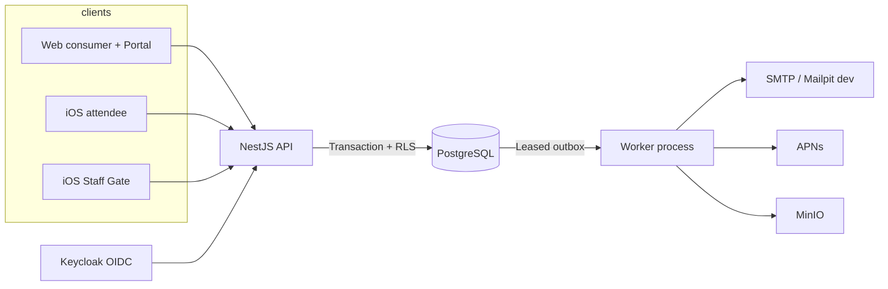

# Kiến trúc hiện trạng Vemoki (canonical)

| Trường | Giá trị |
| --- | --- |
| Epic / Task | [#891](https://github.com/hangndat/ticket-solution/issues/891) · [#902](https://github.com/hangndat/ticket-solution/issues/902) (F06) |
| Role | `architect` (Dexter) · [`docs/agents/roles/architect.md`](../agents/roles/architect.md) |
| **Ngày** | 2026-10-25 |
| **SHA đối chiếu repo** | `5587dce9a8e4e7c96186ae60d7590e6b7722fa2c` (branch tích hợp Epic #891 tại thời điểm viết) |
| **SHA baseline Atlas** | `152b6383d0127c13b9373dfd9ead3105bb510409` (findings F01–F07; không thay thế SHA đối chiếu implementation mới hơn) |
| **Kết luận tài liệu** | **Hiện trạng có bằng chứng** — không khẳng định pilot ready, HA production, hay capacity SLO |

Tài liệu này là **nguồn đọc đầu** cho hiện trạng kiến trúc. [Technical Design](./../TECHNICAL-DESIGN.md) giữ bản đề xuất dài hạn; các mục **superseded** ở đây và trong TD được đánh dấu rõ. Không rewrite lịch sử trong [Decision Log](./../DECISION-LOG.md).

## Chú giải trạng thái

| Ký hiệu | Ý nghĩa |
| --- | --- |
| **Deployed** | Có trong source trên SHA đối chiếu và/hoặc mô tả vận hành VPS đang dùng ([`infra/deploy/README.md`](../../infra/deploy/README.md)) |
| **Tested** | Có test CI hoặc evidence fixture đã publish trong repo (ghi SHA/run; không suy ra production SLO) |
| **Proposed** | Handoff/PR chưa merge hoặc chưa áp dụng ops; đọc label trước khi coi là đang chạy |

## Sơ đồ logic (không phải topology HA)

**Deployed:** monolith API + worker tách process, PG SoT, Keycloak/MinIO self-host theo ADR. **Không khẳng định:** PostgreSQL standby, Gate API pool riêng, BullMQ, hay multi-instance API đã được vận hành với evidence trên production.

## Worker và outbox (ADR-17)

| Khía cạnh | Trạng thái | Bằng chứng |
| --- | --- | --- |
| Durable queue = PostgreSQL outbox + lease / `SKIP LOCKED` | **Deployed** | [ADR-17](../ops/ADR-17-OUTBOX-PG-DIRECT.md), `packages/backend/src/outbox.ts` |
| BullMQ relay là đường chạy MVP | **Superseded** | ADR-17 thay [ADR-04](../TECHNICAL-DESIGN.md) hàng «outbox → BullMQ»; Redis chỉ cache/admission, không SoT job |
| Worker poll trực tiếp sau claim | **Deployed** | `apps/worker/src/worker-relay.ts` |
| Budget theo job class (supervisor, pool wait, PG cancel) | **Tested** (fixture local) | PR [#909](https://github.com/hangndat/ticket-solution/pull/909) · [`docs/reviews/ar891-t4-worker-budget-evidence.md`](../reviews/ar891-t4-worker-budget-evidence.md) |
| Tách nhiều worker process / BullMQ | **Proposed** | Chỉ khi số đo vượt budget — [Atlas F03](./atlas-project-review-2026-10-25.md), handoff [T1](./ar891-t1-recovery-worker-release-handoff.md) |

## Gate và admission (O23)

| Khía cạnh | Trạng thái | Bằng chứng |
| --- | --- | --- |
| Quét / nhập / confirm cổng chỉ **iOS Staff** | **Deployed** (product) | [O23](../DECISION-LOG.md), handoff [VD-01](./vd01-o23-web-gate-migration-handoff.md) |
| Web Gate (`/gate`, camera admission) | **Superseded** | Route web đã xóa; proxy 308 — VD-01 @ `9e6565af…` |
| Portal `/gate` | **Deployed** read-only | BFF `report.read`; không admission |
| Nest Gate API (`reserve` / `confirm` / `offline-sync`) | **Deployed** | Backend module Gate; client admission = iOS Staff |
| Gate API pool deployment riêng | **Proposed** (TD mục tiêu) | **Không** coi là đã chạy trên VPS |

**O05 (một vé / một lượt vào):** invariant server sau sync; không mở rộng phạm vi trong Epic #891.

## Offline Gate (ADR-18) — giới hạn sản phẩm

| Quy tắc | Trạng thái |
| --- | --- |
| `clientOccurredAt` và clock client ± **300 giây** so với server | **Deployed** contract · `packages/backend/src/offline-sync.ts`, [ADR-18](../ops/ADR-18-OFFLINE-GATE-SYNC.md) |
| Replay order trong batch (server) | **Deployed** |
| **Server reconciliation ≠ physical admission** | **Contract** — ADR-18: queue offline không ngăn hai người qua cửa vật lý khi mất mạng; một check-in thắng trong DB sau sync |
| Web offline Gate UI | **Ngoài phạm vi admission** sau O23; API contract có thể tồn tại, không có surface web quét cổng |

## Web, Portal và ranh giới tin cậy

| Surface | Vai trò | Trạng thái |
| --- | --- | --- |
| `apps/web` | Consumer marketing + attendee (vé, redeem); **không** Gate admission | **Deployed** |
| `apps/portal` | Vận hành tenant; import/report; Ant Design Pro stack | **Deployed** · [PORTAL-CONTRACT](./PORTAL-CONTRACT-HANDOFF.md), [O13 host map](./o13-marketing-app-subdomain.md) |
| BFF Next | Session cookie; không tự cấp tenant/permission | **Deployed** |
| OIDC | Keycloak self-host; PKCE iOS | **Deployed** |

Trust boundary: client không nối PG/Redis/SMTP; worker không tin payload queue mà bỏ qua kiểm tra DB/tenant ([TD §3.2](../TECHNICAL-DESIGN.md)).

## Topology triển khai: thực tế vs mục tiêu

### Deployed (VPS / local theo README)

| Thành phần | Mô hình |
| --- | --- |
| TLS / vhost | nginx trên host (Compose không chiếm 80/443) |
| `api`, `worker`, `web`, `portal` | Image runtime mỏng + **bind mount** `node_modules` / `dist` / `.next` trên host |
| PostgreSQL, Redis, Keycloak, MinIO, Mailpit | Compose stack |
| Rollout service | Build artifact → `restart` service tương ứng |

Nguồn: [`infra/deploy/README.md`](../../infra/deploy/README.md). Rủi ro trộn phiên bản giữa API/worker khi cùng tree mount — Atlas **F04**; mitigation **Proposed** bên dưới.

### Proposed / mục tiêu (chưa xác minh ops)

| Mục | Ghi chú |
| --- | --- |
| PostgreSQL primary + **standby** / PITR | Mục tiêu TD §12; **không** tuyên bố đã vận hành standby từ tài liệu deploy hiện tại |
| **Gate API pool** (replica API ưu tiên check-in) | Mục tiêu TD §3.1; **không deployed** |
| Release directory bất biến theo SHA, pin từng service | **Proposed** · PR [#911](https://github.com/hangndat/ticket-solution/pull/911) (`94728c70…`) — candidate review, **chưa** merge/áp dụng production |
| Image self-contained theo digest | Alternative F04 trong [handoff T1](./ar891-t1-recovery-worker-release-handoff.md) |

## Failure domains và recovery semantics

### Đã chốt / implemented (kiểm trên SHA tích hợp)

| Domain | Hành vi | Evidence |
| --- | --- | --- |
| PG outage | Business state trên PG; không mất vé do Redis queue | ADR-17 |
| Worker crash + outbox lease | Reclaim job sau lease; fencing ack | Outbox tests, PR [#907](https://github.com/hangndat/ticket-solution/pull/907) (F02 delivery semantics) |
| Quota concurrent issue | Lock order DB | PR [#908](https://github.com/hangndat/ticket-solution/pull/908) (F01) |
| Worker slow export / provider | Supervisor + class budgets; không overlap vô hạn | PR #909, [ar891-t4 evidence](../reviews/ar891-t4-worker-budget-evidence.md) |

### Handoff recovery (đọc contract, không thay ADR lịch sử)

Chi tiết state machine email/push độc lập, `COMPLETE` chỉ khi mọi delivery bắt buộc terminal: [ar891-t1-recovery-worker-release-handoff.md](./ar891-t1-recovery-worker-release-handoff.md). Implementation F02 theo PR #907; reviewer độc lập và CI trên exact SHA là gate DoD Epic.

### Chưa đủ evidence (Atlas F05 / #901)

Mixed load/soak production-like, RPO/RTO restore đo trên môi trường đích — **không** suy từ benchmark Mac local ([`docs/reviews/atlas-20261025/context-benchmark.json`](../reviews/atlas-20261025/context-benchmark.json), [`evidence.json`](../reviews/atlas-20261025/evidence.json)).

## Quyết định superseded (đọc nhanh)

| Mô tả cũ (dễ đọc nhầm) | Thay bằng | Link |
| --- | --- | --- |
| Redis/BullMQ cho job nền MVP | PG leased outbox + worker poll | [ADR-17](../ops/ADR-17-OUTBOX-PG-DIRECT.md) |
| Web Gate admission | iOS Staff only | [O23](../DECISION-LOG.md), [VD-01](./vd01-o23-web-gate-migration-handoff.md) |
| `GATE-STAY-APP` (web + app gate) | Superseded bởi D-6 / O23 | VD-01 §2 |
| Outbox → enqueue BullMQ (ADR-04 hàng gốc) | ADR-17 MVP path | TD bảng ADR-04 + ADR-17 |

## Handoff và evidence đã publish (paths trong repo)

| Artifact | Path |
| --- | --- |
| Atlas review (F01–F07) | [`docs/architecture/atlas-project-review-2026-10-25.md`](./atlas-project-review-2026-10-25.md) |
| Recovery / worker / release handoff | [`docs/architecture/ar891-t1-recovery-worker-release-handoff.md`](./ar891-t1-recovery-worker-release-handoff.md) |
| F03 worker budget evidence | [`docs/reviews/ar891-t4-worker-budget-evidence.md`](../reviews/ar891-t4-worker-budget-evidence.md) |
| Atlas session metrics (local) | [`docs/reviews/atlas-20261025/evidence.json`](../reviews/atlas-20261025/evidence.json), [`context-benchmark.json`](../reviews/atlas-20261025/context-benchmark.json) |
| F04 release tooling (candidate) | [PR #911](https://github.com/hangndat/ticket-solution/pull/911) — **Proposed**, không link file chỉ có trên branch candidate như canonical |

## Giới hạn tài liệu

- Không mô tả secret, compose production đầy đủ, hay trạng thái live GitHub Project #3.
- Số đo trong `evidence.json` / worker fixture là **Tested local**, không production SLO.
- Code complete trên branch ≠ acceptance complete Epic #891; matrix review: [#903](https://github.com/hangndat/ticket-solution/issues/903).
