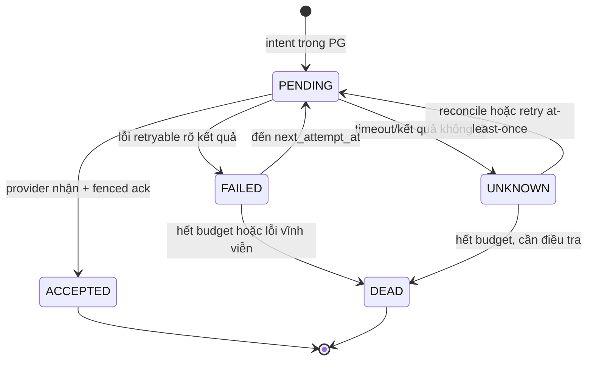

# AR891-T1 — Handoff F02/F03/F04/F07

Ngày: 25/10/2026. Trạng thái: **Đề xuất — chờ coordinator xác nhận trong scope**. Role: `architect`; employee: Dexter. Source runtime/base SHA: `152b6383d0127c13b9373dfd9ead3105bb510409`. Issue: [#891](https://github.com/hangndat/ticket-solution/issues/891), [#895](https://github.com/hangndat/ticket-solution/issues/895).

## Kết luận và ranh giới

1. **F02:** giữ một PG `TicketIssued` outbox row, nhưng xử lý email và từng device push như các delivery độc lập. `COMPLETE` chỉ khi mọi delivery bắt buộc được provider `ACCEPTED` hoặc có lý do **không cần gửi** được ghi bền vững. Delivery hết retry hay lỗi vĩnh viễn dẫn outbox `DEAD`, không được biến thành `COMPLETE` giả. Không hứa `DELIVERED` hoặc exactly-once SMTP/APNs.
2. **F03:** giữ một worker process ban đầu; đặt deadline và đo queue age theo job class. Chỉ tách loop/process khi fault injection hoặc số đo vượt budget bên dưới. Không thêm BullMQ; PostgreSQL vẫn là nguồn chuẩn job theo [ADR-17](../ops/ADR-17-OUTBOX-PG-DIRECT.md).
3. **F04:** chọn release directory bất biến theo source/build SHA, pin mount của từng service vào directory đó. Đây là bước ít đổi hơn từ runtime image + bind mount hiện tại. Image tự chứa theo digest là hướng thay thế khi có registry/build pipeline và phép kiểm chứng artifact ổn định. Không triển khai production trong task này.
4. **F07:** giữ `240/user/giờ` cho đến khi product/event owner cung cấp số **staff identity thật**, cửa sổ mở cổng và đường cong arrival. Với 100 identity, 20 confirm/s chỉ chạy khoảng 20 phút trong cùng một UTC-hour bucket trước khi cạn cap. Nếu dự kiến 40.000 lượt trong khoảng 33 phút ở pace đó, owner phải quyết định tăng cap/đổi admission hoặc bổ sung staff **trước consumer coding**; harness đúng identity không tự giải quyết policy.

Không sửa ADR lịch sử, business code, DB, infra hay chính sách O05/O06. Tài liệu này là contract đề xuất cho owner triển khai/review; chưa phải acceptance hoặc pilot ready. [Báo cáo Atlas gốc](./atlas-project-review-2026-10-25.md) được tiếp nhận từ working diff của checkout `system-design` tại cùng source SHA; file gốc không sửa. Evidence benchmark/test chi tiết còn ở working diff của phiên gốc và được bàn giao cho #900; không coi là file có trên HEAD.

## Bằng chứng và invariant

| ID | Quan sát ở source SHA / evidence | Invariant cần giữ |
| --- | --- | --- |
| F02 | [`outbox.ts:347-349`](../../packages/backend/src/outbox.ts) hoàn tất khi email `ACCEPTED`; email ack trước APNs ở `:575-639`. Fault injection PG thật trong báo cáo Atlas: email `ACCEPTED`, push `PENDING`, reclaim xong outbox `COMPLETE` sai; 14 PASS, 1 FAIL trong suite recovery. | Ticket issuance không bị rollback bởi provider. Mọi delivery intent bắt buộc có kết quả bền vững; không coi provider `ACCEPTED` là thiết bị đã nhận. |
| F02 | [`outbox.ts:723-855`](../../packages/backend/src/outbox.ts) tạo push key theo device, nhưng push ack chưa có lease predicate; `scheduleRetryFenced` ở `:890-959` ghi lại email kể cả khi lỗi thuộc push. [`N1 migration`](../../packages/backend/prisma/migrations/202610170009_n1_notification_delivery/migration.sql) cho notification `PENDING/ACCEPTED/FAILED/DEAD/UNKNOWN`, outbox lease token và append-only attempts. | Stale worker không ghi ack hay đổi terminal state sau reclaim. Lỗi push không mở lại email `ACCEPTED`; lỗi một device không che delivery khác. |
| F03 | [`worker-relay.ts:141-173`](../../apps/worker/src/worker-relay.ts) chạy pending, anonymization, outbox, export, cleanup tuần tự; timeout step chỉ nhả vòng điều phối, không huỷ I/O đang chạy. ADR-17 mặc định poll 2s, claim 10, lease 30s. | Một provider/export chậm không làm việc ưu tiên trễ vô hạn; không claim nhiều việc hơn deadline/lease có thể bảo vệ. |
| F04 | [`infra/deploy/README.md:9-24`](../../infra/deploy/README.md) mô tả runtime image mỏng và cùng host tree `node_modules/dist/.next`; build backend có thể thay file đang mount vào API/worker khác phiên bản. | Mỗi process chỉ đọc một bộ artifact bất biến; deploy service A không làm B đổi file dưới chân. |
| F07 | [`http-limits.ts:21-29`](../../apps/api/src/http-limits.ts) reserve và confirm mỗi loại 240/user/giờ; [`notification-retry.ts:78-128`](../../packages/backend/src/notification-retry.ts) dùng fixed UTC-hour counter. Baseline gốc một staff identity bị 429; sau sửa harness 100 identity riêng, lượt `c6721bd3` đạt 1.200 confirm/60s, 0 lỗi, wrapper exit 0 trên local Mac. | Rate limit tính theo authenticated identity, không theo session/device; phép đo một phút không chứng minh pace cả event. |

Các số `138 PASS/1 FAIL`, benchmark `c6721bd3` và mô tả môi trường là **kết quả đã ghi trong artifact Atlas local**, chưa phải CI trên branch này. Baseline PRD: 2 event × 20.000 vé, 50 scanner/event, 20 confirm/s tổng; là target test, không phải số staff thật hoặc SLO production đã đo ([PRD §9](../PRD.md)).

## F02 — Delivery và recovery

### Contract trạng thái

Một `TicketIssued` outbox row vẫn là lease/điều phối duy nhất. Trong tenant transaction, worker claim/fence outbox, materialize **một lần** tập device active của owner thành `notifications` theo business key `ticket:{ticketId}:issued:push:{deviceRegistrationId}` và đánh dấu snapshot đã materialize bền vững (cột nullable mới hoặc payload marker có version). Việc tạo snapshot và marker phải cùng transaction; không đọc lại tập device để mở rộng job sau khi snapshot đã chốt. Khi gửi, đọc tập notification trong snapshot rồi kiểm lại token còn active và thuộc owner; không chỉ liệt kê active token hiện tại vì có thể bỏ sót row đã snapshot. Device đăng ký sau snapshot nhận thông báo từ event mới, không hồi tố `TicketIssued`. Device bị revoke sau snapshot được ghi kết quả terminal `DEAD` với lý do sanitized hoặc trạng thái bỏ qua được schema/contract định nghĩa rõ; không gửi tới token thuộc account cũ. Email dùng business key hiện hữu `ticket:{ticketId}:issued:email`.

APNs **tắt theo cấu hình có chủ đích** là `push not required` cho job mới; cần ghi mode này bền vững ở snapshot. APNs được bật nhưng misconfigured, credential thiếu, hoặc I/O timeout là lỗi, không được coi như không có device. Khi nâng cấp row cũ chưa có marker, worker mới phải materialize/reconcile trước khi xét completion. Cần dry-run đếm row cũ email `ACCEPTED` + push chưa terminal để lập kế hoạch backfill; không suy từ email `ACCEPTED` rằng toàn job xong. Row đã `COMPLETE` sai cần repair/requeue có audit riêng, vì claim query chỉ lấy `PENDING`/lease hết hạn.



`FAILED`/`UNKNOWN` chưa terminal trong khi còn retry; `ACCEPTED` và `DEAD` terminal cho một delivery. Không thêm `SENT` (constraint N1 chỉ giữ `ACCEPTED`). Với push bị token vĩnh viễn invalid, revoke token và ghi `DEAD` cho device; tiếp tục xử lý các device khác. Không dùng `FAILED` vĩnh viễn rồi `COMPLETE`. Nếu nghiệp vụ muốn phân biệt skipped, cần migration state mới và compatibility; phương án tối thiểu dùng `DEAD` + reason/audit, outbox `DEAD` nếu có delivery bắt buộc chết.

```text
outbox COMPLETE ⇔ email ACCEPTED ∧ (push intentionally disabled ∨ all snapshot devices ACCEPTED)
outbox DEAD     ⇔ no retry remains ∧ at least one required delivery DEAD
otherwise      ⇔ PENDING/PROCESSING with next_attempt_at; never COMPLETE
```

Các delivery chạy độc lập: email `ACCEPTED` không gửi lại vì push fail; push device A `ACCEPTED` không gửi lại vì B fail. Retry/backoff/attempt limit tính **theo notification**, không dùng tổng số claim outbox để làm chết channel chưa thử đủ. Outbox `next_attempt_at` là thời điểm sớm nhất của delivery còn retry, còn attempts outbox chỉ phục vụ lease/audit. Ghi attempt theo ordinal riêng từng notification; unique `(tenant_id, notification_id, ordinal)` hiện hữu. Mọi update notification và outbox completion/dead phải có cùng lease owner + token hợp lệ trong tenant transaction; push ack hiện chưa có predicate đó. Nếu CAS 0 row, trả `stale`, không tăng metric completed và không ghi state/attempt. Provider I/O ở ngoài transaction vẫn at-least-once: crash sau SMTP/APNs accept trước DB ack có thể gửi lặp; stable email Message-ID và APNs collapse/idempotency nếu provider hỗ trợ chỉ giảm trùng, không chứng minh exactly-once.

Lease có thể hết khi provider treo; worker phải giới hạn timeout I/O và batch theo deadline, hoặc renew lease có fence trước khi tiếp tục từng device. Với nhiều device, xử lý một phần snapshot trong deadline rồi requeue phần còn lại; không giữ lease 30s trong một vòng gửi dài. Sau khi biết lease stale không bắt đầu gửi device kế tiếp. `markOutboxCompleteFenced` phải kiểm số row update = 1 và điều kiện completion trong cùng transaction, thay vì hàm `void` hiện tại. Nếu provider chậm hơn lease và hai worker cùng gửi, DB fencing vẫn ngăn stale ack nhưng không ngăn side effect gửi trùng; ghi rõ limitation và đo duplicate trong fault test.

### Ma trận lỗi bắt buộc cho #897

| Điểm lỗi / trạng thái bền vững | Kỳ vọng sau reclaim hoặc retry |
| --- | --- |
| Sau claim, trước snapshot | Snapshot được tạo đúng một lần; không `COMPLETE` trước khi có intent. |
| Sau snapshot, trước email send | Email và từng device vẫn pending; gửi theo key hiện hữu. |
| Sau SMTP accept, trước email ack | Có thể gửi lại email; một notification/attempt hợp lệ, không claim delivered. |
| Sau email ack, trước push materialization/send | Email giữ `ACCEPTED`; push còn thiếu được tạo/retry; đây là regression F02. |
| Sau APNs accept, trước device ack | Chỉ device chưa ack có thể lặp; email/device đã `ACCEPTED` không lặp. |
| Hai device: A accepted, B timeout hoặc token invalid | A giữ `ACCEPTED`; B retry hoặc `DEAD`; outbox chưa `COMPLETE` khi B chưa kết thúc. |
| Lease hết hạn lúc provider treo; owner mới claim | Owner cũ CAS 0 cho notification/outbox, không hoàn tất sai; side effect có thể lặp. |
| APNs misconfigured hoặc SMTP lỗi sau channel kia accepted | Channel đã accepted giữ nguyên; outbox retry/dead đúng budget, không COMPLETE giả. |
| Không có active device / APNs chủ đích tắt | Snapshot rỗng hoặc mode disabled được ghi; email accepted có thể COMPLETE. |
| Ticket revoked, account switch, token revoked | Không gửi QR/token tới owner cũ; ghi terminal reason và outbox DEAD khi delivery bắt buộc bị chặn. |

Test dùng PostgreSQL/RLS thật, notification email fixture thật, nhiều device; kill/reclaim ở durable boundary (mock provider) và ít nhất một process kill thật để xác nhận restart. Reviewer độc lập đối chiếu rows, attempts, CAS, provider calls và metrics trên exact implementation SHA. Test fail F02 hiện hữu giữ nguyên cho đến khi sửa runtime, không đổi assertion để che FAIL.

## F03 — Budget và ngưỡng tách worker

**Đây là budget đề xuất để triển khai và đo, không phải số đã đo.** Tính `oldest due age = now − next_attempt_at` (hoặc created_at lần đầu), tách `processing duration`, `provider latency`, `DB pool wait` và `lease reclaim count` theo class. Metric không gắn tenant/user/ticket ID làm label. Trong cửa sổ S3 20 confirm/s và worker cùng tải, ưu tiên correctness/recovery liên quan Gate; notification có thể chậm hơn mà không được mất.

| Job class | Budget đề xuất p95 / oldest due age | Giới hạn một invocation; phản ứng khi vượt |
| --- | --- | --- |
| Pending redemption reconcile | ≤5s / ≤10s | Batch 50 hiện hữu; timeout 5s, đánh dấu timeout, lần sau tiếp tục. |
| `TicketIssued` outbox email/push | ≤15s / ≤60s | Deadline per claimed row < lease 30s (mục tiêu ≤20s gồm DB), provider timeout riêng ≤5s; claim 1 row nếu chưa renew lease an toàn. |
| Account anonymization | ≤30s / ≤15 phút | Batch 50, chunk/resume; nhả quyền điều phối trước khi chặn outbox. |
| Export | ≤60s / ≤5 phút | Batch 5, chunk I/O; không giữ loop chung khi export chậm. |
| Import-file cleanup | ≤30s / ≤30 phút | Batch 20, tiếp tục kỳ sau. |

Budget age tính tại hàng đợi có việc đủ điều kiện chạy, không tính backoff cố ý. Cần đo p95/p99 và số row quá hạn trong ít nhất mixed-load S3/S6 + soak theo #901; vài lệnh nhanh trên laptop không chứng minh budget. Worker step timeout hiện tại là `Promise.race` style supervisory boundary: khi action còn chạy, không được coi I/O đã huỷ. Nếu provider/MinIO treo, phải có abort/transport timeout thực hoặc process isolation, đồng thời giảm batch/renew lease để không claim vượt thời hạn. Tổng DB connections của thêm worker phải nằm trong pool budget của [Technical Design §14.3](../TECHNICAL-DESIGN.md).

**Ngưỡng xem lại:** nếu trong hai lượt mixed-load/failure injection lặp lại, `oldest due age` của reconcile hoặc outbox vượt budget >5% mẫu trong 10 phút, hoặc một export/provider stall làm miss budget ưu tiên, tách **loop theo class trong cùng process** trước. Nếu I/O không huỷ được, event loop/heap/pool bị kéo theo, hoặc loop tách vẫn vi phạm sau giới hạn concurrency, tách **process** với pool/cpu budget riêng và cùng PG claim. Chỉ đề xuất broker khác qua ADR mới nếu số đo chứng minh PG poll/claim là bottleneck sau các bước đó. Trước mọi quyết định tách, fault injection: SMTP/APNs 5s timeout, MinIO 60s treo, export lớn, DB pool chật, worker kill giữa lease; xác nhận age, reclaim, duplicate và shutdown. Không nâng timeout step để giấu backlog.

## F04 — Release bất biến và schema compatibility

| Cách | Lợi ích | Chi phí/rủi ro | Quyết định |
| --- | --- | --- | --- |
| `/opt/vemoki/releases/<sha-or-build-id>` read-only, compose pin riêng `api`, `worker`, `web`, `portal` vào đường dẫn; manifest checksum cho backend/dist/deps | Tương thích runtime image và bind mount hiện hành; rollback bằng đổi pin/recreate từng service, không rebuild trên artifact đang chạy. | Host phải giữ nhiều release; cần verify dependency/native modules và không dùng symlink `current` bên trong mount của process đang chạy. | **Chọn cho lần chuyển đầu**. |
| Image tự chứa pin `repo@sha256:<digest>` từng service | Artifact và dependency đóng gói, dễ tái lập trên host khác; registry giữ digest. | Cần build/registry/signing/cache, Compose/image rollout và secret handling mới; thay đổi lớn hơn cùng lúc F02/F03. | Xem lại sau rehearsal hoặc khi host release integrity khó bảo đảm. |

Manifest release phải ghi source SHA, build ID, lockfile hash, schema min/max tương thích và digest/checksum artifact cho **từng** service. Build vào thư mục tạm, verify, atomic rename sang release bất biến, chmod read-only; không `pnpm install`/build dưới directory đang mount. Pin đường dẫn cụ thể trong Compose per service, recreate service và kiểm tra process thực đọc đúng manifest; chỉ xóa release cũ sau cửa sổ rollback và khi không còn container pin vào nó. Đường dẫn shared backend package phải thuộc cùng release với API/worker, không tham chiếu tree mutable. Secrets/env/volumes/DB nằm ngoài release.

Migration theo `expand → backfill → switch → contract`: schema mới additive, nullable/default an toàn, index/constraint tương thích; backfill idempotent theo tenant và batch; deploy worker mới sau expand và repair row legacy; rồi API/web/mobile consumer tương thích; contract chỉ sau khi mọi binary cũ dừng và cửa sổ mobile release được đáp ứng. Có canary đọc/ghi cả old/new schema trước switch. Nếu migration làm old binary không hiểu state/column mới, **không** chạy đồng thời old/new trên cùng outbox; dừng claim cũ có kiểm soát, chờ lease hết và xác nhận fence trước khi bật worker mới. API cũ có thể chạy khi schema additive và contract không đổi; không áp dụng ngầm cho worker.

Rollback app: pin lại release trước **chỉ nếu** schema vẫn trong manifest compatibility range và worker cũ không làm `COMPLETE` sai cho row F02 đã migrate. Nếu không, forward recovery bằng fix release mới và repair job; không rollback destructive DB migration. Rehearsal trên staging/self-host tương đương: deploy API rồi worker lệch phiên bản có chủ đích, chạy issue/reclaim, đảo pin một service, so checksum/process mount, kiểm schema và notification; backup/restore key+object thuộc F05 riêng. Production change cần task/ủy quyền riêng.

## F07 — Cap theo identity và pace

Counter là **hai bucket riêng** `reserve` và `confirm`, mỗi bucket 240/authenticated user/UTC hour; một scan thành công thông thường dùng một lượt ở mỗi bucket. 100 scanner session dùng **một** staff identity có tổng trần 240 confirm/giờ như lần benchmark lỗi; 100 identity thật cho trần lý thuyết 24.000 confirm/giờ, không bảo đảm từng staff phân tải đều. Với pace 20 confirm/s: 1.200/phút; 100 staff chia đều là 12/staff/phút, đạt 240 ở phút 20. Một event 20.000 lượt với 50 staff và pace 10/s cũng cần 400/staff trong ~33,3 phút. Hai event 40.000 lượt trong một UTC hour cần ít nhất `ceil(40.000/240)=167` identity đều tải, chưa tính retry/probe/burst. Những phép tính này là **capacity theo policy**, không phải đo throughput.

Decision gate cho product/event owner: cung cấp roster staff identity thực (không đếm device/session), thời gian và UTC-hour boundary mở cổng, arrival curve p95/burst, số scan/staff dự kiến, retry allowance và shared-account policy. Nếu tối đa của một identity trong **bất kỳ fixed UTC-hour bucket** >240, chọn một trong: tăng cap cho staff/event có quyền với tenant/event guard và abuse monitoring; thêm staff identity hợp lệ; hoặc điều tiết pace/check-in plan. Không tự tăng 240, tắt counter, chia một người thành nhiều account giả hay kết luận 429 là DB saturation. Backend consumer #898/#900 giữ policy hiện hành đến khi owner/coordinator ghi quyết định; harness #900 vẫn tiếp nhận và chạy với identity thật độc lập.

## Handoff và điều kiện nghiệm thu

| Consumer / owner | Có thể bắt đầu | Phụ thuộc quyết định này / evidence cần bàn giao |
| --- | --- | --- |
| #896 F01 backend | Ngay | Không chờ F02/F03/F04/F07; khóa quota trong DB là scope độc lập. |
| #900 F07 harness/tooling | Ngay | Tiếp nhận working diff, hash artifact/runner, test identity guards và benchmark; không sửa cap runtime. |
| #897 F02 backend/worker | Sau coordinator xác nhận contract completion, snapshot và `DEAD` semantics | DB migration/repair plan, PG fault matrix, reviewer khác implementer. |
| #898 F03 worker | Sau coordinator xác nhận budget đo và F02 contract ổn định | Metrics/failure injection; tách loop/process chỉ khi ngưỡng vượt. |
| #899 F04 infra | Sau coordinator xác nhận release directory | Manifest/pin/rehearsal, compatibility matrix và rollback/forward recovery. |
| #901 F05 capacity | Candidate sau các sửa liên quan | Mixed load/soak, DB+key+object restore, tài nguyên tương đương đích và proof limits. |

**Điểm cần owner quyết định:** cap Gate nếu roster/pace dự kiến vượt 240; coordinator xác nhận F02 terminal policy và F04 rollout boundary. Các consumer trên không tự đổi O06, ADR-17 hoặc production deployment. Review tài liệu này theo **exact handoff commit SHA**; review implementation độc lập trên SHA riêng, giữ finding IDs F02/F03/F04/F07, CI và evidence theo DoD. Kết luận: **Đủ để triển khai trong scope sau xác nhận contract; F07 policy còn chờ dữ kiện vận hành/owner nếu vượt cap.**
