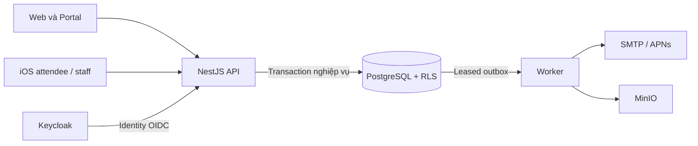

# Đánh giá kiến trúc Vemoki — Atlas

> Bản tiếp nhận cho #895 từ working diff ở checkout `system-design`, source SHA `152b6383d0127c13b9373dfd9ead3105bb510409`. Các file evidence JSON và harness nêu dưới đây chưa được đưa vào branch tài liệu này; #900 chịu trách nhiệm tiếp nhận, xác minh và xuất bản đúng slice. Báo cáo ghi kết quả phiên gốc, không phải lượt chạy lại hay nghiệm thu của #895.

Ngày: 25/10/2026. Source SHA: `152b6383d0127c13b9373dfd9ead3105bb510409` (working tree sạch khi bắt đầu).

Kế hoạch khắc phục được người dùng yêu cầu: [Epic #891](https://github.com/hangndat/ticket-solution/issues/891), 3 Story #892–#894 và 10 Task #895–#904. Tracking động trên Project #3; chưa dispatch từ bước lập Epic. F07 harness local được tiếp nhận ở #900, F02 ở #897, F01 ở #896; không coi local diff là đã merge.

Người thực hiện: persona Dexter (`company/employees.json`), role `architect`; skill Atlas. Architecture impact: Có — đánh giá transaction, recovery và deployment; không thay quyết định. Cost tier: advanced. Đây là đánh giá trực tiếp trong phiên người dùng, không phải receipt worker Orca hay nghiệm thu DoD/security.

**Kết luận: giữ modular monolith, PostgreSQL làm nguồn chuẩn và worker PG outbox. Ưu tiên khép kín recovery, thứ tự khóa và bằng chứng vận hành trước khi tăng độ phức tạp hạ tầng.** Trạng thái báo cáo: **Đề xuất**; không kết luận pilot ready.

## Phạm vi và giới hạn

Đã đọc có chọn lọc PRD, Technical Design, Decision Log, Roadmap, ADR-18; source API composition, tenant context, issuance/approval, Gate/offline sync, outbox/worker; migrations RLS nền tảng; CI và bằng chứng load/restore lịch sử. Không audit toàn bộ auth, mọi migration, web/mobile hoặc production live. Không chạy test, benchmark hay restore mới. Không kiểm tra trạng thái live Project #3. File deployment Compose bị context gateway chặn vì có nội dung nhạy cảm; đánh giá deployment dựa vào README, không vượt chặn.

Baseline O03: 2 event × 20.000 vé, 50 scanner/event; không phải 50.000 concurrent users. O05: một vé/một lượt vào. O08: shared PostgreSQL + RLS. ADR-17: leased PG outbox, chưa BullMQ. O23: Gate chỉ trên iOS Staff. Không thay phạm vi đã duyệt hoặc mở feature mới.

## Kiến trúc và đường đi đại diện



Sơ đồ thể hiện quan hệ logic, không khẳng định topology production đã có HA hay pool Gate riêng.

Redemption xác minh email, claim operation theo actor/event/idempotency key; khóa policy, code, attendee counter và quota; ghi ticket/credential, notification, audit và outbox bằng cùng transaction handle. Worker claim job, chuẩn bị dữ liệu trong tenant transaction, gửi provider ngoài transaction, rồi ack có lease token. Đây là thiết kế phù hợp khi invariant quota/check-in cần transaction mạnh và team chưa có lý do vận hành microservices.

Điểm tốt có source:

- Transaction-local context và timeout: `packages/backend/src/tenant-context.ts:8`, `:24`; migrations nền bật FORCE RLS, ví dụ `prisma/migrations/202610160001_foundation/migration.sql:18`. Đây là bằng chứng cơ chế, không chứng nhận mọi bảng/role production đúng.
- Idempotency và atomic issuance: `packages/backend/src/issue.ts:247`, `:548`, `:643`, `:668`.
- Provider I/O nằm ngoài tenant transaction; ack có fencing: `packages/backend/src/outbox.ts:551`, `:575`.
- Offline batch kiểm tra permission, event và session trước apply: `packages/backend/src/offline-sync.ts:610`.
- CI có các shard RLS, issue/gate, offline receipt và outbox/APNs: `.github/workflows/ci.yml:243`, `:267`, `:275`. Việc có test trong CI không đồng nghĩa tôi đã chạy hoặc xác nhận PASS ở SHA này.

## Findings và đề xuất

### F01 — Thứ tự khóa quota chưa được thực thi tại DB

Loại: lỗi code so với thiết kế; **should-fix**, ưu tiên cao. Mở tại SHA trên. Cần đóng trước khi xác nhận invariant thứ tự khóa đạt; báo cáo này không ra quyết định merge cho PR nào.

`issue.ts:548–565` và `approval.ts:744–759` chạy SELECT … FOR UPDATE không ORDER BY, rồi mới `quotas.sort()` trong JavaScript. Khi sort chạy, các row đã bị khóa. Vì vậy comment EVENT → TYPE → SOURCE và yêu cầu deterministic lock order tại `docs/TECHNICAL-DESIGN.md:250` chưa được bảo đảm. Có nguy cơ deadlock/rollback khi các transaction dùng thứ tự truy cập khác nhau; chưa tái hiện deadlock và không kết luận có over-issuance.

Đề xuất backend thống nhất một primitive khóa quota theo thứ tự tại DB (ORDER BY rõ ràng trước FOR UPDATE, hoặc khóa lần lượt theo khóa ổn định). Đối chiếu cả auto issue, manual approval và mutation quota khác; giữ cùng transaction, không thêm Redis lock.

Điều kiện đóng: review SQL và kiểm thử cạnh tranh auto/manual trên nhiều source/type của cùng event; số vé/counter đúng, retry có kết quả ổn định. Owner: backend; reviewer độc lập xác minh.

### F02 — Email ACCEPTED có thể kết thúc job trong khi push chưa xong

Loại: correctness/recovery gap đã biết; **should-fix**, ưu tiên cao. Cần đóng trước khi cam kết recovery push tự động đầy đủ.

`outbox.ts:347–349` hoàn tất job ngay khi email ACCEPTED. Nhưng email ack được commit trước APNs (`:575`, `:615`, `:635`). Nếu worker chết sau email ack và không chạy catch/retry handler, lần retry gặp email ACCEPTED sẽ kết thúc trước bước push. Phân biệt với APNs throw được catch: `scheduleRetryFenced` có thể đổi email về FAILED, cho phép gửi lại cả email; test graceful exception cũ PASS không chứng minh hard-crash recovery. Giới hạn liên quan đã ghi ở `docs/DECISION-LOG.md:94`; không khẳng định outage production.

Đề xuất tối thiểu: tính completion theo trạng thái từng channel, bỏ qua gửi lại email nhưng vẫn tiếp tục push còn pending; chỉ COMPLETE khi các channel cần thiết đạt terminal state theo policy. Phương án mạnh hơn là tách delivery job email/push, vẫn trong PG; đổi lại phải quản lý fan-out và migration. Không cần thêm broker chỉ để sửa state machine này.

Điều kiện đóng: fault injection sau email ack/trước APNs, sau APNs send/trước ack, nhiều device có partial failure, lease reclaim và duplicate suppression. Phải dùng fixture có email notification thật; không suy recovery chuẩn chỉ từ test gọi riêng nhánh push. Owner: backend + worker; giữ ACCEPTED khác DELIVERED.

### F03 — Worker còn chia sẻ lịch xử lý giữa nhiều loại công việc

Loại: rủi ro vận hành/đề xuất; **should-fix khi số đo vượt budget**, không tự chặn merge.

`apps/worker/src/worker-relay.ts:141–173` lần lượt chạy pending expiry, account anonymization, outbox, export và cleanup. Có step timeout và chống chạy trùng (`:94–138`), nhưng đây vẫn là một lịch điều phối; thời gian xử lý một bước ảnh hưởng thời điểm bắt đầu bước tiếp theo. `outbox.ts:101` xử lý batch tuần tự. Chưa có số đo backlog chứng minh đây là bottleneck hiện tại.

Đề xuất đo oldest pending age, lease expiry/reclaim, thời gian theo job class và DB pool wait. Khi công việc chậm làm vượt mục tiêu delivery/cleanup, tách loop hoặc worker process theo class với concurrency/connection budget riêng, dùng chung code và PG. Chỉ cân nhắc BullMQ khi benchmark chứng minh PG polling hoặc scheduling là giới hạn.

Điều kiện đóng khi cần triển khai: provider chậm/export lớn không làm quá hạn job quan trọng; restart/reclaim an toàn. Owner: backend/worker và coordinator hạ tầng.

### F04 — Cách deploy hiện hành làm tăng rủi ro trộn phiên bản artifact

Loại: deployment risk; **should-fix**, không tự chặn merge.

`infra/deploy/README.md:9–17` mô tả runtime image mỏng, source/node_modules/dist/.next trên host bind mount; build rồi restart riêng service. API và worker cùng phụ thuộc backend (`:23–24`). Do đó rollout/rollback cần kiểm soát artifact được mount và compatibility giữa các process; đây là suy luận từ mô hình deploy, chưa quan sát một incident trộn phiên bản.

Hai hướng khả thi: image tự chứa theo digest (README đã có Dockerfile tương ứng), hoặc giữ bind mount nhưng dùng release directory bất biến theo SHA và pin riêng từng service. Hướng hai ít thay đổi vận hành hơn; hướng một dễ tái lập artifact hơn. Cả hai cần migration expand/contract, manifest version API/worker/web/portal và rollback rehearsal. Không tự chuyển phương thức deploy trong review này.

Điều kiện đóng: chứng minh process dùng đúng artifact, deploy service A không thay file của B đang chạy, rollback app tương thích schema. Owner: coordinator/root infra.

### F05 — Bằng chứng tải/restore chưa đủ để suy ra năng lực production hiện tại

Loại: thiếu evidence trong phạm vi review; **should-fix trước cam kết capacity/RPO/RTO**. Không khẳng định toàn dự án không có evidence mới hơn.

`docs/reviews/D12-LOAD-SUMMARY-3a5be02d.json:14–50` ghi 50 issue/s + khoảng 20 confirm/s trong khoảng 61 giây, p95 khoảng 34ms/20ms, trên M4 Max 14 CPU/36GB. 2 × 20k vé là SQL seed, không phải 40k request issue được đo. Đây là bằng chứng baseline local có giá trị, không phải benchmark VPS hay soak dài.

`docs/reviews/D5-ISSUE-25-EVIDENCE.md:41–50` chứng minh dump-point restore và giải mã; tài liệu tự ghi không chứng minh continuous RPO ≤15 phút. Không suy ra chưa có backup production từ tài liệu lịch sử này.

Đề xuất kiểm chứng trên môi trường có tài nguyên/cấu hình tương đương production: issuance + Gate + reporting + worker, sustained và burst; theo dõi p95/p99, lock wait, pool wait, backlog; restore DB cùng key material và object assets theo RPO/RTO đã chốt. Owner: coordinator/ops; không tự cấp quyền chạy tải production.

### F06 — Tài liệu kiến trúc tổng quan còn trộn mục tiêu cũ với hiện trạng

Loại: documentation drift; **should-fix**, không tự chặn merge.

`docs/TECHNICAL-DESIGN.md:10` còn nói Redis/BullMQ; `:49`, `:76` còn Web Gate; trong khi ADR-17 và O23 đã thay đổi. Bảng topology có primary + standby và Gate API pool (`:51–54`) nhưng không nên đọc như bằng chứng hạ tầng đang chạy. Roadmap có nhiều checkpoint lịch sử, đã cảnh báo nguồn live là Project #3.

Đề xuất thêm một trang hiện trạng canonical với SHA/ngày xác minh, topology đang triển khai, quyết định thay thế và proof limits; giữ lịch sử ADR nhưng đánh dấu superseded ngay nơi dễ đọc nhầm. Owner: architect/docs phối hợp coordinator. Điều kiện đóng: một người mới xác định được worker hiện tại, bề mặt Gate và topology thực tế mà không ghép nhiều snapshot mâu thuẫn.

## Giới hạn offline cần giữ trong sản phẩm

ADR-18 cho phép queue và hòa giải; không bảo đảm ngăn hai người được cho qua cửa vật lý khi thiết bị mất kết nối. Một check-in thắng trong DB sau sync khác với exactly-once admission ngoài đời. Replay ordering trong code là theo batch; không hiểu là sắp xếp toàn cục mọi thiết bị theo thời gian scan.

ADR-18:31 và `offline-sync.ts:197–202` giới hạn clientOccurredAt ±300 giây so với thời điểm server xử lý. Vì vậy đây là offline có giới hạn, không phải hỗ trợ mất mạng tùy ý nhiều giờ. Đây là contract đã chốt, không tự coi là bug hoặc nới window. Nếu thực tế địa điểm cần outage dài hơn, cần quyết định riêng về auth/session freshness, conflict và vận hành cổng.

## Thứ tự thực hiện được đề xuất

1. Backend xử lý F01 và chốt recovery semantics F02; review độc lập và kiểm thử failure/concurrency trên SHA mới.
2. Coordinator thu evidence F05 và chốt rollout/rollback F04; chỉ tách worker F03 theo số đo.
3. Architect đồng bộ F06 và trình bày rõ giới hạn offline cho vận hành.

Giữ transaction nhất quán trong monolith. Chưa có bằng chứng cần microservices, DB-per-tenant hoặc quota sharding. Chỉ xem lại khi đo được lock contention/DB saturation sau admission control và tối ưu hợp lý, hoặc có nhu cầu isolation/SLA riêng đã được duyệt. Mọi thay đổi nêu trên là đề xuất để đưa vào workflow hiện hành, không tự mở roadmap hay thay gate phát hành.

## Bổ sung kiểm chứng theo yêu cầu người dùng — 25/10/2026

Người dùng đã yêu cầu chạy test/benchmark và cho phép tự thiết kế test. Phần này bổ sung evidence mới; giới hạn “chưa chạy test” phía trên chỉ mô tả lượt review ban đầu. Runtime vẫn ở SHA `152b6383d0127c13b9373dfd9ead3105bb510409`; working diff bổ sung test và package scripts, không sửa implementation.

- `pnpm install --frozen-lockfile`: thành công, không đổi lockfile. Node `v26.11.0`, pnpm `10.32.1`, Docker `29.8.2`, k6 `1.6.1`.
- `pnpm --filter @ticket/backend test:db`: **55 PASS, 0 FAIL, 0 SKIP**, test runner khoảng 45,94 giây. Gồm RLS, issuance, approval, Gate, outbox fences và tenant/auth/account paths.
- `pnpm --filter @ticket/worker test`: **16 PASS, 0 FAIL, 0 SKIP**, test runner khoảng 1,31 giây.
- `pnpm --filter @ticket/backend test:architecture-recovery`: **14 PASS, 1 FAIL, 0 SKIP**, khoảng 16,16 giây. Ca FAIL mới là F02; APNs/receipt còn lại PASS.

### F02 — Đã tái hiện bằng PostgreSQL thật

Test mới trong `packages/backend/test/apns-atleast-once.test.cjs` giữ email `ACCEPTED`, dựng trạng thái bền vững sau process death giữa APNs send và DB ack: push `PENDING`, outbox `PROCESSING` với lease hết hạn. Worker sau reclaim phải gửi lại push và không gửi lại email.

Kết quả thực tế:

```json
{"emailSends":1,"pushSends":1,"notifications":[{"channel":"email","state":"ACCEPTED"},{"channel":"push","state":"PENDING"}],"outboxStatus":"COMPLETE"}
```

Kỳ vọng `pushSends=2`, push `ACCEPTED`. Đây là durable-state fault injection với mock provider và PostgreSQL/container thật, không phải thử APNs thiết bị thật hoặc kill process thực tế. Test không reset email và không chạy graceful catch trước reclaim, khác test recovery cũ vốn đổi email về `PENDING`. Vì vậy F02 được nâng từ đường đi code có rủi ro thành **lỗi recovery đã tái hiện**. Giữ assertion FAIL để thể hiện regression cần sửa; không đánh dấu skip/todo hoặc thay implementation để làm xanh trong task đo kiểm.

Log local: `/tmp/atlas-20261025-db-tests.log`, `/tmp/atlas-20261025-worker-tests.log`, `/tmp/atlas-20261025-recovery-tests.log`. Không đưa fixture bearer tokens/credential từ benchmark vào repo.

### F01 — Test cạnh tranh mới PASS, chưa tái hiện deadlock

`pnpm --filter @ticket/backend test:architecture-quota`: **1 PASS, 0 FAIL**, khoảng 5,22 giây. Test mới trong `approval.test.cjs` chạy 5 event độc lập; mỗi event có 10 auto issuance + 10 manual approval cùng tranh quota EVENT=7, hai source/type riêng và pool 20 connection. Actor/code riêng tránh serialize sớm trên cùng code hoặc attendee. Sau đó replay toàn bộ idempotency keys.

Kết quả: 100 operation ban đầu + 100 replay; mỗi event đúng 7 thành công, 13 QUOTA_EXHAUSTED; 35 vé tổng cộng, quota EVENT/TYPE/SOURCE khớp vé, 7 outbox/event, không có exception deadlock/timeout. Đây là stress có giới hạn, không điều khiển execution plan/thứ tự row lock, nên **không đóng F01** về deterministic locking.

`pnpm --filter @ticket/backend test`: **52 PASS, 0 FAIL, 0 SKIP**, khoảng 0,60 giây. Tổng các lượt test đã chạy: **138 PASS, 1 FAIL, 0 SKIP** (không tính benchmark; test:db chạy trước khi thêm ca F01, ca mới chạy riêng sau đó).

### Benchmark S1/S3 — FAIL tại rate limit Gate

Lệnh chạy (không chạy test/build đồng thời trong cửa sổ đo):

```sh
pnpm --filter @ticket/api build
D5_LOAD_SKIP_BUILD=1 D5_LOAD_ARTIFACT_DIR=/tmp/atlas-20261025-benchmark D5_LOAD_API_PORT=13251 D5_LOAD_PG_PORT=55552 ./scripts/d5-load-baseline.sh
```

Local Mac 14 CPU/36GB RAM; Docker báo memory limit khoảng 15,66GiB. PostgreSQL riêng `d5-load-pg-b649bf92`, API riêng port 13251; Keycloak local có sẵn. 2 event × 20.000 vé được seed SQL trong 131,38 giây; 50 session/event. k6 chạy 50 issue/s + 20 confirm/s trong cửa sổ khoảng 60,71 giây. Không gọi SMTP/APNs thực, không benchmark delivery worker, không đo production hoặc opening-shock 50k.

| Chỉ số | Kết quả |
| --- | --- |
| Issue HTTP thành công | 3.001; khoảng 50,02/s; p95 19ms; lỗi 0% |
| Confirm HTTP thành công | 240; 4/s; p95 16,1ms của các request confirm thực sự được gửi |
| Reserve bị chặn trong S3 | 961 HTTP 429 / 1.201 lượt reserve, khoảng 80,02% |
| Gate scanner probe sau S3 | 200/200 request reserve bị 429 |
| Health probe | PASS |
| Quota/vé/credential | Khớp cả hai event; không ghi nhận over-issue |
| Check-in ↔ USED / không trùng | Khớp; event thứ hai có 0 check-in nên không đạt checkinsMeetExpected |
| Verdict harness | Exit 2; `pass=false`, `invariantsOk=false`, `meetsPrdPilotWithoutCaveat=false` |

3.001 HTTP success dùng pool 3.000 issue jobs: không gọi tất cả là vé mới; request dư có thể replay cùng key. Đếm volume seed không phải HTTP throughput. p95 confirm thấp không cứu verdict: các request bị chặn ngay ở reserve không vào phép đo latency confirm.

### F07 — Harness và rate-limit policy chưa khớp mô hình nhiều scanner

Loại: thiếu coverage/mismatch workload-policy; **should-fix trước khi dùng benchmark để công bố Gate capacity**. Phát hiện bằng evidence mới, owner: coordinator/tooling cho harness; backend/product cho policy. Không tự đổi production rate limit.

Kiểm tra claims của fixture chỉ xuất thống kê, không log token: 1.300 confirm jobs, **100 session nhưng chỉ một staff identity**, 2 event. `apps/api/src/gate.ts:316` dùng `userId` làm key, `http-limits.ts:23` đặt reserve và confirm mỗi loại **240/user/giờ**; `packages/backend/src/notification-retry.ts:96` thực hiện counter theo giờ. k6 raw metrics chứng minh đúng 240 reserve 200 rồi 961 reserve 429. Hai probe scanner sau đó cũng bị chặn vì dùng chung identity đã cạn budget.

Đây là giới hạn application admission cộng với fixture không đại diện 100 staff identity, **không phải bằng chứng DB bão hòa hay trần Gate=4/s**. Với 100 identity riêng, tổng budget lý thuyết là 24.000 reserve/giờ (~6,67/s bình quân đủ một giờ), nhưng burst một phút có thể cao hơn; cần chốt pace event thực tế trước khi thay policy. Đường Gate bypass admission ở edge không miễn counter trong API.

Điều kiện đóng: harness phân biệt thiết bị/session với identity; chạy baseline bằng số identity phù hợp và chạy riêng kịch bản shared-account/429; đo dài đủ chạm window policy. Không nâng/tắt cap âm thầm để đạt PASS. Không rerun cùng cấu hình vì nguyên nhân đã xác định; phần sửa workload/policy là bước tiếp theo, không suy rằng baseline hiện tại đạt.

Evidence tổng hợp bền vững: `docs/reviews/atlas-20261025/evidence.json`. Raw metrics/log nằm ở `/tmp/atlas-20261025-benchmark`; không commit job/env chứa token. Containers PostgreSQL test/benchmark và API do harness tạo đã được cleanup; các service local có sẵn vẫn giữ nguyên. `git diff --check` và syntax check hai test mới PASS. CRG MCP không có trong session, sử dụng source trực tiếp; một số harness source bị context gateway chặn nên không kiểm toán đầy đủ nội bộ harness, kết luận được giới hạn theo các input/output và source API đã kiểm.

## Chạy lại đúng mô hình scanner — yêu cầu bổ sung 25/10/2026

Đã sửa riêng harness theo yêu cầu người dùng:

- Mỗi scanner có một Keycloak identity, backend user, membership/event assignment và staff session riêng. Quyền fixture chỉ `gate.confirm`; token vẫn được API xác thực bình thường. Không sửa rate limit/auth/runtime API.
- Request S3 confirm luân phiên giữa hai event suốt cửa sổ đo; probe 50 VU/event cũng dùng đúng identity/session của từng scanner.
- Harness kiểm tra số identity từ `(iss, sub)`, backend user và session trước khi chạy tải; fail nếu trùng. Summary ghi số đếm, không ghi token. File job/scanner dùng mode 0600; thư mục artifact riêng mode 0700.
- Không tự ghi đè snapshot D5 lịch sử; chỉ ghi bản review khác khi truyền `D5_LOAD_REVIEW_SUMMARY_PATH`.
- `pnpm test:load-context`: **4/4 PASS**, bao gồm tái hiện lỗi fixture “nhiều session cùng identity”, duplicate OIDC subject và phân bố event.
- Smoke `935e0730`: 2 event × 200 vé, 2 scanner/event = **4 identity riêng**; 5 issue/s + 2 confirm/s trong 5 giây. S3, scanner probes và invariant đều PASS. Đây chỉ là kiểm chứng wiring, không dùng làm bằng chứng baseline pilot dù field lịch sử của harness có tên `meetsPrdPilotWithoutCaveat`.

Lệnh baseline đầy đủ:

```sh
D5_LOAD_SKIP_BUILD=1 D5_LOAD_ARTIFACT_DIR=/tmp/atlas-20261025-context-full D5_LOAD_API_PORT=13252 D5_LOAD_PG_PORT=55553 ./scripts/d5-load-baseline.sh
```

Lượt đầy đủ `913c8a96` đạt các phép đo/invariant: 100 identity, 3.001 issue HTTP success, 1.200 confirm, p95 issue/confirm 17ms/10ms, lỗi 0%; 700 check-in/event sau probe bổ sung. Raw k6 có 1.200 reserve 200, 1.200 confirm 200, 3.001 issue 201, không có 429. Tuy nhiên **wrapper exit 127 sau khi benchmark hoàn tất** vì agent thêm comment vào file shell đang chạy, làm lệch vị trí đọc của bash (`ho: command not found`). Không coi đây là một lượt lệnh thành công hoàn toàn. Agent đã kiểm tra syntax và chạy lại trên DB mới với cùng cấu hình, giữ nguyên file thực thi trong toàn bộ lượt xác nhận.

### Kết quả canonical: `c6721bd3` — PASS, wrapper exit 0

Lượt xác nhận dùng cùng lệnh/cấu hình phía trên, thay `D5_LOAD_ARTIFACT_DIR=/tmp/atlas-20261025-context-clean`. Không chạy tests/build khác đồng thời trong cửa sổ đo. Source runtime vẫn `152b6383`; chỉ harness có working diff, hash từng file nằm trong `docs/reviews/atlas-20261025/context-benchmark.json` của checkout gốc (chờ #900 tiếp nhận).

| Chỉ số | Kết quả đã xác minh |
| --- | --- |
| Workload | 2 event × 20.000 vé; 50 scanner/event; 100 OIDC identity/backend user/session riêng |
| Thời gian S3 | 60,74 giây wall time; arrival-rate window 60 giây |
| Issue HTTP success | 3.001; 50,02/s theo window; p95 **26ms**; lỗi 0% |
| Confirm HTTP success | 1.200; 20/s; p95 **17ms**; lỗi 0% |
| Raw S3 HTTP | 3.001 issue 201; 1.200 reserve 200; 1.200 confirm 200; không có 429 |
| Probe scanner sau S3 | Cả hai event PASS; mỗi event thêm 100 confirm |
| Check-in cuối | 700/event, tổng 1.400; USED và confirmed reservations khớp, không double-confirm |
| Quota/credentials/outbox | Các invariant harness PASS; 3.000 TicketIssued outbox cho HTTP issuance |
| Health/report | Health PASS, report HTTP 200 |
| Kết thúc | `pass=true`, `invariantsOk=true`, wrapper exit **0**; container DB/API benchmark đã cleanup |

**F07 phần harness đã được xử lý và baseline local đạt trong context đúng.** Không dùng kết quả một phút để kết luận sustained nhiều giờ, maximum throughput hoặc production SLO. Hạn mức 240/user/giờ vẫn giữ nguyên và cần đánh giá riêng nếu pace vận hành yêu cầu dài hơn. F01 chưa có deterministic-lock proof; F02 recovery push vẫn là lỗi đã tái hiện, không được sửa bởi thay đổi harness. 3.001 HTTP success dùng 3.000 issue jobs nên có replay; không báo thành 3.001 vé mới. 40.000 vé là volume SQL seed kết hợp issue pool, không phải 40.000 lần issue HTTP.
