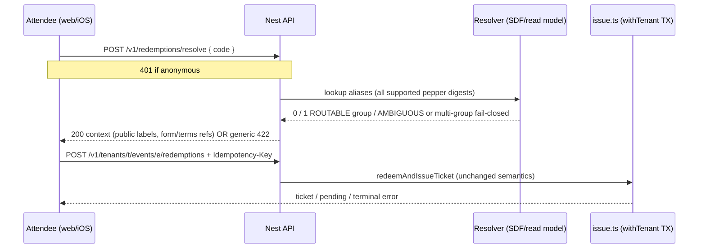

# Single-code redemption — kiến trúc & contract

| Trường | Giá trị |
| --- | --- |
| **Trạng thái** | **Đề xuất** — chờ user review roadmap (không tự chốt ADR / không mở coding) |
| **Mode** | Thiết kế · Role `architect` · [`docs/agents/roles/architect.md`](../agents/roles/architect.md) |
| **Architecture impact** | **Có** — invariant uniqueness mã, resolver cross-tenant trust boundary, migration, shared contract web/iOS |
| **Base SHA đã đọc** | `6ba435ebfaf810e2a15149761e16abd193368280` (`main` worktree; mobile dirty — chỉ đọc) |
| **Source chính** | `packages/backend/prisma/migrations/202610160004_d2_issue_ticket/migration.sql` · `packages/backend/src/code-hmac.ts` · `packages/backend/src/issue.ts` · `packages/backend/src/inventory.ts` · `apps/api/src/tickets.ts` · `apps/mobile/src/redeem/redeem-client.ts` · `apps/mobile/src/redeem/redeem-draft-intent.ts` |
| **Authority** | [PRD M06–M07](../PRD.md) · [TECHNICAL-DESIGN §6–8](../TECHNICAL-DESIGN.md) · ADR-02/03 (RLS) · ADR-09 (auth) |
| **Kết luận** | **Đề xuất** — routing group + alias lookup (không partial-unique ACTIVE), namespace **reserve toàn đời**; global resolve chỉ bật sau migration catalog sạch `AMBIGUOUS` |
| **Revision** | 2026-10-20 — reconcile coordinator review (tombstone, ambiguity DDL, pepper aliases, resolveToken policy, global flag) |

**Không phải:** code complete · acceptance complete · pilot ready · deploy prod · store submit.

---

## 1. Phạm vi

### 1.1 Mục tiêu (user request — hẹp)

- Một ô nhập **mã đổi vé** có thể đặt ở **bất kỳ entry point** (web global, iOS tab/home, deep link shell) — **không** bắt chọn event, **không** nhập slug/UUID tenant/event.
- **Auth gate ngay:** anonymous → chuyển đăng nhập/xác minh email (theo UX auth đã chốt); **không** gọi resolve/issue trước khi authenticated (trừ health).
- **Bước 1 — Resolve (read-only):** server xác định `tenantId`, `eventId`, `ticketTypeId`, `sourceId`, cửa sổ đổi vé, `approvalMode`, phiên bản form/terms đã publish — trả **tên công khai** (tổ chức, event, loại vé).
- **Bước 2 — Confirm + Issue:** user hoàn thành form/terms bắt buộc → nút xác nhận → **POST redeem hiện có** (`redeemAndIssueTicket`) — **không** tự phát vé ở resolve.
- Web + iOS dùng **cùng** contract OpenAPI (`packages/contracts`).

### 1.2 Non-goals

- Không thay transaction cấp vé (quota, idempotency, consent, approval hold, outbox) — chỉ thêm **đường vào** và **routing mã**.
- Không scan toàn bảng `redemption_codes` theo tenant trong resolver (tránh bypass RLS pattern / enumeration).
- Không cho client là authority `tenantId` (query param tùy ý không thay lookup server).
- Không auto-rotate legacy code, không seed/reset production, không đổi mã đã phát khi dry-run import.
- Không mở Android / payment / Wallet trong scope này.

### 1.3 Hiện trạng (observed)

| Khía cạnh | Hiện tại |
| --- | --- |
| Uniqueness | `UNIQUE (tenant_id, event_id, code_hmac)` — cùng chuỗi mã **có thể** tồn tại ở nhiều event trong một tenant |
| Lưu trữ | Chỉ `code_hmac` + `code_pepper_version`; raw code **không** lưu DB |
| HMAC | `HMAC-SHA256(pepper, "v{version}:{NORMALIZED}")` — `normalize = trim + UPPER` ([`code-hmac.ts`](../../packages/backend/src/code-hmac.ts)) |
| Redeem API | `POST /v1/tenants/{tenantId}/events/{eventId}/redemptions` — **bắt buộc** biết tenant + event ([`tickets.ts`](../../apps/api/src/tickets.ts)) |
| Issue | `redeemAndIssueTicket` lookup code trong **tenant + event** scope ([`issue.ts`](../../packages/backend/src/issue.ts)) |
| Import | `importRedemptionCodes` insert `redemption_codes`; duplicate trong **cùng event** → lỗi ([`inventory.ts`](../../packages/backend/src/inventory.ts)) |
| Mobile | `redeemCode` cần `tenantId` + `eventId`; draft intent park code khi login ([`redeem-draft-intent.ts`](../../apps/mobile/src/redeem/redeem-client.ts)) |
| PRD M07 (cũ) | “Khách **chọn event**, nhập mã…” — **cần amend** khi feature được duyệt |

---

## 2. Ràng buộc & trust boundary

- **PostgreSQL SoT;** resolve **không** mutate quota/code; issue vẫn một transaction PG ([TD §8](..//TECHNICAL-DESIGN.md)).
- **RLS:** mọi mutation issue giữ `withTenant(tenantId)`; resolve dùng **đường đọc có kiểm soát** (xem §5) — **không** `SET app.tenant_id` theo client rồi `SELECT * FROM redemption_codes`.
- **Identity:** bearer OIDC; `emailVerified` trước issue (đã enforce trong `redeemAndIssueTicket`).
- **Anti-enumeration:** response resolve/reject **generic** cho invalid/ambiguous/consumed; không trả danh sách event candidate, không timing oracle rõ (constant-work HMAC + bounded DB).
- **Logging:** cấm log/audit raw code, query string code, URL path chứa mã; chỉ `code_hmac` prefix hoặc hash request (đã có pattern operation idempotency).
- **Giữ:** tenant locks, operations idempotency, consent snapshot, MANUAL approval hold, outbox, import job semantics ([PORTAL handoff](./PORTAL-CONTRACT-HANDOFF.md) — commit CODES không `allocated++`).

---

## 3. Luồng đề xuất (hai bước)



**UX invariant:** resolve **never** sets `HELD`, **never** increments quota, **never** creates `redemption_requests` — chỉ đọc projection + policy flags.

**Auth UX (align đã chốt):**

1. User nhập mã → nếu chưa login → park draft (memory only, **no URL code**) → return sau login.
2. Sau login → resolve → hiển thị context → form/terms → confirm → issue.

---

## 4. Phương án

### 4.1 Phương án A — Routing group + digest aliases — **khuyến nghị**

**Ý tưởng:** Tách **namespace routing** (reserve toàn đời) khỏi row `redemption_codes`. Một **routing group** gom mọi candidate cho cùng “ô” routing; global resolve chỉ thành công khi group `ROUTABLE` (đúng một candidate). Legacy nhiều candidate → `AMBIGUOUS` **fail-closed** kể cả khi một candidate `AVAILABLE` và một `CONSUMED` (không route mã đã dùng event A sang event B).

**Không dùng:** `UNIQUE (pepper_version, code_hmac) WHERE status = ACTIVE` — tombstone/TOMBSTONED **không** được giải phóng slot cho event khác; partial unique mâu thuẫn invariant đó.

#### DDL logic (3 bảng)

**`code_routing_groups`** — namespace vĩnh viễn

| Cột | Ghi chú |
| --- | --- |
| `id` | UUID PK |
| `routing_key` | text, **`UNIQUE` không điều kiện** — giữ reservation **toàn đời** (ACTIVE, CONSUMED, DISABLED, TOMBSTONED) |
| `plaintext_fingerprint` | nullable bytea — chỉ set khi insert có raw; `HMAC-SHA256(ROUTING_FP_SECRET, normalized)` — **không** lưu plaintext |
| `resolution` | `ROUTABLE` \| `AMBIGUOUS` \| `LEGACY_UNLINKED` |
| `routed_code_id` | nullable FK `(tenant_id, event_id, redemption_code_id)` — chỉ khi `ROUTABLE` |
| `tombstoned_at` | nullable — đánh dấu namespace đã chết (code consumed/disabled); **vẫn** chặn insert trùng `routing_key` |

**`code_routing_candidates`** — private (staff report + SDF; không attendee API)

| Cột | Ghi chú |
| --- | --- |
| `routing_group_id` | FK |
| `tenant_id`, `event_id`, `redemption_code_id` | FK composite |
| `code_pepper_version`, `code_hmac` | snapshot tại gắn candidate |
| `code_status_snapshot` | `AVAILABLE` \| `HELD` \| `CONSUMED` \| `DISABLED` tại backfill/attach |
| UNIQUE | `(tenant_id, event_id, redemption_code_id)` |

**`code_routing_digest_aliases`** — tra cứu resolve (mọi pepper version đang support)

| Cột | Ghi chú |
| --- | --- |
| `code_pepper_version`, `code_hmac` | **`UNIQUE` không điều kiện** — alias vĩnh viễn |
| `routing_group_id` | FK |
| `routing_key` | denormal copy — enforce cùng namespace |

**Invariant namespace:** Một khi `routing_key` hoặc bất kỳ alias `(version, hmac)` đã tồn tại, **cấm** INSERT mã mới (event/tenant khác) reuse cùng key/alias — kể cả sau tombstone. Remediation = **mã plaintext mới** (phát hành lại), không “giải phóng” slot.

#### Insert mã mới (có raw — mọi path)

Trong **cùng TX** (mức isolation `SERIALIZABLE` hoặc `pg_advisory_xact_lock` trên `routing_key`):

1. `normalized` = trim + UPPER (như `hashRedemptionCode`).
2. `routing_key` = `pf:{fingerprint(normalized)}`.
3. Với **mỗi** `v` trong `SUPPORTED_PEPPER_VERSIONS` (config runtime): `hmac_v` = `hashRedemptionCode(pepper_v, normalized)`.
4. **Check:** không alias trùng; không `routing_key` trùng với group khác; fingerprint trùng group khác → fail.
5. INSERT `redemption_codes` (hmac current version) + group `ROUTABLE` + một candidate + **tất cả** alias rows cho mọi `hmac_v`.

→ Cùng plaintext không thể lọt qua rotation pepper vì mọi digest version được check/reserve ngay tại insert.

#### Resolve (attendee SDF)

1. Compute `hmac_v` cho **tất cả** `SUPPORTED_PEPPER_VERSIONS` (constant count).
2. JOIN `code_routing_digest_aliases` → tập `routing_group_id` khác nhau.
3. |groups| = 0 → invalid; |groups| > 1 → **fail-closed** (generic invalid); 1 group:
   - `resolution = AMBIGUOUS` → fail-closed (**không** chọn candidate AVAILABLE).
   - `resolution = ROUTABLE` → load `routed_code_id` + public projection; issue vẫn lock row trong `issue.ts`.

**Không** scan `redemption_codes` theo tenant; **không** ưu tiên status AVAILABLE trong global lookup.

### 4.2 Phương án B — Self-contained opaque code (versioned payload)

**Ý tưởng:** Mã mới = chuỗi opaque (base32/base64url) chứa `tenant_id`, `event_id`, `redemption_code_id` (hoặc random id) + MAC/HMAC toàn cục; parser server xác thực MAC **trước** khi lock row.

**Ưu:**

- Resolve O(1) không cần global DB lookup cho format mới; in mã QR in sẵn context.
- Uniqueness theo construction.

**Nhược:**

- **Không** cover import CSV legacy (chuỗi do khách hàng cung cấp) — vẫn cần Phương án A hoặc dual-path.
- Đổi format in ấn / đối tác; rotation phức tạp hơn.
- Rủi ro client parse (phải **cấm** parse trên client — chỉ server).

**Verdict:** Hữu ích **phase 2** (generator nội bộ) nếu product muốn mã ngắn có embed routing; **không** thay thế registry cho legacy/import trong MVP slice này.

### 4.3 Giữ hiện trạng (chỉ UX)

Chỉ thêm UI “nhập mã” nhưng vẫn yêu cầu slug event từ catalog → **không** đáp user request; loại.

### 4.4 Khuyến nghị

**Chọn Phương án A** (routing group + aliases) cho Epic này; ghi nhận B như generator phase 2.

---

## 5. API contract đề xuất

### 5.1 `POST /v1/redemptions/resolve`

| | |
| --- | --- |
| Auth | **Bearer bắt buộc** (401 `UNAUTHENTICATED`) |
| Body | `{ "code": string }` — length/format giống `hashRedemptionCode` input (≤128, normalize server-side) |
| Idempotency | **Không** (read-only); vẫn rate-limit |
| Success 200 | `RedemptionResolveResponse` (contracts) |

**`RedemptionResolveResponse` (đề xuất fields):**

```ts
export interface RedemptionResolveResponse {
  tenantId: string;
  eventId: string;
  ticketTypeId: string;
  sourceId: string;
  // Public display only
  tenantDisplayName: string;
  eventTitle: string;
  ticketTypeLabel: string;
  approvalMode: 'AUTO' | 'MANUAL';
  redemptionWindow: { opensAt: string | null; closesAt: string | null; open: boolean };
  published: {
    form: FormDefinition | null;
    terms: PublishedTerms | null;
    schemaVersion: number;
    publishedConfigVersion: number;
  };
  // Client must send back on issue
  resolveToken: string; // bắt buộc cho global flow — xem §5.2 policy
  resolveExpiresAt: string;
}
```

**`resolveToken` (global flow only):** JWT/HMAC ngắn hạn, kid rotation; claims: `actor_user_id`, `routing_group_id`, `tenant_id`, `event_id`, `routed_code_id`, `exp`. **Không** raw code / plaintext. Cấp chỉ từ `POST /v1/redemptions/resolve`.

**Errors (user-facing copy generic):**

| Điều kiện | HTTP | `code` (gợi ý) | Message user |
| --- | --- | --- | --- |
| Chưa auth | 401 | `UNAUTHENTICATED` | (auth flow) |
| Không tìm thấy | 422 | `CODE_INVALID` | “Mã không hợp lệ hoặc không còn khả dụng.” |
| Group `AMBIGUOUS` hoặc multi-group alias hit | 422 | `CODE_INVALID` | **Cùng copy** — không `CODE_AMBIGUOUS` public |
| Event đóng đổi vé | 422 | `REDEMPTION_CLOSED` | “Đợt đổi mã đã kết thúc.” |
| Rate limit | 429 | `RATE_LIMITED` | “Thử lại sau.” |

**Không trả:** email owner, quota còn lại chính xác, danh sách event khác, `code_hmac`, internal ids ngoài scope cần cho issue.

### 5.2 Endpoint policy — global vs tenant-bound (không mâu thuẫn optional/required)

| Flow | Entry | Resolve | Issue | `X-Redemption-Resolve-Token` |
| --- | --- | --- | --- | --- |
| **Global (mới)** | Home / tab / global shell | `POST /v1/redemptions/resolve` **bắt buộc** trước issue | `POST …/tenants/{t}/events/{e}/redemptions` | **Bắt buộc** — thiếu/sai/expired → `422 RESOLVE_TOKEN_REQUIRED` / `RESOLVE_TOKEN_STALE` |
| **Tenant-bound (legacy)** | Event page đã biết `tenantId`+`eventId` | **Không** gọi global resolve | Cùng path redeem hiện tại | **Không** gửi — server **bỏ qua** token; hành vi D4 giữ nguyên |

**Verify token (global only):** `actor_user_id` = bearer; `tenant_id`/`event_id` khớp path; `routing_group_id`/`routed_code_id` khớp body `code` (qua alias lookup); chưa hết `exp`. Mismatch → stale, không issue.

**Capability:** OpenAPI ghi rõ `redemptionFlow: 'global' | 'tenant_bound'` trên client SDK; server không suy từ header tùy ý ngoài token policy trên.

**Grants:** issue tenant-bound và global-after-resolve — authenticated attendee, `withTenant`; resolve SDF — không staff, không PII cross-owner.

### 5.3 Operations / reconcile

- Giữ `GET /v1/operations/{clientOperationId}?tenantId&eventId&command=redemption.redeem` — client lấy `tenantId/eventId` từ **resolve response** đã lưu local (không từ user input tự do).

---

## 6. Legacy backfill, ambiguity quarantine, bật global input

**Điều kiện legacy:** Cùng `(code_pepper_version, code_hmac)` có thể map **nhiều** `redemption_codes` (cross-event). Raw plaintext **không** có trong DB → **không** pretend rehash/backfill fingerprint; **không** suy uniqueness across pepper versions từ distinct `(version, hmac)` alone.

### 6.1 Backfill (fail-closed)

1. Mỗi row `redemption_codes` → một **candidate** + một alias `(version, hmac)` (alias **permanent**).
2. Gom candidates theo alias key trùng: nếu `count(*) > 1` → tạo/ cập nhật **một** `code_routing_groups` với `resolution = AMBIGUOUS`, gắn **tất cả** candidates (AVAILABLE, HELD, CONSUMED, DISABLED — **không** lọc).
3. Alias trùng chỉ trỏ một group; group `AMBIGUOUS` **không** có `routed_code_id`.
4. Trường hợp 1:1 → `ROUTABLE` + `routed_code_id` set.

**Cấm global resolve:** chọn candidate theo `status` (vd CONSUMED bỏ qua, AVAILABLE thắng) — luôn invalid cho attendee.

### 6.2 Collision quarantine (catalog-wide)

- Bảng/view vận hành `code_routing_collision_quarantine` (hoặc filter `resolution = AMBIGUOUS`) — **đếm toàn platform**, không per-tenant flag chọn winner.
- Staff report: group id, candidate ids, events, status snapshots — **không** raw code.

### 6.3 Bật `POST /v1/redemptions/resolve` (global)

- Feature flag **`single_code_resolve_global`** (một cờ **platform**, không per-tenant auto-pick).
- **Điều kiện:** `COUNT(*) WHERE resolution = 'AMBIGUOUS' = 0` trên toàn catalog đã backfill + mọi insert path đã ghi alias đủ (§9).
- Trước điều kiện: UI global input **ẩn** hoặc 503 có copy; tenant-bound event redeem **vẫn** hoạt động.
- Remediation: Manager reissue **mã mới** (plaintext mới → fingerprint mới); **không** auto-rotate mã đã in; không xóa alias/tombstone để “nhường” slot.

### 6.4 Giới hạn rotation (minh bạch)

- Cùng plaintext đã import ở `version=1` và duplicate vô tình ở `version=2` (hai alias, hai group) → global resolve **fail-closed** đến khi remediation; insert mới (có raw) ngăn lặp lại nhờ check all digests + fingerprint.

---

## 7. Pepper rotation, tombstone, rollback

| Chủ đề | Đề xuất |
| --- | --- |
| **Rotation** | Tăng `CODE_HMAC_VERSION` + pepper; **mã mới** insert kèm alias cho **tất cả** `SUPPORTED_PEPPER_VERSIONS` trong cùng TX |
| **Resolve** | Tính digest cho mọi version support; tra `code_routing_digest_aliases` — không giả định `(version, hmac)` unique theo plaintext |
| **Legacy rows** | Chỉ alias version tại thời insert; **không** rehash backfill (không raw); dual-alias chỉ cho **insert mới** |
| **Tombstone** | `CONSUMED`/`DISABLED`: set `tombstoned_at` trên group; **giữ** `routing_key` + toàn bộ alias; **cấm** insert reuse namespace |
| **Rollback deploy** | Tắt `single_code_resolve_global`; tenant-bound redeem không đổi |
| **Audit** | `redemption.routing.tombstone` — `routing_group_id`, `redemption_code_id`; không raw code |

---

## 8. Rate limiting & abuse

| Key | Gợi ý |
| --- | --- |
| Per user (`sub`) | 30 resolve / 10 phút |
| Per IP (Caddy + app) | 60 resolve / 10 phút (burst thấp) |
| Per code_hmac (server-side bucket) | 5 failures / 15 phút — chống targeted guess |
| Issue endpoint | Giữ limit hiện có + không giảm idempotency |

Redis chỉ counter; **không** quyết định validity code.

---

## 9. Import / dry-run / generation (invariants)

- **Mọi insert** `redemption_codes` (có raw) → group + candidate + **đủ** digest aliases + fingerprint lock (cùng TX, serialized).
- **Dry-run / preview:** `duplicateRoutingKey`, `duplicateDigestAlias`, `wouldCreateAmbiguousGroup`, `namespaceReserved` — không INSERT.
- **Commit:** vi phạm `routing_key` hoặc alias unique → fail; không đổi mã đã phát.
- **Quota:** không đổi — import không `allocated++` until issue.
- **Quarantine report:** CSV staff — group id + candidate ids; không raw.

---

## 10. Client (web + iOS) — handoff ngắn

| Surface | Thay đổi |
| --- | --- |
| Entry | Component `RedeemCodeEntry` — một field mã |
| State machine | `idle → auth? → resolving → context → form → submitting → outcome` |
| Storage | Lưu `resolve` payload + `resolveToken` in-memory / secure session; **không** URL query `code` |
| Issue | Global: redeem + **bắt buộc** `X-Redemption-Resolve-Token`; event page: redeem legacy không token |
| Event catalog | iOS vẫn ADR-19 tenant slug cho **browse**; redeem global **không** thay catalog API |
| Stale | `FORM_VERSION_STALE` / `RESOLVE_TOKEN_STALE` → re-resolve |

---

## 11. Xác minh & evidence (khi implement)

| Loại | Nội dung |
| --- | --- |
| Unit | Resolver: 0/1/N rows; token verify; HMAC normalize |
| Integration | Import + registry unique; issue unchanged idempotency |
| Security | Enumeration harness — same response class invalid vs ambiguous; no raw in logs |
| Concurrency | Hai user một mã — giữ AC M07 hiện có |
| Physical UAT | Nhập mã tại home iOS + web không chọn event |

---

## 12. User review (product / roadmap — không hỏi lại fork kỹ thuật)

1. Epic **single-code global input** + sửa PRD M07 (“nhập mã; hệ thống nhận diện event”).
2. Chấp nhận **không bật global** cho đến khi ambiguity quarantine = 0 (tenant-bound redeem vẫn dùng được).
3. Chấp nhận remediation collision = **phát mã mới**, không tái dùng namespace cũ.

Kiến trúc (routing group, alias đa-pepper, token policy, global flag) **đã chốt trong doc** — coordinator triển khai theo §4–7.

---

## 13. Kết luận

**Đề xuất:** routing group + digest aliases, namespace reserve toàn đời, `AMBIGUOUS` fail-closed, `resolveToken` chỉ global flow, tenant-bound redeem không đổi. **Sẵn user review roadmap** — coding sau duyệt (AGENTS.md).
