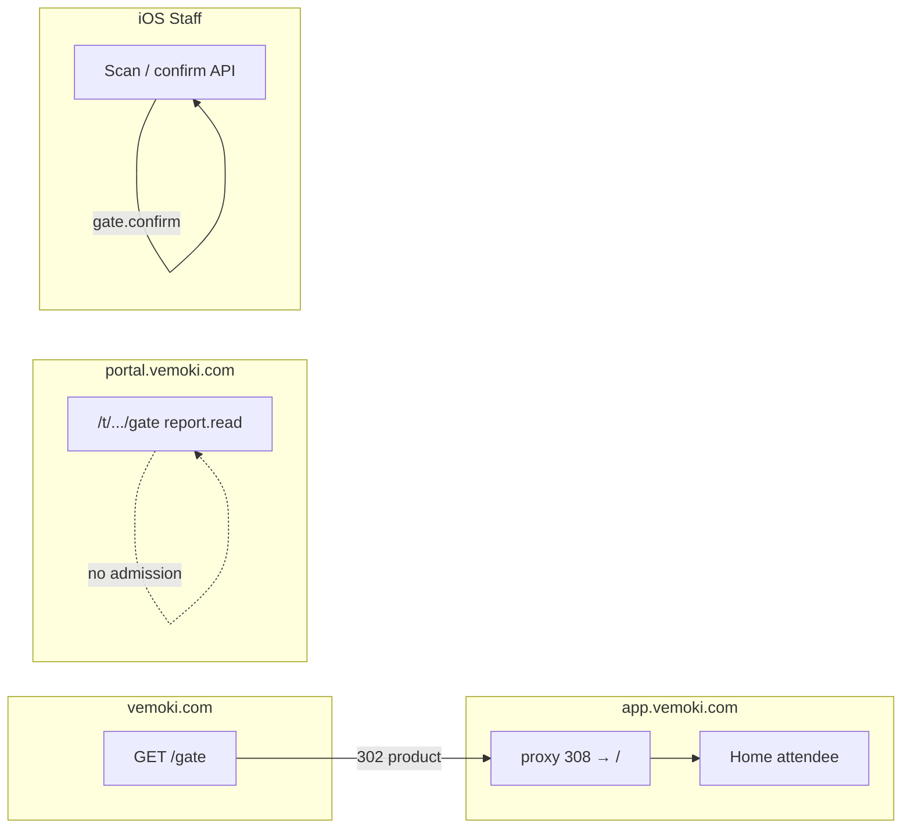

# VD-01 — Handoff kiến trúc O23: bỏ Web Gate, admission chỉ iOS Staff

| Trường | Giá trị |
| --- | --- |
| Epic / Task | [#874](https://github.com/hangndat/ticket-solution/issues/874) · [#876](https://github.com/hangndat/ticket-solution/issues/876) |
| Role | `architect` (Dexter) · [`docs/agents/roles/architect.md`](../agents/roles/architect.md) |
| Worktree | `/Users/admin/SideProject/ticket-solution/vd01-gate-migration` |
| **Exact SHA đối chiếu** | `9e6565af68e6aba1c61790ed857a7082d0229fdd` |
| Quyết định nguồn (checkout gốc `ticket-solution`, chưa merge O23 vào `DECISION-LOG` worktree) | [O23](../../../docs/DECISION-LOG.md) (main worktree) · [Plan VD-*](../../../docs/plans/VEMOKI-UNIFIED-DESIGN-IMPLEMENTATION-2026-10-24.md) · [DESIGN-ACCEPTANCE](../../../docs/design/Vemoki-Complete%202/DESIGN-ACCEPTANCE.md) |
| Mẫu artifact | [`docs/architecture/<task-slug>.md`](./vd01-o23-web-gate-migration-handoff.md) (architect role) |
| **Kết luận** | **Đủ để triển khai trong scope** — không cần ADR mới; consumer VD-02/VD-06/VD-07 triển khai theo ma trận dưới |

Architecture impact: **Có** (kênh admission, route/deep link, copy residual). **Non-goals:** không đổi Gate Nest API, RBAC server, idempotency reserve/confirm, offline reconciliation iOS (ADR-18), không mở payment/Android/store/deploy.

---

## 1. Phạm vi và mục tiêu

**Mục tiêu:** Chốt hành vi hệ thống sau O23 — quét/nhập/xác nhận cổng **chỉ** trên iOS Staff; web không còn surface admission; Portal chỉ **báo cáo** Gate khi có `report.read`.

**Đã có trong code (SHA trên):**

- D-6 / Epic #786: cây `apps/web/app/gate` **đã xóa**; proxy **308** `/gate` và `/gate/*` → `/` (query bị xóa).
- Nav staff web **không** còn href `/gate` khi có `gate.confirm`.
- Portal route `/t/{tenantId}/e/{eventId}/gate` là **report read-only** (BFF `report`), không camera/admission.
- OIDC post-login **không** allowlist `/gate` → refresh/reject terminal về `/`.

**Còn mở (VD-02 marketing/copy, không chặn contract):** link/copy residual trỏ scanner web hoặc URL `app.vemoki.com/gate` — xem §6.

---

## 2. Ràng buộc và ADR đối chiếu (không tạo ADR trùng)

| Nguồn | Áp dụng VD-01 |
| --- | --- |
| **O23** (Decision Log gốc) | SoT sản phẩm: bỏ Web Gate; Portal report-only; checklist migration trước production cutover |
| **ADR-22 D-6** | Xóa route web gate; mobile (iOS Staff) thay thế |
| **ADR-20** `GATE-STAY-APP` | **Superseded** bởi D-6: `/gate` app host → 308 `/`; scan chỉ iOS |
| **ADR-18** | Offline/queue/conflict semantics **giữ** trên iOS; web không queue gate |
| **O13** host map | `vemoki.com` + path product → redirect `app.vemoki.com`; `/gate` vẫn là product path (redirect apex rồi 308 home) |

**Gap tài liệu lịch sử (không đổi quyết định):** một số plan/design cũ (`PORTAL-ROADMAP.md`, `PORTAL-SUBDOMAIN-ANTD.md`, HTML portal roadmap) vẫn mô tả Web Gate trên `app.` — **O23 + ADR-20 sửa đổi + bảng §3** là authority cho implementation; coordinator có Task docs riêng nếu cần sweep PRD/roadmap.

---

## 3. Ma trận route × host × hành vi (contract VD-02+)

| Request | Host | Phương thức | Hành vi chuẩn | Admission? | Ghi chú implementation |
| --- | --- | --- | --- | --- | --- |
| `/gate`, `/gate/*` | `app.*` (product) | GET/HEAD | **308** → `/` (search cleared) | **Không** | `apps/web/proxy.ts` |
| `/gate` | `vemoki.com` (marketing) | GET | **302** → `PRODUCT_ORIGIN/gate` → **308** → `/` | **Không** | `decideHostRouting` + proxy |
| `/admin`, `/platform` | `app.*` | GET/HEAD | Portal redirect hoặc 404 (D-7); **không** áp cho `/gate` | N/A | `decideAdminToPortalRedirect` explicitly skips `/gate` |
| Legacy admin deep link `?job=gate` trên app | `app.*` | GET | Map sang **portal** `/t/.../e/.../gate` (report) khi dual-run redirect bật; **không** qua `/gate` web | **Không** (report) | `mapLegacyAdminToPortalPath` |
| `/t/{t}/e/{e}/gate` | `portal.*` | GET | Trang báo cáo; load khi `report.read` | **Không** | `apps/portal/.../gate/page.tsx` |
| Staff iOS deep link / universal link (workspace Staff) | iOS | — | Camera/manual/confirm theo API hiện hành | **Có** (chỉ khi backend `APPLIED` / policy) | VD-06; **không** đổi contract API |

**Invariant:** Không request path trên web được mount scanner, gọi `gate.confirm` từ UI web, hoặc hiển thị success admission khi kết quả queued/unknown/conflict.

---

## 4. Auth, session và deep link

| Kịch bản | Hành vi chuẩn | Evidence SHA |
| --- | --- | --- |
| Bookmark `/gate` (đã login guest/staff cookie app host) | 308 → home attendee; **không** lộ vé tenant khác | `routes.integration.mjs`, `proxy.ts` |
| OIDC return `next=/gate` hoặc refresh sau SSR 401 với `next=/gate` | `sanitizePostLoginPath` **không** allowlist `/gate` → fallback **`/`** | `session-refresh.test.ts`, `post-login.ts` |
| Portal post-login / return path `/gate` | **null** (allowlist portal chỉ prefix portal staff) | `apps/portal/tests/origin-adapter.test.ts` |
| Portal deeplink builder `/gate` | **Không** tạo link | `dual-run-allowlist.test.ts` |
| Dual-run banner link `<Link href="/gate">` | Hiện **còn** (residual); sau VD-02: thay bằng copy iOS-only, **không** href scanner web | `dual-run-banner.tsx` |

**Session:** Cookie OIDC vẫn host-only trên product (`ADR-20`); redirect `/gate` **không** xóa session — user về home vẫn đăng nhập nếu cookie hợp lệ.

---

## 5. Ma trận quyền × surface (không đổi RBAC server)

| Permission | Web `app.*` | Portal `portal.*` | iOS Staff |
| --- | --- | --- | --- |
| `gate.confirm` | Không nav `/gate`; không UI admission | **Không** mở menu Gate report một mình; có thể hiện **hint** scan iOS (`GateIosScanHint`) | Admission workspace |
| `report.read` | N/A (không trang gate report trên app) | Menu **Gate** → `/t/.../gate` report + `asOf`/stale | N/A (report trên portal) |
| Chỉ `gate.confirm` | — | Vào URL report trực tiếp → **403** / need `report.read` | Scan |

**Không suy quyền:** `gate.confirm` ≠ `report.read`; Portal copy đã khóa trong i18n (`gate.needReportRead`).

---

## 6. Residual inventory (ownership VD-02 / VD-04)

Web worker **chỉ** `apps/web` — cập nhật theo contract §3–§5, không đổi API.

| ID | Path | Vấn đề | Hành động đề xuất |
| --- | --- | --- | --- |
| R1 | `apps/web/src/portal/dual-run-banner.tsx` | Link `/gate` “Cổng quét vẫn trên app” | Đổi thành text + link help/App Store / copy iOS Staff; **không** `/gate` |
| R2 | `apps/web/src/marketing/copy.ts` (+ bento/hero) | Demo URL `app.vemoki.com/gate`, tab “Cổng” trong **marketing preview** | Copy: cổng trên **app iOS Staff**; URL preview không gợi ý scanner web live |
| R3 | `apps/web/src/marketing/sections/bento.tsx` | Key `bento.gate` | Giữ chủ đề audit/ops; body không hứa web scan |
| R4 | `apps/web/src/ui/live-region.ts` comment | Mention gate chrome | Doc-only hoặc redeem/admin |
| R5 | `apps/web/app/api/auth/refresh/route.ts` comment | Ví dụ `next=/gate` | Comment → retired path |
| R6 | Docs/plan lịch sử trong repo | GATE-STAY-APP wording | Không blocking code; coordinator backlog docs |

**Giữ đúng:** `PRODUCT_PATH_PREFIXES` có `/gate` (apex redirect); `robots` omit `/gate`; `dual-run.ts` exclude `/gate` khỏi portal migration redirect; tests D-6 listed §8.

---

## 7. Portal Gate report (VD-07 reference)

- **Route:** `/t/[tenantId]/e/[eventId]/gate` — tên “Gate” trong nav là **báo cáo**, không scanner.
- **Data:** `GET` BFF event `report`; hiển thị `formatReportAsOf`, quota, ticket state counts; CTA chỉ deep-link nghiệp vụ khác (pending approval, email CS) — **không** approve/deny/resend trên trang gate (tests `ops-report.test.ts`).
- **UI copy:** `GateStayAppNotice` / `gateDeeplink.*` — scan iPhone only.
- **Không** thêm link tới `https://app.vemoki.com/gate`.

---

## 8. Rollback, monitoring và migration test

### 8.1 Rollforward (mặc định)

- VD-02 ship copy/link + xác nhận test matrix §8.3.
- **Không** khôi phục `app/gate` trừ quyết định product mới (ngoài scope O23).

### 8.2 Rollback kỹ thuật (hiếm)

- Revert commit D-6/proxy 308 → tái xuất Web Gate **vi phạm O23**; chỉ khi coordinator + user explicit.
- Epic #786 rollback note (ADR-22): revert WP có D-6 cần kiểm redirect và không mount scanner ngoài ý định.

### 8.3 Monitoring (production / pilot)

| Signal | Mục đích |
| --- | --- |
| HTTP **308** count path `/gate`, `/gate/*` trên app edge | Volume bookmark/campaign cũ; alert spike bất thường |
| **4xx/5xx** trên legacy staff API paths (410 gone) | Cutover admin |
| Gate API (`reserve`/`confirm`) **User-Agent / client** | Không có traffic admission mới từ web BFF (iOS only) — baseline từ metrics hiện có |
| Portal BFF `report` latency/errors trên `/gate` page | Report read-only health |

### 8.4 Test migration (bắt buộc trước pilot ready)

Chạy trên SHA tích hợp (local CI đã có unit/integration):

```bash
pnpm --filter @ticket/web test
# Hoặc node --test cho các file gate/D-6 liên quan khi slice web
```

| Check | Test / artifact |
| --- | --- |
| 308 `/gate`, `/gate/scan` | `apps/web/tests/routes.integration.mjs` |
| Không `app/gate` | `mobile-menu-focus.test.ts` |
| Nav không `/gate` với `gate.confirm` | `nav-capabilities.test.ts` |
| `/gate` không redirect portal | `portal-dual-run.test.ts` T8 |
| Session refresh `next=/gate` → home | `session-refresh.test.ts` |
| Marketing apex `/gate` → product | `marketing-host.test.ts` |
| UAT nav `/gate` → home | `nav-o02-uat.mjs` |
| Portal report permission | `capabilities.test.ts`, `ops-report.test.ts` |
| Portal sanitize `/gate` | `origin-adapter.test.ts`, `dual-run-allowlist.test.ts` |

**UAT bổ sung (VD-08):** guest vs staff cookie trên `/gate`; staff với `gate.confirm` vẫn không thấy scanner; Portal supervisor chỉ `report.read` xem số liệu; iOS Staff E2E gate (thiết bị thật cho camera/offline).

---

## 9. Handoff ownership

| Consumer | Input từ VD-01 | Deliverable của consumer |
| --- | --- | --- |
| **VD-02** web | §3–§6, R1–R5 | PR `apps/web` residual + regression tests |
| **VD-06** iOS Staff | §3, §5; không đổi API | Staff flows vs design acceptance |
| **VD-07** portal | §5, §7 | Chỉ delta link/copy nếu còn; theme/report UX |
| **VD-08** integration | §8.3–§8.4 | Exact-SHA evidence, route × persona matrix |

**Backend / API:** không Task từ VD-01.

---

## 10. Xác minh và giới hạn

| Checks | Kết quả tại SHA handoff |
| --- | --- |
| Đọc `proxy.ts`, `post-login`, portal gate page, dual-run | Khớp ma trận §3 |
| CRG / graph | Graph MCP trên `main` có thể lệch branch; source worktree thắng |
| Decision Log worktree | **Chưa** có mục O23 — handoff dẫn checkout gốc; merge O23 là Task coordinator |
| Design complete | Không đồng nghĩa pilot ready (DESIGN-ACCEPTANCE §Gate còn mở) |

---

## 11. Sơ đồ luồng (bookmark `/gate`)



---

*Tài liệu này là handoff architect Task #876; không thay thế reviewer DoD hoặc user approval production.*
