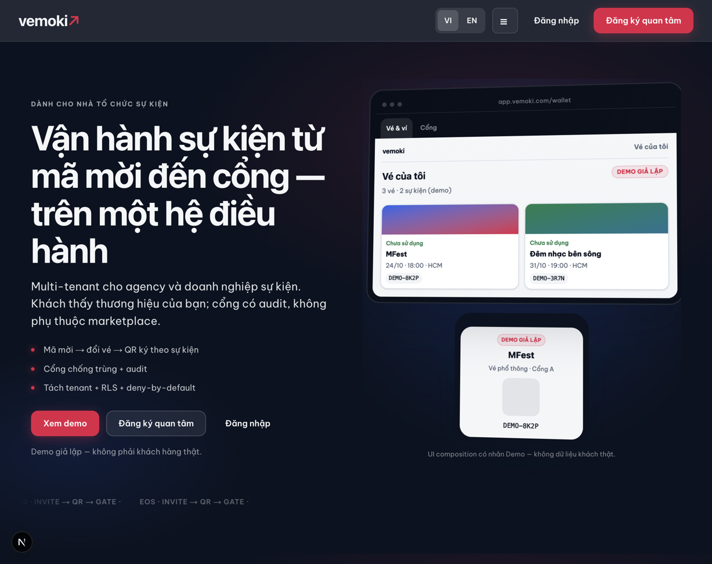

# FB08 — Thiết kế lại hero/banner marketing + catalog + event header

> Bản Liv ban đầu, được lưu làm lịch sử. **Đã được thay bởi [README.md](./README.md)**: catalog có `CatalogHeroBand`; Orca có lệnh resize; mẫu sau thiết kế và quyết định triển khai nằm trong README/prototype. Không dùng các kết luận mâu thuẫn bên dưới để nghiệm thu.

**Issue:** #869 (batch 2/2) · PR #870 · Epic #867 / Story #868. Baseline `30ce1daa60572f6309305436ff9aa29a17ccebe1`.
**Role:** `product-design`. **Owner tiếp theo:** Web (`apps/web`).
**Visual budget:** Có — token nguồn `brand/vemoki/tokens.json` v2 (không đổi token).
**Scope quyết định:** Hero marketing (VI/EN) là surface duy nhất hiện có banner/hero thật sự. Catalog "Khám phá" và event detail/redeem **không có** banner/hero section ở HEAD `30ce1da` (xem mục 6) → không cần redesign ở đó cho batch này; ghi rõ để Web không tự thêm banner ngoài scope.
**Không đổi:** ảnh bìa sự kiện (`EventBanner`/`EventMediaHeader` trong `apps/web/src/ui/event-media.tsx`) — chờ user clarify nguồn ảnh, business flow/auth contract giữ nguyên.

---

## 0. Brand / visual budget

| Hạng mục | Nội dung |
| --- | --- |
| Tokens | `ink #0B1220`, `paper #F4F6F8`, `signal #E11D48`, `focus #2563EB`, `line #D7DFE9`, `muted #5B687B` — từ `brand/vemoki/tokens.json` (không sửa file) |
| Typography | Display `Sora` (H1/eyebrow), body `Be Vietnam Pro`. Cấm Inter/Roboto/Arial/system-only cho H1 |
| Surfaces | Giữ nền `ink` tối cho hero (đã đúng brand "Live Pulse"); ảnh sản phẩm đặt trong khung phẳng, không thêm gradient/texture mới |
| Anti-patterns bị loại ở batch này | (1) khung "fake browser chrome" ba chấm tròn + URL bar giả, (2) khung điện thoại giả (device mockup) nổi dưới browser giả, (3) dữ liệu demo cứng trong component thay vì chụp thật, (4) stat số liệu không có nguồn (`hero.proof1/2/3` nếu là số liệu chưa kiểm chứng — xem mục 5 action cho Web) |
| Motion | Giữ marquee hiện có (giảm biên độ nếu lệch); fade-in ảnh hero 150–200ms; tôn trọng `prefers-reduced-motion` (tắt marquee animation + fade) |
| Priority screens | (1) Marketing hero desktop 1440/1024, (2) Marketing hero mobile 390, (3) Marketing hero EN (copy khác, bố cục giống VI) |
| Freeze | Implementer không invent thêm hiệu ứng/ảnh ngoài khối này; thiếu asset ảnh sản phẩm thật → escalate coordinator, **không** tạm thế bằng mockup giả hoặc ảnh AI |

## 1. Vấn đề hiện tại (bằng chứng runtime)

Nguồn: `apps/web/src/marketing/sections/hero.tsx` render `ProductPreviewFrame` (`packages/ui/src/marketing/product-preview-frame.tsx`). Capture thật tại `localhost:3417/` (HEAD `30ce1da`), viewport 1227×973:

_(actual runtime capture — Orca embedded browser, `localhost:3417/`, 1227×973 logic px @2x DPR, không chỉnh sửa)_

Vấn đề cụ thể khớp feedback user:
- Khung "trình duyệt giả": 3 chấm tròn (traffic-light) + thanh URL text tĩnh (`hero.preview.url.wallet/gate`) — không phải browser thật, không phải ảnh chụp.
- Bên trong là UI **vẽ lại bằng tay** (card vé, QR giả vẽ bằng border-dashed, không phải mã QR thật) — đúng loại "fabricated QR" user chê.
- Khung điện thoại giả lặp lại data y hệt bên trên (MFest / DEMO-8K2P) → trùng lặp, tốn không gian, không phải ảnh chụp sản phẩm thật.
- Hai CTA chính (`hero.cta.demo`, `hero.cta.interest`) + 1 CTA phụ (`hero.cta.login`) đã đúng hierarchy 1 chính + phụ về số lượng nhưng visual weight cả 3 nút gần bằng nhau (variant `primary`/`secondaryOnInk`/`ghostOnInk` — cần parent xác nhận token tương phản đủ rõ, xem mục 5).

## 2. Thiết kế mới — nguyên tắc

1. **Thay khung giả bằng ảnh chụp màn hình runtime thật** của sản phẩm (web wallet hoặc Gate), lấy từ chính app đang chạy — không vẽ lại UI bằng div/border.
2. Một khung ảnh phẳng, bo góc theo `radius.xl` (24px), đổ `shadow.frame` đã có trong token — **không** thêm chrome trình duyệt, **không** thêm khung điện thoại giả nhân đôi nội dung.
3. Caption text ngắn ngay dưới ảnh làm rõ đây là ảnh minh hoạ sản phẩm (ví dụ: "Màn hình Ví vé thật — demo dữ liệu mẫu"), giữ nguyên vai trò `labels.caption` hiện có nhưng copy phải thừa nhận đây là capture thật + demo data, không giả vờ là dữ liệu production.
4. Nếu cần thể hiện 2 chế độ (Wallet/Gate) như hiện tại, dùng **tab chuyển ảnh** (giữ `role="tablist"`/`tabpanel` cho a11y) nhưng mỗi tab hiển thị **một ảnh chụp khác nhau**, không phải UI vẽ tay.
5. Bỏ hẳn khung điện thoại giả phía dưới (`mt-4 hidden md:block` block trong `product-preview-frame.tsx`) — không nhân đôi thông tin.

## 3. Layout theo viewport

### Desktop 1440 / 1024
- Giữ grid 2 cột hiện tại (`marketingHeroGrid`): cột trái copy (eyebrow, H1, sub, 3 proof points, CTA group, demo note), cột phải **ảnh chụp sản phẩm** trong khung phẳng.
- Tỉ lệ cột: ~55/45 ở 1440, chuyển 50/50 hoặc stack ở 1024 nếu ảnh bị bóp quá hẹp (đo thực tế khi implement; giữ min-width ảnh ≥ 420px ở 1024 hoặc stack dọc).
- Aspect ratio khung ảnh: cố định `4:3` (khớp tỷ lệ ảnh chụp UI wallet thực tế) để không giật layout khi đổi tab Wallet/Gate hay đổi ngôn ngữ (khớp FB01 — không nhảy layout khi đổi VI/EN).

### Mobile 390
- Stack dọc: copy trước, CTA group, rồi ảnh chụp sản phẩm full-width bên dưới (thay vì scale-down 3D transform hiện tại — bỏ `perspective`/`rotateY` transform ở mobile, đã có `max-md:transform-none`, giữ nguyên quy tắc này).
- Ảnh giữ aspect ratio `4:3`, full width trong wrap container, không crop mất nội dung UI quan trọng (nav bar, CTA trong ảnh).
- CTA group: giữ thứ tự chính → phụ → ghost, cho phép wrap 2 dòng trên 390 (đã có `flex-wrap`).

## 4. States

| State | Khi nào | Nội dung |
| --- | --- | --- |
| loading (ảnh) | Ảnh hero chưa tải xong | Skeleton khung đúng aspect ratio `4:3`, màu `line`/`paper` mix hiện có (không chữ "Loading…", không spinner lớn giữa màn) |
| ready | Ảnh tải xong | Fade-in 150–200ms, tắt hoàn toàn nếu `prefers-reduced-motion: reduce` |
| error (ảnh lỗi/404) | Ảnh không tải được | Fallback: khung phẳng màu nền `ink`/`paper` mix + caption text giữ nguyên, **không** vỡ layout, không icon ảnh hỏng mặc định của browser |
| tab Wallet/Gate (nếu giữ) | Chuyển tab | Giữ `role="tablist"`, `aria-selected`, ảnh tương ứng tab, không nhảy chiều cao khung (aspect ratio cố định) |

## 5. Accessibility

- Ảnh hero: `alt` mô tả đúng nội dung thật (ví dụ "Màn hình Ví vé Vemoki hiển thị 2 vé demo"), không `alt=""` vì đây là nội dung có nghĩa, không chỉ trang trí.
- Tab Wallet/Gate (nếu giữ): giữ nguyên cấu trúc ARIA đã có trong `product-preview-frame.tsx` (`role="tablist"`, `aria-controls`, `aria-selected`) — tái dùng, không viết lại từ đầu.
- Contrast: caption text trên nền `ink` đã dùng `text-paper/55` — kiểm lại ≥ 4.5:1 khi đổi nền ảnh (có thể cần tăng lên `/70` nếu ảnh nền sáng lộ ra ngoài khung).
- `prefers-reduced-motion`: tắt fade-in ảnh + marquee track animation.
- Hit target CTA: giữ `min-h-9`+ hiện có cho nút, không giảm khi đổi layout.

## 6. Catalog "Khám phá" và event detail/redeem header

Đã kiểm tra `apps/web/src/home-catalog/home-catalog-grid.tsx` (section `aria-labelledby="home-catalog-title"`, heading `sr-only`) và `apps/web/src/ui/event-media.tsx` (`EventBanner`/`EventMediaHeader`, dùng ảnh bìa sự kiện `bannerUrl`, không dùng ở detail/redeem flow hiện tại — không có call site nào import `EventMediaHeader` ngoài file định nghĩa nó).

→ **Không có banner/hero cần redesign ở hai surface này tại HEAD `30ce1da`.** Nếu Web cần thêm section giới thiệu phía trên lưới catalog sau này, áp **cùng nguyên tắc mục 2** (ảnh thật, không mockup giả, một CTA chính) và quay lại PD xin handoff riêng — không tự thêm ngoài Task này.

Ảnh bìa sự kiện (`EventBanner`) giữ nguyên — theo yêu cầu user, chờ clarify nguồn ảnh trước khi đổi.

## 7. AC quan sát được (Given/When/Then)

- **AC1** Given hero marketing load xong, When nhìn cột phải, Then thấy một ảnh chụp sản phẩm thật (không browser-chrome giả, không phone-mockup giả, không QR vẽ tay) trong khung bo góc `radius.xl` + `shadow.frame`.
- **AC2** Given đổi ngôn ngữ VI↔EN, When hero re-render, Then khung ảnh giữ nguyên kích thước/aspect ratio (không nhảy layout), khớp FB01.
- **AC3** Given viewport 390/1024/1440, When xem hero, Then bố cục đúng mục 3 (stack mobile, 2 cột desktop), CTA group không vỡ dòng xấu, ảnh không bị crop mất chi tiết quan trọng.
- **AC4** Given ảnh hero đang tải, When trước khi có data, Then thấy skeleton đúng khung (không trang trắng/spinner toàn màn).
- **AC5** Given `prefers-reduced-motion: reduce`, When hero hiển thị, Then không có fade-in ảnh, marquee đứng yên hoặc giảm hẳn tốc độ.
- **AC6** Given screen reader, When focus vào ảnh hero, Then nghe alt text mô tả đúng nội dung (không rỗng, không "image").
- **AC7** Given catalog "Khám phá" / event detail / redeem, When review, Then xác nhận không có banner/hero bị bỏ sót theo mục 6 (không cần đổi UI mới ở đây).

Evidence map: chạy Orca browser/UAT theo `.cursor/rules/uat-headless.mdc` tại 390/1024/1440, VI+EN, chụp lại hero sau khi Web implement, so với capture "before" ở mục 1.

## 8. Hướng dẫn triển khai (Web)

- **Ownership:** `apps/web` (component `apps/web/src/marketing/sections/hero.tsx`) + `packages/ui/src/marketing/product-preview-frame.tsx` (coordinator ownership — sửa trong `packages/ui` cần theo quy tắc coordinator; Web có thể đề xuất diff nhưng xác nhận theo AGENTS.md ownership trước khi merge).
- **Nguồn ảnh:** chụp thật từ app đang chạy (ví dụ Wallet page của `apps/web` attendee surface hoặc Gate demo) ở độ phân giải đủ nét (≥2x nếu dùng `next/image`/`Image` với `srcSet`); lưu asset vào path demo hiện có (`apps/web/public/demo/` đã có `banner.png` làm tiền lệ) — đặt tên rõ ràng, có manifest nguồn (route/persona/thời điểm chụp) theo FB02.
- **Component:** giữ `ProductPreviewFrame` làm tên/props tương thích tối thiểu (hoặc đổi tên nếu coordinator đồng ý) nhưng thay toàn bộ nội dung vẽ tay (div/border mô phỏng UI) bằng ``/`next/image` point tới ảnh thật; xoá khối "khung điện thoại giả" (`mt-4 hidden md:block`) hoàn toàn.
- **Token/spacing:** tái dùng `radius.xl`, `shadow.frame`, màu `ink`/`paper`/`signal`/`focus` đã có — không thêm token mới.
- **Thứ tự implement:** (1) chụp + chuẩn hoá ảnh demo → (2) đổi `ProductPreviewFrame` sang hiển thị ảnh thật + skeleton/error state → (3) kiểm responsive 390/1024/1440 + VI/EN không nhảy layout → (4) a11y pass (alt, reduced-motion, contrast) → (5) xoá code vẽ-tay cũ không dùng nữa.
- **Good enough cho MVP:** 1 ảnh tĩnh cho Wallet (bắt buộc) + tuỳ chọn thêm ảnh Gate nếu kịp; không bắt buộc animation chuyển tab phức tạp, giữ tab đơn giản đổi `src` ảnh.
- **Phụ thuộc cần flag cho coordinator nếu thiếu:** ảnh chụp sản phẩm thật đạt chất lượng (không chứa dữ liệu thật của user ngoài demo fixture), quyền sửa `packages/ui/src/marketing/product-preview-frame.tsx` (coordinator-owned package).

## 9. Điểm còn mở

- Ảnh bìa sự kiện (`EventBanner`) chưa đổi — chờ user clarify nguồn ảnh (ghi trong task gốc).
- Chưa chụp được breakpoint 390/1024 bằng tool capture có sẵn trong phiên này (Orca embedded browser không có lệnh resize viewport trong bản CLI hiện tại; cài Playwright chromium bị timeout do mạng chậm). Bố cục 390/1024 ở mục 3 là **spec thiết kế** dựa trên token/breakpoint hiện có (`brand/vemoki/tokens.json` → `breakpoints.sm=640/md=768/lg=1024/xl=1280`) và cấu trúc CSS đã có trong `hero.tsx`/`product-preview-frame.tsx` (class `max-md:transform-none`, `flex-wrap`), **không phải ảnh chụp đo thật** — Web cần tự chụp lại 390/1024 khi implement để đối chiếu AC3 trước khi coi UAT PASS.
- Giá trị "proof1/2/3" (`hero.proof1/2/3`) chưa được audit có phải số liệu có căn cứ hay không trong batch này — nếu là stat vô căn cứ theo ý user, Web/coordinator cần xác nhận nguồn trước khi giữ lại trong copy.
