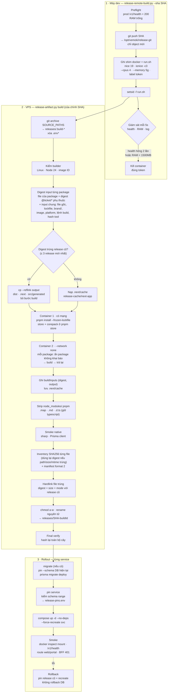
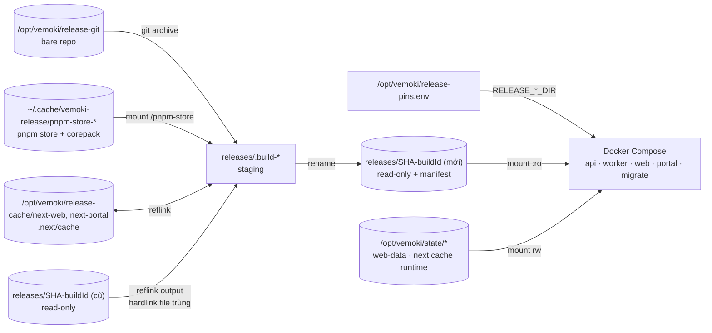

# Quy trình deploy — sơ đồ kỹ thuật

Mô tả luồng deploy theo `scripts/release-remote-build.py` + `scripts/release-artifact.py` (#1104, #1105). Contract chi tiết, rollout schema và xử lý lỗi: [IMMUTABLE-RELEASE.md](./IMMUTABLE-RELEASE.md).

## Tổng quan

## Dữ liệu trên VPS

| Đường dẫn | Vai trò | Xóa được? |
| --- | --- | --- |
| `/opt/vemoki/release-git` | Bare repo nhận `git push`; nguồn `git archive`. | Có, lần sau push lại đủ. |
| `/opt/vemoki/releases/<SHA>-<buildId>` | Release read-only, manifest checksum từng file, hardlink chung file trùng. | Chỉ qua `cleanup` (chặn release đang pin/mount). |
| `/opt/vemoki/release-cache/next-*` | `.next/cache` web/portal, ngoài release. | Có. |
| `~/.cache/vemoki-release/pnpm-store-<platform>` | pnpm store + `corepack` (pnpm cho bước build không mạng). | Có. |
| `/opt/vemoki/release-pins.env` | Release đang pin cho 5 service. | Không. |
| `/opt/vemoki/release-build/logs` | Log từng lần build. | Có. |
| `/opt/vemoki/state/*` | State ghi được, bind vào release. | Không. |

## Cơ chế chặn ship sai

| Rủi ro | Cơ chế |
| --- | --- |
| Package đọc ngầm package không khai báo | Package ngoài closure dependency bị chuyển sang `.build-hidden/` trong lúc build → đọc ngầm là fail, kể cả build đủ. |
| Build lấy input từ mạng | Bước build chạy `docker run --network none`. |
| Logic tool đổi | Hash `release-artifact.py` nằm trong digest chung → build lại toàn bộ. |
| Gợi ý digest sai | `verify` cuối hash lại toàn bộ cây đã publish. |
| Lệch schema khi pin/rollback | `pin` kiểm range; worker trước F02 bị chặn. |
| Xóa nhầm release | `cleanup` mặc định dry-run; chặn release đang pin hoặc đang mount (kể cả container dừng). |
| Nghi ngờ output tái dùng | `build --full` tắt tái dùng output, cache Next và gợi ý digest. |
| Build làm nghẽn prod | Shim giới hạn CPU/RAM + `nice`/`ionice`; wrapper kill khi health hỏng hoặc RAM thấp. |

## Thời gian (đo trên VPS, mỗi kịch bản 1 mẫu)

| Kịch bản | Trước #1104 | Sau #1104 | Sau #1105 |
| --- | ---: | ---: | ---: |
| Chỉ đổi web | 439s | 136s | 67–72s |
| Chỉ đổi api | 439s | 136s | 60s |
| Build đủ (lockfile hoặc tool đổi, lần đầu sau merge) | 439s | 136s | ~120s |
| Đĩa thêm mỗi release | 1.36 GB | +24 MB | +24–35 MB |

Lần chỉ đổi web (~67s): ssh/push ~3s · kế hoạch ~1s · install ~10s · build web ~15s · strip ~3s · inventory + manifest ~22s · dedupe/publish ~5s · verify ~7s. Manifest là phần lớn nhất còn lại vì `node_modules` cài mới có mtime mới nên phải hash lại.
