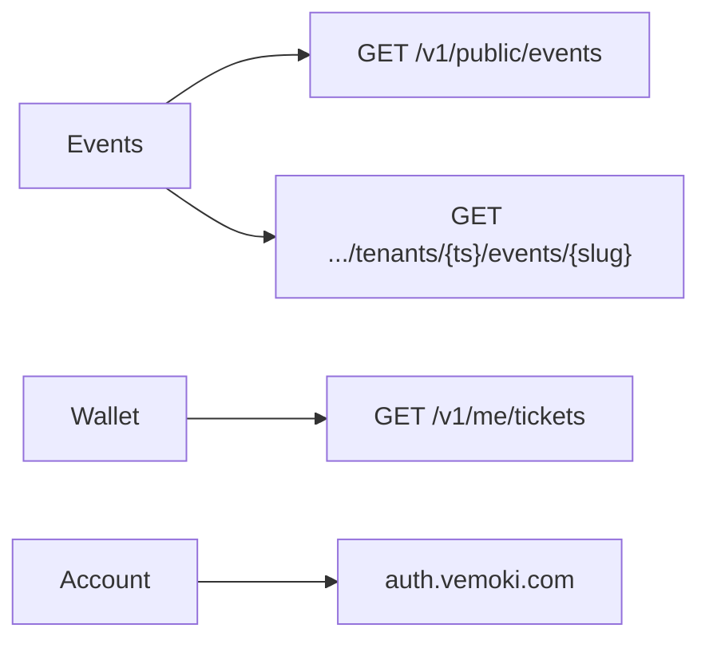

# Kiến trúc — Refactor trải nghiệm production (mobile)

> Handoff kiến trúc ngày 20/10/2026. Các phần “đề xuất” và bảng hiện trạng phản ánh thời điểm lập kế hoạch; catalog API, mobile catalog/Tài khoản và ví owner đã lần lượt merge qua PR #586, #587, #597. Đối chiếu implementation và trạng thái nghiệm thu trên PR/SHA, không suy từ bản thiết kế này.

| Trường | Giá trị |
| --- | --- |
| **Issue / Run** | [#580](https://github.com/hangndat/ticket-solution/issues/580) · `run_526c9a272efd` |
| **Role** | Architect ([`docs/agents/roles/architect.md`](../../../docs/agents/roles/architect.md)) |
| **Revision** | 2026-10-20 — follow-up coordinator freeze (`task_a1d832cc4ffc`) |
| **Base SHA** | `6ba435ebfaf810e2a15149761e16abd193368280` (`main`; mobile dirty — chỉ đọc) |
| **Authority** | [README](./README.md) · [O18](../../DECISION-LOG.md#o18--refactor-app-production-tài-khoản-thông-báo-catalog-toàn-platform-20102026) · [PRD](../../PRD.md) · [TECHNICAL-DESIGN](../../TECHNICAL-DESIGN.md) · [ADR-19](../../ops/ADR-19-EVENT-SERVER-SOURCE.md) |
| **Trạng thái** | **Đủ để triển khai trong scope O18** — contract catalog platform + aggregate wallet là **đề xuất kỹ thuật** (§4, §6); amendment ADR-19 do coordinator cấp ID |
| **Phân loại** | Design — không code / acceptance / pilot ready |

---

## 1. Phạm vi

- Ánh xạ **O18** (catalog toàn platform, API prod cố định, Tài khoản/thông báo) lên ADR-19 hiện tại và WIP mobile.
- **Non-goals:** code, migration prod, EAS/store, audit mở rộng.

---

## 2. Bảng quyết định

| Chủ đề | **Đã chốt (O18 / README)** | **Đề xuất kỹ thuật (implement)** |
| --- | --- | --- |
| Catalog | Sự kiện PUBLIC published **toàn platform**; không `EXPO_PUBLIC_TENANT_SLUG` | `GET /v1/public/events` — §4 (đáp O18, không hỏi lại product) |
| API / OIDC | Luôn `https://api.vemoki.com` + issuer prod; **mọi** build runtime; test chỉ inject transport | Getter **hằng số** — §5 |
| Wallet | Bỏ slug/tenant env; không MFest | **W1 bắt buộc:** aggregate owner `GET /v1/me/tickets` — §6 |
| RLS | Không lộ draft/private | Projection có điều kiện ADR-19; không bypass DB |
| Thông báo | Quyền đúng ngữ cảnh; không toggle giả | UX Tài khoản đơn giản — §7 |
| Single-code | Workstream riêng | §8 |

---

## 3. Hiện trạng (evidence)

| Vùng | Source |
| --- | --- |
| Per-tenant public API | [`apps/api/src/published-events.ts`](../../../apps/api/src/published-events.ts) |
| Projection SQL | [`packages/backend/src/published-events.ts`](../../../packages/backend/src/published-events.ts) |
| Mobile catalog + slug gap | [`apps/mobile/src/identity/catalog-context.ts`](../../../apps/mobile/src/identity/catalog-context.ts), [`apps/mobile/src/published/events-home.ts`](../../../apps/mobile/src/published/events-home.ts) |
| Config đọc env/extra | [`apps/mobile/src/identity/config.ts`](../../../apps/mobile/src/identity/config.ts), [`apps/mobile/app.config.ts`](../../../apps/mobile/app.config.ts) |
| Wallet bắt buộc `tenantId` | [`apps/api/src/tickets.ts`](../../../apps/api/src/tickets.ts) |
| Push device token | [`apps/mobile/src/push/apns-device-token.ts`](../../../apps/mobile/src/push/apns-device-token.ts) |

**Gap:** O18 yêu cầu catalog platform và API prod trên mọi build; code hiện tại vẫn tenant-scoped catalog và `pickPublic` env.

---

## 4. Catalog platform — contract đề xuất (thực hiện O18)

User đã chốt catalog công khai đa tenant. **Không** mở lại câu hỏi product. ADR-19 chỉ có `GET /v1/public/tenants/{tenantSlug}/events`; đề xuất **bổ sung** route platform sau (amendment ADR-19).

### 4.1 Khuyến nghị — `GET /v1/public/events`

- Trả `PublishedEventListResponse` (tái dùng [`packages/contracts/src/published-events.ts`](../../../packages/contracts/src/published-events.ts)).
- `listPlatformPublishedEvents` trong `withPlatformRole` ([`packages/backend/src/platform-context.ts`](../../../packages/backend/src/platform-context.ts)) — SQL cùng invariant ADR-19, join `tenants` ACTIVE.
- Pagination: `ORDER BY starts_at ASC NULLS LAST, tenant_id ASC, id ASC`; `nextCursor` opaque (document OpenAPI).
- Detail giữ `GET /v1/public/tenants/{tenantSlug}/events/{eventSlug}`.
- Mobile Events home → route mới; deep link per-tenant giữ.

### 4.2 Không chọn

- **Materialized directory** — phase 2 nếu cần perf.
- **Client fan-out slug** — vi phạm O18.

**Workstream:** `WS-BE-PUBLIC-PLATFORM-CATALOG` trước `WS-MOBILE-EVENTS-HOME`.

---

## 5. Runtime API/OIDC — hằng số prod (O18)

### 5.1 Invariant (mọi build: Debug, Simulator, Release, TestFlight)

| Getter runtime | Giá trị **luôn** trả về |
| --- | --- |
| `getApiBaseUrl()` | `https://api.vemoki.com` |
| `getOidcIssuer()` | `https://auth.vemoki.com/realms/ticket` |
| `getOidcClientId()` | `ticket-mobile` (hoặc hằng số bake đồng bộ `VEMOKI_PROD_PUBLIC`) |

- **Không** phụ thuộc `EXPO_PUBLIC_*`, `extra.ticketPublic`, `getApsEnvironment()`, `__DEV__`, hay chuyển host theo env.
- **Không** `return null` vì máy dev còn `localhost` trong file `.env` — env **deprecated** cho host resolution; **bỏ qua** khi resolve URL (tùy chọn: log diagnostic nội bộ / assert ở bước `expo prebuild` CI, không chặn runtime attendee).
- **Không** dynamic switching / fallback local / demo API trên đường app.

### 5.2 Test & network

- **Unit/integration:** inject `fetchImpl` và/hoặc wrapper client tại call site — **không** đổi getter để trỏ staging.
- **CI (mọi build target):** test `getApiBaseUrl()` / OIDC getters === hằng số prod kể cả khi `process.env.EXPO_PUBLIC_API_BASE_URL='http://127.0.0.1:3001'`.
- **UAT thật:** traffic tới `api.vemoki.com` (read-only catalog / auth flow theo AC planner).

### 5.3 Catalog / wallet env legacy

- `EXPO_PUBLIC_TENANT_SLUG`, `EXPO_PUBLIC_TENANT_ID`, `EXPO_PUBLIC_EVENT_ID` — **deprecated**; không dùng cho catalog hay wallet scope (§6).
- `aps-environment` vẫn chỉ ảnh hưởng **sandbox vs production APNs** khi POST device-token — **không** ảnh hưởng API origin.

---

## 6. Wallet — W1 aggregate owner (bắt buộc)

### 6.1 Vấn đề

`GET /v1/me/tickets?tenantId=` bắt buộc một UUID ([`tickets.ts`](../../../apps/api/src/tickets.ts)). `EXPO_PUBLIC_TENANT_ID` buộc một tenant/binary → user có vé từ **web hoặc thiết bị khác** sẽ **mất vé** trên app nếu chỉ dựa client.

### 6.2 Đề xuất W1 (scope riêng — không tùy chọn product)

**`WS-BE-ME-TICKETS-AGGREGATE`**

- `GET /v1/me/tickets` — `tenantId` **optional**.
  - Không có: trả **tất cả** `TicketSummary` của `owner_user_id` (identity reader / query parameterized; align TD §5.3).
  - Có: giữ hành vi hiện tại (compat web).
- Mobile: sau verified session, fetch aggregate một lần; group UI theo event/tenant; cache theo `userId` (+ tenant khi filter).
- **Cấm:** “silent tenant set” từ env, hardcode MFest, hoặc danh sách tenant client tự invent.

### 6.3 W2 — loại

Chỉ lưu `tenantId` local từ redeem trên **cùng** thiết bị **không** đáp O18 / cross-channel wallet — **không** dùng làm fallback.

### 6.4 Staff / redeem

- Staff scope: eligibility API + workspace store.
- Redeem/gate: `tenantId`/`eventId` từ API response (vé, resolve, event detail) — không env.

---

## 7. Thông báo — Tài khoản (UX, không jargon)

**Nguyên tắc O18:** trạng thái thật; không toggle giả; **không** hứa “đã nhận push” / delivery receipt trên UI.

**Một khối ngôn ngữ người dùng (PD copy), ví dụ:**

- *Chưa bật thông báo* — chưa xin hoặc undetermined; CTA xin quyền khi đúng moment (sau vé đầu tiên hoặc trong Tài khoản).
- *Đã bật trong Cài đặt* — OS granted.
- *Đã tắt trong Cài đặt* — OS denied; CTA mở Settings; **không** CTA “bật trong app” giả.

**Không** lộ trên UI: device token hex, POST `/v1/me/device-tokens`, sandbox vs production entitlement, epoch registration.

**Engineering (nội bộ):** đăng ký token server sau session verified; `clearApnsRegistrationState` trước logout — giữ như hiện tại.

**Cấm thiết kế product:** dùng silent/data push mặc định để **né** khi user denied alert — nếu denied, coi như user không muốn thông báo hiển thị; không bypass lựa chọn iOS.

**Moments:** không xin quyền cold start / tab Sự kiện.

---

## 8. Single-code redemption

Thiết kế: [single-code-redemption.md](../../architecture/single-code-redemption.md). Epic riêng; không migration trong #580. Mobile `redeem-draft-intent` nối contract khi BE sẵn sàng.

---

## 9. Luồng mục tiêu

Mọi origin REST: `api.vemoki.com`.

---

## 10. Handoff

| ID | Owner | Deliverable |
| --- | --- | --- |
| `WS-BE-PUBLIC-PLATFORM-CATALOG` | Backend | `GET /v1/public/events` + tests |
| `WS-BE-ME-TICKETS-AGGREGATE` | Backend | W1 optional `tenantId` + RLS review |
| `WS-MOBILE-RUNTIME-HOSTS` | iOS | Hằng số §5; deprecated env ignored |
| `WS-MOBILE-EVENTS-HOME` | iOS | Platform list + pagination |
| `WS-MOBILE-WALLET` | iOS | Aggregate fetch; bỏ `EXPO_PUBLIC_TENANT_ID` |
| `WS-SINGLE-CODE-REDEMPTION` | BE/web/iOS | Archive |
| `WS-PD-ACCOUNT-NOTIFICATIONS` | PD + iOS | §7 copy + moments |

---

## 11. AC kiểm tra (implementation)

| ID | Điều kiện |
| --- | --- |
| CAT-1 | `GET /v1/public/events` chỉ PUBLIC+PUBLISHED+ACTIVE; draft không xuất hiện |
| CAT-2 | ≥2 tenant public → list có cả hai `tenantSlug` |
| HOST-1 | Mọi build: getters API/OIDC = prod constants |
| HOST-2 | `.env` localhost **không** đổi getters; app vẫn gọi prod |
| WAL-1 | User có vé web + app login → wallet hiển thị cả hai (sau W1) |
| WAL-2 | Không `EXPO_PUBLIC_TENANT_ID` trong flow wallet |
| PUSH-1 | Tài khoản không hiển thị jargon/token/receipt |
| PUSH-2 | Denied → không thiết kế bypass silent push |

---

## 12. Kết luận

| | |
| --- | --- |
| **Verdict** | **Đủ để triển khai trong scope O18** sau amendment ADR-19 cho route platform |
| **Blocker** | Coordinator cấp ID ADR; BE W1 + platform catalog trước mobile wallet/catalog ship |
| **Không blocker** | PD Account UI; iOS audit song song |
