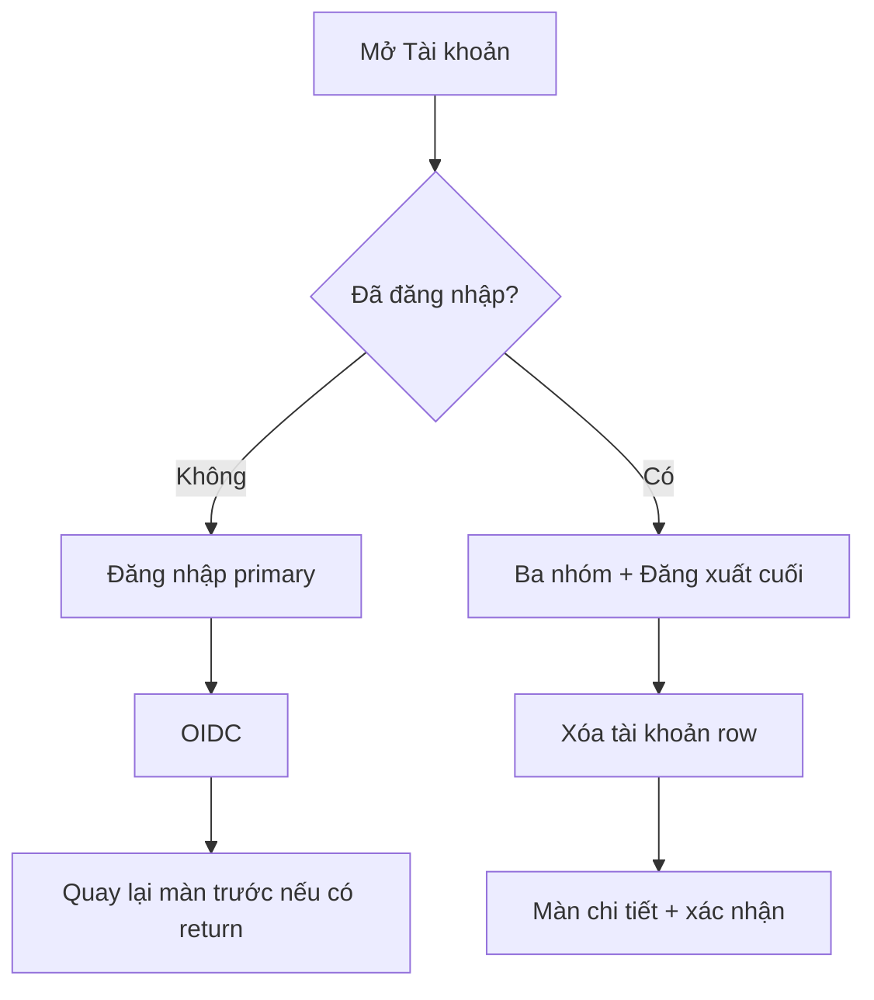
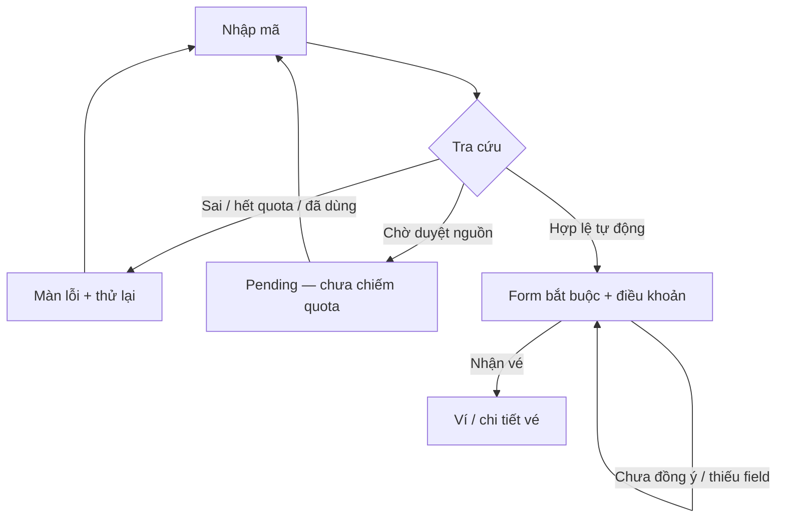
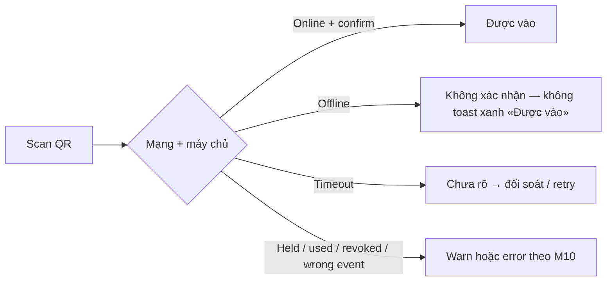

# PD handoff — Tài khoản (iOS production refactor)

**Issue:** [#580](https://github.com/hangndat/ticket-solution/issues/580) · **Run:** `run_526c9a272efd` · **Task:** `task_3645ab7ab7e0` (polish sau `task_fcd365de3ddb`)\
**Role:** `product-design` · **Persona:** Liv · **Cost tier:** standard · **Architecture impact:** Có (IA Account + luồng quyền thông báo)\
**Visual budget:** Có — [`brand/vemoki/tokens.json`](../../../brand/vemoki/tokens.json), [`docs/design/visual-identity-v2/visual-notes.md`](../../design/visual-identity-v2/visual-notes.md)\
**Prototype:** [`prototype.html`](./prototype.html) — **PREVIEW ONLY**, không API, không dữ liệu production\
**Authority:** [`README.md`](./README.md) (O18 / quyết định user 20/10/2026)

| Mốc | Trạng thái |
| --- | --- |
| Design / PD | **Done** — user duyệt mockup + roadmap 20/10/2026; coding iOS theo Wave 3 (T4) |
| Code iOS | **Chưa** |
| Acceptance | **Chưa** — **UAT trên iPhone thật** (README O18); unit copy-state bổ trợ, không thay thao tác đầy đủ |
| Pilot | **Chưa** |

### Quyết định sản phẩm (không chờ review thêm)

| Quyết định | Nội dung |
| --- | --- |
| API runtime | Mọi bản app production **luôn** gọi `https://api.vemoki.com`; **không** override host theo env / local / demo ở runtime (test inject transport — ngoài app). |
| IA Account (attendee) | **Ba nhóm chính:** **Bạn** · **Thông báo** · **Quyền riêng tư & dữ liệu** — grouped list iOS (large title + inset). |
| Đăng xuất | Nút **destructive** **cuối** màn (sau ba nhóm), không đặt giữa section Bạn như secondary thường. |
| Xóa tài khoản | **Không** panel dài inline; một **row** «Xóa tài khoản» → màn **chi tiết** (explainer + xác nhận) → gửi yêu cầu. |
| Copy user-facing | **Không** jargon: phiên, token, verified, cấu hình bản dựng, log kỹ thuật, disclaimer RBAC/staff trên flow khách. |
| Push UI | Trạng thái **quyền iOS thật**; không toggle giả; không hứa «đã gửi» / delivery receipt. |

**Ngoài scope:** catalog Sự kiện công khai, staff 3 tab, guest wallet, redeem auth gate, single-code redemption ([`archive/single-code-redemption.md`](./archive/single-code-redemption.md)).

---

## 0. Brand / visual budget (Account)

| Hạng mục | Chốt |
| --- | --- |
| Tokens | ink `#0B1220`, paper `#F4F6F8`, signal `#E11D48`, focus `#2563EB` |
| Type | Sora (title) · Be Vietnam Pro (body) |
| Chrome | Large title «Tài khoản»; **grouped inset** trên paper; không wordmark hero; không card cluster |
| Native look | Section header footnote/uppercase; row min height **44pt**; chevron trên row điều hướng |
| Anti-patterns | UISwitch giả quyền; nút «Bật thông báo» khi provider tắt; email thật trong mock; hai modal liên tiếp trước system prompt trên Account |
| Freeze | Thiếu token/pattern → escalate; không invent palette |

---

## 1. Cấu trúc màn — ba nhóm + đăng xuất

```text
Large title: Tài khoản

[Bạn]
  Guest: trạng thái + primary «Đăng nhập» (trong group hoặc ngay dưới group)
  Verified: email (từ /v1/me) — không dòng «email đã xác minh»
  Offline cache: một dòng giải thích + «Xóa dữ liệu xem offline» (destructive text row, không nhầm đăng xuất)

[Thông báo]  — ẩn cả section nếu push provider ≠ apns (prod bake apns)
  Row trạng thái read-only + một hành động hợp lệ (§4)
  Không Notice dài; không hứa tin đã gửi

[Quyền riêng tư & dữ liệu]
  Chính sách quyền riêng tư → màn WebView trong app (không mở browser)
  Xóa tài khoản (verified) → push màn chi tiết + confirm

── cuối scroll ──
[Đăng xuất]  destructive full-width (verified hoặc offline-clear path)

Staff workspace (ngoài ba nhóm hoặc row cuối trước đăng xuất):
  «Quay lại quét» → staff-scan — không đổi 3 tab cổng
```

**Loại bỏ khỏi Account:** «Làm mới hồ sơ», «Đổi mã lấy vé», footnote quyền nhân viên/RBAC, mọi copy «Phiên» / «xác minh trên máy chủ».

**Phương án B (hero + card «Phiên»):** **Không** dùng — giữ **grouped Settings-style** (phương án A trước đó).

---

## 2. User flow (rút gọn — không nhánh kỹ thuật)



**Thông báo — hai điểm vào (không trùng modal):**

| Điểm vào | Hành vi |
| --- | --- |
| **Tài khoản** — tap «Bật thông báo» | Nếu `notDetermined` → **gọi thẳng** system permission (không màn primer «Tiếp tục» chen giữa). Nếu `denied` → **Mở Cài đặt**. Nếu `authorized` → đăng ký thiết bị (POST) + copy trạng thái lưu máy chủ. |
| **Vé** — sau **vé đầu tiên** vào ví | **Card ngữ cảnh** (không chặn): giải thích ngắn + «Bật thông báo» + **«Để sau»** (dismiss; không hỏi lại mỗi lần mở ví trong cùng cài đặt nếu đã dismiss). Tap Bật → cùng luồng permission như trên. |

**Không làm:** prompt lúc cold launch; prompt ngay sau login; card notification **không** bắt buộc theo mẫu pre-alert **protected data** (camera/location) một nút «Tiếp tục» bắt buộc — card ví là **gợi ý có thể bỏ qua**, có dismiss.

**Đăng nhập OIDC:** chỉ primary trên **Bạn**; Sự kiện/Redeem/Claim dùng `goToAccountForSignIn` (không OIDC tại đó).

---

## 3. Thông báo — Apple + trạng thái kết hợp

| Nguồn | Áp dụng |
| --- | --- |
| [Asking permission](https://developer.apple.com/documentation/usernotifications/asking-permission-to-use-notifications) | Xin trong ngữ cảnh có giá trị; không launch; prompt explicit **một lần** |
| [Managing notifications](https://developer.apple.com/design/human-interface-guidelines/managing-notifications) | `denied` → Settings; không spam request |
| [Privacy (pre-alert)](https://developer.apple.com/design/human-interface-guidelines/privacy) | **Không** copy máy móc cho card ví — card có dismiss; Account opt-in **không** thêm primer modal |

**Provisional (phase 2):** Nếu sau này dùng provisional — copy phải nói rõ: thông báo **im lặng** trong Notification Center, **không** banner/âm thanh cho đến khi người dùng giữ hoặc bật trong Cài đặt; **không** gợi ý đã «bật đầy đủ» như alert.

### Ma trận UI (provider × OS × backend)

| Điều kiện | Section Thông báo | Hành động | Copy gợi ý |
| --- | --- | --- | --- |
| Provider **OFF** | **Ẩn** hoặc một dòng «Chưa hỗ trợ thông báo trên phiên bản này» | **Không** nút «Bật» | Không fake opt-in |
| Guest | Hiện section | Không bật | «Đăng nhập để bật nhắc vé và sự kiện» |
| `notDetermined` + verified | Row + «Bật thông báo» | → system prompt | Sau allow: «Đang lưu thiết bị…» |
| `authorized` + POST ok | Row «Đã bật trên iPhone» | (optional) «Thử lưu lại» nếu cần | Không nói «tin sẽ tới» |
| `authorized` + POST **fail** | Row «Đã bật trên iPhone» | «Thử lại» | **Không** viết «chưa bật quyền» — quyền OS đã có |
| `denied` | Row «Đã tắt trên iPhone» | **Mở Cài đặt** | Không gọi lại `requestPermissions` |
| `provisional` | Row giải thích quiet (nếu ship) | Mở Cài đặt để bật đầy đủ | Theo § provisional |

Implementer: đọc `getPermissionsAsync` cho UI; `registerApnsDeviceToken` cho POST — **tách** trong copy và state machine.

---

## 4. Ma trận trạng thái — Tài khoản

| State | Bạn | Thông báo | Quyền riêng tư | Cuối màn |
| --- | --- | --- | --- | --- |
| guest | Đăng nhập primary | Như §3 | Chỉ privacy link | — |
| guest-offline | Đăng nhập + xóa cache row | Như guest | Privacy link | — |
| verified | Email | §3 | Privacy + row Xóa tài khoản | **Đăng xuất** destructive |
| busy | Disabled + «Đang xử lý…» | Disabled | Disabled | Disabled |
| me-error | Email nếu có | Giữ | Privacy; ẩn xóa đến khi ổn | Đăng xuất vẫn có nếu đã đăng nhập |

**Xóa tài khoản — màn chi tiết (push):** tiêu đề «Xóa tài khoản»; body ngắn (yêu cầu ghi nhận trên máy chủ; đăng xuất là việc riêng); field xác nhận (checkbox hoặc «Gửi yêu cầu» destructive sau một bước); không paste panel hiện tại inline.

---

## 5. Copy chốt (VI)

| Vị trí | Text |
| --- | --- |
| Bạn — guest | «Chưa đăng nhập» / «Đăng nhập để xem vé trên thiết bị này.» |
| Bạn — verified | `{email}` / «Tài khoản đang dùng trên máy.» |
| Thông báo — opt-in row | «Bật thông báo» |
| Thông báo — denied | «Đã tắt trên iPhone» + «Mở Cài đặt» |
| Thông báo — server fail | «Đã bật trên iPhone. Chưa lưu thiết bị — thử lại.» |
| Card ví (vé đầu) | «Nhận nhắc về vé và sự kiện?» + Bật + **Để sau** |
| Privacy row | «Chính sách quyền riêng tư» |
| Xóa row | «Xóa tài khoản» › |
| Cuối màn | «Đăng xuất» (destructive) |

---

## 6. Accessibility

| Hạng mục | Yêu cầu |
| --- | --- |
| Hit target | Row và nút ≥ **44×44 pt** |
| VoiceOver | Thứ tự: title → 3 section headers → rows; «Đăng xuất, nút, hành động nguy hiểm» |
| Focus / contrast | AA ink/paper; destructive đủ contrast |
| Live region | Lỗi đăng nhập `assertive`; loading `polite` |
| Thủ công (UAT iPhone) | Mở Cài đặt từ denied; dismiss card ví; Dynamic Type không cắt header |

---

## 7. Tiêu chí nghiệm thu (UI)

Không claim UAT đã chạy. Bằng chứng acceptance: **phiên UAT trên iPhone thật** theo README O18.

| ID | Given | When | Then |
| --- | --- | --- | --- |
| AC-A1 | Guest | Mở Tài khoản | Ba nhóm; một primary Đăng nhập; không jargon; không disclaimer staff |
| AC-A2 | Verified | Scroll | Xóa tài khoản là **row** → màn confirm; **không** panel dài trên root |
| AC-A3 | Verified | Cuối màn | **Đăng xuất** destructive sau ba nhóm |
| AC-A4 | Verified, notDetermined | Tap Bật trên Account | **System prompt ngay** — không modal app «Tiếp tục» trước |
| AC-A5 | denied | Section Thông báo | Mở Cài đặt; không nút Bật vô hiệu |
| AC-A6 | Provider off | Mở Account | Không nút Bật giả |
| AC-A7 | OS authorized, POST fail | UI | Copy **không** nói quyền bị tắt |
| AC-A8 | Vé đầu tiên | Card hiện | Có **Để sau**; dismiss không hiện lại phiên đó (policy lưu local) |
| AC-A9 | a11y | VoiceOver | Section + hit targets |

---

## 8. Triển khai (iOS — sau review)

| Vùng | Việc |
| --- | --- |
| `account.tsx` | 3 section + logout cuối; push row; navigate delete detail |
| `push/*` | State machine §3; provider off → no CTA |
| `screen-state-copy.ts` | `accountCopy` tập trung; test cấm jargon |
| Wallet | Card dismiss + first-ticket trigger |

**Không** đổi API host / catalog trong task Account.

---

## O22 — Đổi mã (redeem) & Cổng (gate) · Issue [#859](https://github.com/hangndat/ticket-solution/issues/859)

**Run:** `run_2c9e147d89e6` · **Task:** MR-IOS · **Prototype:** [`full-prototype.html`](./full-prototype.html) (HTML/iOS shell, không kết luận app native)\
**PRD:** M07 (redemption/duyệt) · M10 (gate/check-in) · **Quyết định:** O22 D-3/D-4/D-5 · light-only chrome (D-4); staff **3 tab** giữ (D-6 gate mobile-only).

### Luồng đổi mã (attendee)



**Không** nhảy thẳng từ tra cứu vào ví (MR-04). Một form mã (single-code); không chọn sự kiện thủ công.

### Ma trận trạng thái — redeem (mock preset)

| State | Khi nào | UI / copy gợi ý | Preset mã (minh họa) |
| --- | --- | --- | --- |
| `redeem` | Đã đăng nhập, chưa tra cứu | Ô mã + «Tìm vé» | — |
| `redeem-confirm` | Tra cứu OK, chưa submit | MFest summary + họ tên + SĐT + checkbox điều khoản; «Nhận vé» disabled đến khi hợp lệ | `DEMO-OK` |
| `redeem-pending` | Nguồn chờ duyệt (M07) | «Đang chờ duyệt» — không hứa vé; chưa chiếm quota | `PENDING-01` |
| `redeem-denied` | Sai mã | «Không tìm thấy mã» + thử lại | `BAD-CODE` |
| `redeem-denied` | Hết quota | «Hết suất cho mã này» | `QUOTA-FULL` |
| `redeem-denied` | Mã đã dùng | «Mã đã được sử dụng» | `USED-01` |
| `redeem-success` | Submit thành công | Ring ✓ → mở ví lọc sự kiện | Sau confirm |

### Luồng cổng (staff · Scan tab)



ADR-18 / D7: **không** cấm mọi thao tác offline; phân biệt local/provisional vs server-confirmed. Mock: toggle **○ Online / ● Offline** trên màn Scan; khi offline, preset «Hợp lệ» → toast **error** «Không xác nhận khi offline».

### Ma trận trạng thái — gate scan (mock preset)

| Kết quả | Toast | Lớp | Ghi chú |
| --- | --- | --- | --- |
| Hợp lệ (online) | Được vào | success | Có nhãn xác nhận máy chủ |
| Hợp lệ (offline) | Không xác nhận khi offline | error | M10 — không success giả |
| Đã sử dụng | Vé đã được sử dụng | warn | |
| Đang giữ | Vé đang được giữ | warn | M10 held |
| Thu hồi | Vé đã thu hồi | error | |
| Sai sự kiện | Sai sự kiện | error | |
| Chưa rõ | Chưa rõ kết quả | warn | Trước retry |
| Đối soát (online) | Đã đối soát | success | Sau timeout · **xác nhận máy chủ** |
| Đối soát (offline) | Đối soát cục bộ | warn (provisional) | D7 — lưu máy · **chờ đồng bộ**; không toast success «Đã đối soát» |

### Evidence UI (MR-IOS)

| Artifact | Viewport | Preset |
| --- | --- | --- |
| `MR-IOS-attendee-redeem-terms-390.png` | 390×phone frame | `user` · `redeem-confirm` · checkbox + form |
| `MR-IOS-attendee-redeem-pending-390.png` | 390 | `redeem-pending` · `PENDING-01` |
| `MR-IOS-staff-gate-offline-390.png` | phone clip @ DPR 2 | `staff` · `scan` · offline + `result(ok)` toast từ chối |
| `MR-IOS-staff-gate-offline-recover-390.png` | phone clip @ DPR 2 | offline + `result(recover)` · toast **cục bộ/chờ sync** |
| `MR-IOS-fullviewport-390x844.png` | **innerWidth 390** full window | `staff` · `scan` · R-07 responsive proof (không thay phone clip) |

Server tĩnh (coordinator): `http://127.0.0.1:57277/plans/mobile-production-refactor/full-prototype.html` — **không** claim UAT device thật.

### AC map (task MR-IOS)

| AC | Đáp ứng |
| --- | --- |
| AC-1 | Form + terms trước «Nhận vé» |
| AC-2 | Pending + denied/error + quota stub |
| AC-3 | Gate warn/valid; offline không success giả |
| AC-4 | `:root{color-scheme:light}` — không dark mock |
| AC-5 | Section O22 này (flow + bảng) |
| AC-6 | PNG 390 attendee + staff (evidence dir) |

---

## 9. Tham chiếu

- [`README.md`](./README.md) · [`prototype.html`](./prototype.html)\
- Guest CTA: [`archive/PD-GUEST-FLOW-HANDOFF.md`](./archive/PD-GUEST-FLOW-HANDOFF.md) (lịch sử; slug catalog superseded)\
- Visual: [`docs/design/visual-identity-v2/`](../../design/visual-identity-v2/)

---

*PD handoff — Liv · Issue #580 · polish `task_3645ab7ab7e0`.*

## Bổ sung review: lịch sử, camera và chính sách

- Quyết định user: chính sách/quyền riêng tư đọc trong WebView của app, giữ native header/quay lại; có loading, lỗi và thử lại. Dùng tài liệu chính thức, không đưa nội dung minh họa thành chính sách thật. Không tự chuyển ra trình duyệt. Chỉ cho phép URL HTTPS tin cậy; không truyền token tài khoản vào trang chính sách.
- Lịch sử hiện tại chưa paging: StaffHistoryScreen dùng ScrollView, panel map toàn bộ rows; staff-gate-device-history.ts giới hạn MAX_ROWS=12. Đây là lịch sử thiết bị, không phải audit toàn hệ thống. Mockup mới có Tải thêm, loading, retry, hết dữ liệu. Cần mở rộng lưu trữ/đọc theo cursor trước khi app có thể hiển thị quá 12 lượt; không chỉ phân trang 12 rows rồi tuyên bố đầy đủ. Lịch sử toàn hệ thống cần contract/scope riêng.
- Camera: đề xuất vạch mảnh lên/xuống trong khung, mỗi chiều khoảng 1.9 giây, không nhấp nháy hoặc phủ tối QR. Đây là tín hiệu camera sẵn sàng, không phải tiến độ giải mã. Dừng khi mất focus/background, chưa có quyền, đang xử lý hoặc đang hiện kết quả; resume khi sẵn sàng. Reduce Motion dùng khung tĩnh, không bắt buộc animation để hiểu trạng thái. Native implementation dùng transform trên UI thread, không setState mỗi frame.
- Mockup: ép light color-scheme trong khung thiết kế, đặt rõ màu foreground cho button/input/placeholder; đã kiểm tra browser render 36 tổ hợp vai trò/màn và compile các onclick, kiểm tra màu nút và scan animation, xem screenshot camera. Chưa phải UAT app native.
- Nguồn: [Apple Motion](https://developer.apple.com/design/human-interface-guidelines/motion), [Expo WebView](https://docs.expo.dev/versions/latest/sdk/webview/), [WebView Guide](https://github.com/react-native-webview/react-native-webview/blob/master/docs/Guide.md). Thông số 1.9 giây là đề xuất thiết kế, không phải yêu cầu Apple.

## Đề xuất: vé của người dùng trong Sự kiện

- Danh sách: người đã đăng nhập có vé thấy dòng «Bạn có N vé · Xem vé» dưới thông tin sự kiện. Bấm dòng này mở tab Vé của tôi với eventId lọc sẵn; bấm phần còn lại mở chi tiết sự kiện. Không dùng cả thẻ làm nút nested trong native implementation: tách hai vùng tương tác có nhãn accessibility riêng.
- Chi tiết: cùng dòng thông tin/nút Xem vé trước khu vực đổi mã. Không thay thế CTA đổi mã vì người dùng vẫn có thể nhận thêm vé.
- Ví: hiển thị bộ lọc tên sự kiện, có «Xem tất cả» để bỏ lọc. Đi qua tab Vé của tôi trực tiếp hiển thị toàn bộ. Dùng ID ổn định, không lọc bằng tên hoặc tenant env.
- Số đếm: tổng vé thuộc người dùng còn trong ví theo eventId, trạng thái dùng/chưa dùng trình bày ở vé; không gọi là số người được vào. Nếu cần số vé còn dùng được, phải có nhãn riêng. Loại vé đã thu hồi/xóa theo contract ví. Không đếm số row của trang ví đang tải.
- Chưa tải/không lấy được số đếm: skeleton ngắn hoặc bỏ dòng; không giả 0. Guest hoặc 0 vé: không thêm CTA đăng nhập ở từng card. Không làm lỗi dữ liệu cá nhân chặn public catalog. Backend phải cung cấp tổng hợp chính xác theo chủ sở hữu, cache tách user và invalidate sau nhận vé/đăng xuất.
- Mockup v3 đã kiểm tra browser: card MFest mở ví lọc MFest với hai vé, chi tiết có count, guest không có dòng count. Dữ liệu này là minh họa, chưa tích hợp backend.
