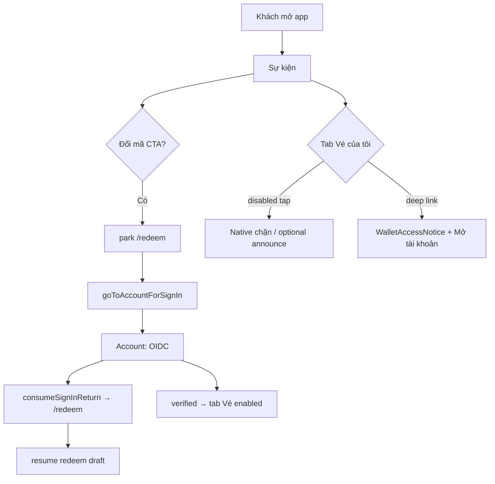

# PD handoff — Guest / production attendee UX (iOS)

**Task:** `task_471e15d67e7d` · **Role:** `product-design`\
**Nguồn authority:** yêu cầu user (coordinator) — **không** đổi «disabled» thành «hide».\
**Phạm vi khảo sát:** working tree live `apps/mobile` (chưa commit), không giả định `main` đã merge.\
**Visual budget:** Không — dùng token/native hiện hành (`brand/`, `AttendeeCta`, `Notice`, `screen-state-copy`).\
**Architecture impact:** Không (chỉ IA/UX/copy/gate).\
**Trạng thái artifact:** **code review trên WT** — chưa UAT, chưa acceptance complete.

---

## 1. Tóm tắt điều hành

| Chủ đề | Hiện trạng WT | Hướng chốt (user + BA) |
|--------|----------------|-------------------------|
| Tab **Vé của tôi** (khách) | **Ẩn** khi chưa có wallet (`hidden={!myTicketsTab}`) | **Hiện**, **disabled** khi anonymous; nội dung giải thích + một đường tới Tài khoản (không CTA đăng nhập thứ hai trên màn ví) |
| **Đổi mã lấy vé** (khách) | Mở `/redeem`, park return/draft; **không** kích OIDC; copy «đăng nhập ở Tài khoản» | **Context action:** kích đăng nhập (OIDC chỉ từ luồng Account) rồi **quay lại** `/redeem` (hoặc claim) — không trang chết |
| **Đăng nhập** standalone | Chỉ nút «Đăng nhập» trên tab/màn **Tài khoản** | Giữ; redeem/claim dùng `goToAccountForSignIn` + `parkSignInReturn` (helper đã có, **chưa gọi**) |
| **Sự kiện — «Chưa sẵn sàng tải sự kiện»** | Guard config: thiếu `EXPO_PUBLIC_API_BASE_URL` **hoặc** `EXPO_PUBLIC_TENANT_SLUG` | PD **không** đổi copy; iOS/ops: đảm bảo slug bake đúng build prod (xem §5) |
| **Đổi tổ chức demo** | Không còn control UI «Đổi tổ chức» trên attendee shell WT | **Không** thêm lại; fixture/demo route giữ dev-only (`showDemoEventCatalog`) |
| **Staff** | 3 tab Nhập tay \| Scan \| Lịch sử + event picker header khi >1 sự kiện | **Giữ** — đã khớp MVP |

---

## 2. Ma trận hành vi (attendee)

Ghi chú session: **verified** = `session.status === 'verified'` (đã `/v1/me`); **offline bound** = `offlineDisplay.status === 'bound'` (cache vé, không thay OIDC).

| Trạng thái | Tab bar | Vé của tôi (nội dung) | Sự kiện | Đổi mã `/redeem` | Nhận mời `/claim` | Tài khoản |
|------------|---------|------------------------|---------|------------------|-------------------|-----------|
| **Anonymous** (signed-out, không offline) | WT: tab Vé **ẩn** → **mục tiêu:** tab **hiện, disabled** | WT: redirect về Sự kiện **hoặc** `WalletAccessNotice` (không vé) → **mục tiêu:** cho vào stack, notice + hướng «Mở Tài khoản» (`goToAccount`, không OIDC tại đây) | List nếu config OK; CTA «Đổi mã» → `/redeem` | Form một phần; submit disabled; park `/redeem` + draft → **mục tiêu:** CTA ngữ cảnh (Sự kiện / primary trên redeem) → `goToAccountForSignIn('/redeem')` | Park `/claim` + guest intent; notice «Cần đăng nhập» → **mục tiêu:** CTA «Tiếp tục» → `goToAccountForSignIn('/claim')` | «Đăng nhập» (OIDC) |
| **Verified** | Tab Vé **bật** | Fetch/cache vé; refresh; empty → CTA «Đổi mã» | CTA redeem; branding từ event đầu list | Submit API; resume draft sau login | Submit claim; resume intent | Hồ sơ, đăng xuất, redeem secondary |
| **Offline bound** (chưa verified) | WT: tab Vé **hiện** (có `hasWalletAccess`) | Cache read-only; banner offline | Như anonymous cho redeem | Cần mạng + verified để submit | Cần verified | «Đăng xuất (xoá hiển thị offline)» |
| **Logout** | Về anonymous; staff → redirect Sự kiện nếu đang workspace | Clear cache/intent (`wallet-logout.ts`) | — | Clear redeem draft + sign-in return | Clear claim intent | End Keycloak session |
| **Revoked / unauthorized vé** | Tab như verified | `decideTicketSyncApply` → unauthorized: message + `logoutAndClearWalletArtifacts` — **không** dùng cache | — | — | — | User đăng nhập lại từ Tài khoản |

**Vé revoked trên UI:** copy qua `presentTicketRow` / `ticketGateHint` (`attendee-outcome-copy.ts`) — trạng thái deny tại cổng, không đổi trong task này.

---

## 3. NativeTabs `disabled` (Expo Router 58.0.21 / SDK 58)

**Kết luận:** API **hỗ trợ** `disabled` trên `NativeTabs.Trigger` — **không** cần hide tab cho khách.

| Nguồn | Chi tiết |
|-------|----------|
| `expo-router@58.0.21` `build/native-tabs/types.d.ts` | `disabled?: boolean` — tab **hiện** nhưng không chọn bằng tap; khác `hidden` |
| `NativeBottomTabsNavigator.js` | Tap tab disabled → `tabPress` với `isPrevented: true`, **không** navigate |
| **Giới hạn (documented)** | `router.push('/(tabs)/my-tickets')` / `<Link />` **vẫn** vào route — cần guard ở `my-tickets/index.tsx` + deep link |

**A11y gợi ý (iOS):**

- `NativeTabs.Trigger` `accessibilityLabel`: ví dụ «Vé của tôi, cần đăng nhập» khi `disabled`.
- `screenListeners.tabPress`: nếu `e.data?.isPrevented`, announce ngắn (VoiceOver) — optional, chỉ khi tap bị chặn.
- Màn `WalletAccessNotice`: giữ `accessibilityRole`/header; một nút secondary «Mở tài khoản» (`goToAccount`) — **không** thêm nút «Đăng nhập» trên màn ví (user: login standalone chỉ Tài khoản).

---

## 4. File map — hiện trạng vs thay đổi iOS

| File | Hiện trạng WT | Việc implementer |
|------|----------------|-------------------|
| `src/app/(tabs)/_layout.tsx` | `my-tickets` `hidden={!myTicketsTab}`; staff 3 tab OK | Tách **visibility attendee** vs **wallet access**: tab luôn visible (attendee, non-staff); `disabled={!hasWalletAccess}`; **không** `hidden` cho guest |
| `src/navigation/attendee-wallet-access.ts` | Comment «hidden, not faux-disabled»; `showMyTicketsTab` = access | Thêm `showMyTicketsTabForAttendee` (chỉ `showAttendeeTabs`) tách `hasWalletAccess`; cập nhật test |
| `src/navigation/attendee-wallet-access.test.ts` | Expect guest tab hidden | Expect guest tab **visible** policy (disabled ở layout, không assert hide) |
| `src/app/(tabs)/my-tickets/index.tsx` | `!canAccess` → `Redirect` events | **Bỏ redirect**; render `MyTicketsScreen` / notice guest |
| `src/screens/my-tickets.tsx` | `WalletAccessNotice` khi `!canAccess` | Giữ; có thể bổ sung `goToAccount()` một CTA (secondary), không OIDC |
| `src/screens/events.tsx` | `router.push('/redeem')` | Anonymous: `parkSignInReturn` + `goToAccountForSignIn('/redeem')` **hoặc** push redeem với primary CTA đăng nhập — **không** chỉ notice |
| `src/screens/redeem.tsx` | `needsAuth` notice; không CTA login | Primary «Đăng nhập để tiếp tục» → `goToAccountForSignIn('/redeem')` khi `!verified` |
| `src/screens/claim.tsx` | Notice `redeemCopy.authRequiredBody` | CTA «Đăng nhập để nhận vé» → `goToAccountForSignIn('/claim')` |
| `src/navigation/go-to-account-sign-in.ts` | **Không được gọi** | Wire từ events/redeem/claim |
| `src/screens/account.tsx` | `consumeSignInReturn()` sau OIDC | Đã OK cho `/redeem`, `/claim`, wallet paths |
| `src/components/wallet-access-notice.tsx` | «Đăng nhập trong tab Tài khoản» | Copy OK; thêm `AttendeeCta` «Mở tài khoản» nếu chưa có |
| `src/components/screen-state-copy.ts` | `eventsCopy.misconfigured*` | **Không đổi** (PD) |

**Staff (không đổi IA):** `staff-gate-screen-chrome.tsx` — title sự kiện + menu đổi sự kiện khi `gateEventChoices.length > 1`; tabs `staff-manual` \| `staff-scan` \| `staff-history`.

**Demo / debug:** Không surface «Đổi tổ chức» trên production attendee. `getTenantSlug()` / catalog single-tenant; `showDemoEventCatalog()` chỉ non-production.

---

## 5. Sự kiện — truy vết «Chưa sẵn sàng tải sự kiện»

**Copy (giữ nguyên):** `eventsCopy.misconfiguredTitle` / `misconfiguredBody` trong `screen-state-copy.ts`.

**Điều kiện kích hoạt (fail-closed, không phải lỗi API):**

1. `EventsScreen` khởi tạo phase: `initialPublishedListPhase(Boolean(getApiBaseUrl() && catalogTenantSlug))` — `screens/events.tsx`.
2. `catalogTenantSlug = getTenantSlug()` — chỉ `process.env.EXPO_PUBLIC_TENANT_SLUG` (`identity/config.ts`); **không** đọc `extra.ticketPublic` (khác `tenantId` UUID).
3. Effect fetch: nếu `!getApiBaseUrl() || !catalogTenantSlug` → `publishedPhase = 'misconfigured'`, `publishedError = eventsCopy.misconfiguredBody`.

**Ý nghĩa prod:** Build có API/OIDC bake (`app.config.ts` prod) nhưng **thiếu slug** → user thấy misconfigured **dù API sống**. BA/ops: chốt slug tenant catalog cho app production (env bake) — **ngoài scope PD đổi copy**.

**Phân biệt:** `phase === 'error'` + retry = lỗi mạng/API; `empty` = API OK, list rỗng.

---

## 6. User flow (rút gọn)

**Claim deep link:** tương tự với `/claim` + `guestClaimIntent`.

---

## 7. Tiêu chí nghiệm thu (UI) — iOS

Không claim UAT đã chạy; AC quan sát được cho `scripts/sim-uat.sh` / manual sau implement.

| ID | Given | When | Then |
|----|-------|------|------|
| AC-G1 | Attendee anonymous, OIDC configured | Mở tab bar | Thấy **Vé của tôi** (icon + label); tab **disabled**; Sự kiện + Tài khoản usable |
| AC-G2 | AC-G1 | Tap tab Vé (native) | Không chuyển stack / hoặc vẫn guest notice; không crash; a11y label phản ánh «cần đăng nhập» |
| AC-G3 | Anonymous | Tap «Đổi mã lấy vé» trên Sự kiện | OIDC flow qua Tài khoản; sau success **ở lại** redeem với draft (nếu đã nhập) |
| AC-G4 | Anonymous trên `/redeem` | Tap CTA đăng nhập ngữ cảnh | Cùng AC-G3; không màn chỉ có notice không CTA |
| AC-G5 | Anonymous `/claim` hợp lệ | Tap CTA đăng nhập | Quay claim sau login; intent không mất |
| AC-G6 | Verified, 0 vé | Vé của tôi | Empty + «Đổi mã» secondary |
| AC-G7 | Logout từ Tài khoản | — | Tab Vé disabled lại; redeem/claim intent cleared (`wallet-logout.ts`) |
| AC-G8 | Staff eligible | — | 3 tab cổng; không attendee tabs; event menu khi >1 event |
| AC-G9 | Build thiếu tenant slug | Mở Sự kiện | Title/body **misconfigured** như copy hiện tại (không đổi text) |

---

## 8. Handoff implementer iOS

**Thứ tự đề xuất**

1. Refactor `attendee-wallet-access` + tests (visibility vs access).
2. `_layout.tsx` `disabled` + a11y labels.
3. Bỏ redirect `my-tickets/index`; polish `WalletAccessNotice` (1 CTA «Mở tài khoản»).
4. Wire `goToAccountForSignIn` (events, redeem, claim).
5. Regression navigation tests (`navigation/*.test.ts` nếu có).

**Không làm (MVP / user)**

- Hide tab Vé cho khách.
- Nút «Đăng nhập» primary trên màn Vé (chỉ Tài khoản chạy OIDC).
- Thêm «Đổi tổ chức» demo trên attendee.
- Đổi copy misconfigured events.

**Phụ thuộc BA / ops**

- `EXPO_PUBLIC_TENANT_SLUG` (và nếu cần `EXPO_PUBLIC_TENANT_ID` cho wallet) cho bản production — để Sự kiện + ví không fail-closed config.

**Kiểm thử tự động**

- Cập nhật `attendee-wallet-access.test.ts`.
- Optional: unit cho tab policy (pure functions).

---

## 9. Code complete vs acceptance complete

| Mốc | Trạng thái |
|-----|------------|
| PD handoff (artifact này) | **Done** trên WT review |
| iOS thay đổi theo §4–§8 | **Chưa** — WT lệch user authority (hide tab, redirect, redeem không trigger login) |
| CI / sim-uat AC-G1–G9 | **Chưa** |
| Pilot / production attendee | **Chưa** — cần config slug + UAT |

---

## 10. Tham chiếu docs sản phẩm

- `docs/PRD.md` — Attendee ví vé, OIDC, không mock auth production.
- `docs/ROADMAP.md` — D11 UX production (baseline D0–D10).
- `AGENTS.md` — iOS local build; không EAS cloud.

**Giao tiếp BA:** xác nhận single-tenant slug bake vs catalog đa tenant trên app một org — ảnh hưởng §5, không đổi copy misconfigured.
