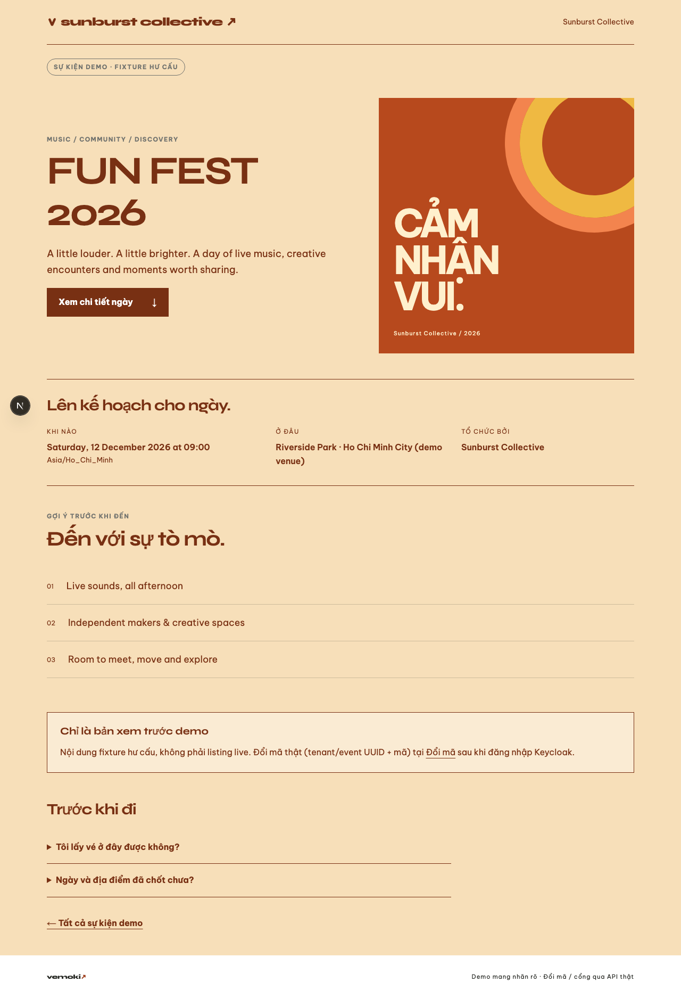
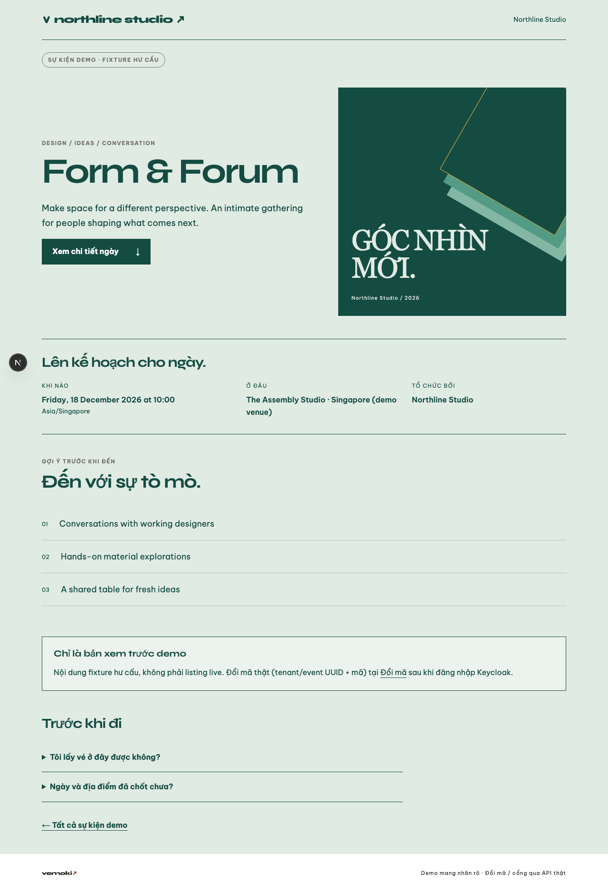
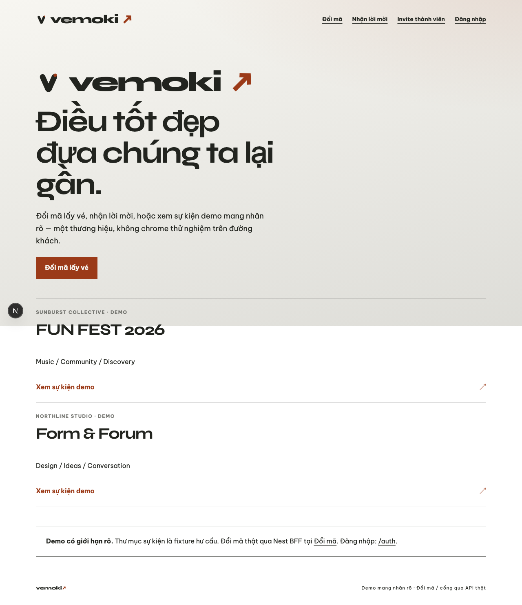
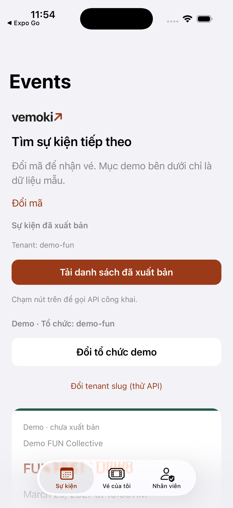

# D8-S4-T1 — UAT headless multi-tenant branding

**Issue:** [#131](https://github.com/hangndat/ticket-solution/issues/131) · Story [#130](https://github.com/hangndat/ticket-solution/issues/130) · Epic [#119](https://github.com/hangndat/ticket-solution/issues/119)  
**Ownership:** web (+ sim-uat iOS) · **không** EAS Cloud Build · **không** computer-use / cliclick trên Chrome/Safari/Simulator  
**Branch:** `hangndat/d8-s4-t1-uat-branding`  
**Base (origin/main lúc chạy):** `361deddeea7a83e628ece69d9ed6307d08fc7468`  
**Evidence tip SHA:** ghi trên Issue #131 / PR sau commit (self-referential pin tránh ở đây).

## Fixture ≥2 tenant (brand khác nhau)

| Nền | Tenant A | Tenant B | Brand markers |
| --- | --- | --- | --- |
| Web demo event | `sunburst` / `fun-fest-2026` | `northline` / `form-forum-2026` | `#783013` Sunburst Collective vs `#154c42` Northline Studio |
| Web platform | Vemoki default | — | wordmark `vemoki`, title `Vemoki` |
| iOS demo catalog | `demo-fun` · Demo FUN Collective | `demo-studio` · Demo Studio Organization | card `primaryColor` `#245B47` vs `#59428A`; label `Tổ chức: demo-*` |

## Web — Playwright headless (`scripts/web-uat.sh`)

Local Next.js (Turbopack) trên `127.0.0.1:3012` (port 3000 bị chiếm bởi app khác trên máy).

```bash
pnpm --filter @ticket/contracts build
pnpm --filter @ticket/web exec next dev --port 3012 --hostname 127.0.0.1

WEB_BASE_URL=http://127.0.0.1:3012 WEB_UAT_OUT_DIR=apps/web/.uat-artifacts/d8-s4-t1 \
  ./scripts/web-uat.sh screenshot \
  http://127.0.0.1:3012/t/sunburst/events/fun-fest-2026 \
  apps/web/.uat-artifacts/d8-s4-t1/web-tenant-sunburst.png

WEB_BASE_URL=http://127.0.0.1:3012 WEB_UAT_OUT_DIR=apps/web/.uat-artifacts/d8-s4-t1 \
  ./scripts/web-uat.sh screenshot \
  http://127.0.0.1:3012/t/northline/events/form-forum-2026 \
  apps/web/.uat-artifacts/d8-s4-t1/web-tenant-northline.png

WEB_BASE_URL=http://127.0.0.1:3012 WEB_UAT_OUT_DIR=apps/web/.uat-artifacts/d8-s4-t1 \
  ./scripts/web-uat.sh screenshot \
  http://127.0.0.1:3012/ \
  apps/web/.uat-artifacts/d8-s4-t1/web-platform-vemoki.png
```

- Launcher: cached `chrome-headless-shell` (không mở Chrome.app)
- HTML markers: `Sunburst Collective` + `#783013`; `Northline Studio` + `#154c42`
- Titles: `FUN FEST 2026 — Sunburst Collective · Vemoki` / `Form & Forum — Northline Studio · Vemoki` / `Vemoki`
- Originals (gitignored): `apps/web/.uat-artifacts/d8-s4-t1/`
- Curated: [`d8-uat/s4-t1/web/`](./d8-uat/s4-t1/web/)

| Surface | File |
| --- | --- |
| Tenant sunburst event |  |
| Tenant northline event |  |
| Platform home (Vemoki) |  |

## iOS Simulator — `scripts/sim-uat.sh` (AXe HID + simctl)

```bash
scripts/sim-uat.sh boot "F191CF59-4B73-44E5-BFA8-4CE439EB31AD"   # không open -a Simulator
scripts/sim-uat.sh launch com.hangndat.ticket
SIM_UAT_OUT_DIR=apps/mobile/.uat-artifacts/d8-s4-t1 \
  scripts/sim-uat.sh screenshot … ios-tenant-demo-fun.png
scripts/sim-uat.sh tap --label "Đổi tổ chức demo"
SIM_UAT_OUT_DIR=apps/mobile/.uat-artifacts/d8-s4-t1 \
  scripts/sim-uat.sh screenshot … ios-tenant-demo-studio.png
scripts/sim-uat.sh tap --label "Đổi tenant slug để thử API đã xuất bản"
SIM_UAT_OUT_DIR=apps/mobile/.uat-artifacts/d8-s4-t1 \
  scripts/sim-uat.sh screenshot … ios-tenant-slug-demo-studio.png
```

- Device: iPhone 17 Pro · UDID `F191CF59-4B73-44E5-BFA8-4CE439EB31AD` · **không** EAS Cloud Build
- App: `com.hangndat.ticket` (Expo Go / local install)
- A11y: `Tenant: demo-fun` + `Demo FUN Collective` / `FUN FEST · Demo` → sau “Đổi tổ chức demo”: `Tổ chức: demo-studio` + `Demo Studio Organization` / `Studio Night · Demo`
- Originals (gitignored): `apps/mobile/.uat-artifacts/d8-s4-t1/`
- Curated: [`d8-uat/s4-t1/ios/`](./d8-uat/s4-t1/ios/)

| Surface | File |
| --- | --- |
| Demo org `demo-fun` |  |
| Demo org `demo-studio` |  |
| After slug toggle |  |

## Limitations / known gaps

- Chrome platform (home/admin) vẫn Vemoki khi chưa resolve tenant slug vào `ThemeProvider` — đúng giới hạn D8 web đã ghi (#125/#126).
- iOS header wordmark có thể vẫn `vemoki↗` khi public branding API không reachable; card demo vẫn khác brand color/org name theo fixture.
- Không chứng minh BE branding GET live trên prod; không deploy (#133); không archive iOS (#132).
- Không tuyên bố pilot ready / store submission.

## Verdict (implementer handoff)

UAT headless web + sim với **≥2 tenant fixture brand khác nhau** — **PASS** cho gate milestone (a) của Epic #119 / Story #130. Chờ DoD reviewer Cursor độc lập (exact SHA evidence commit).
