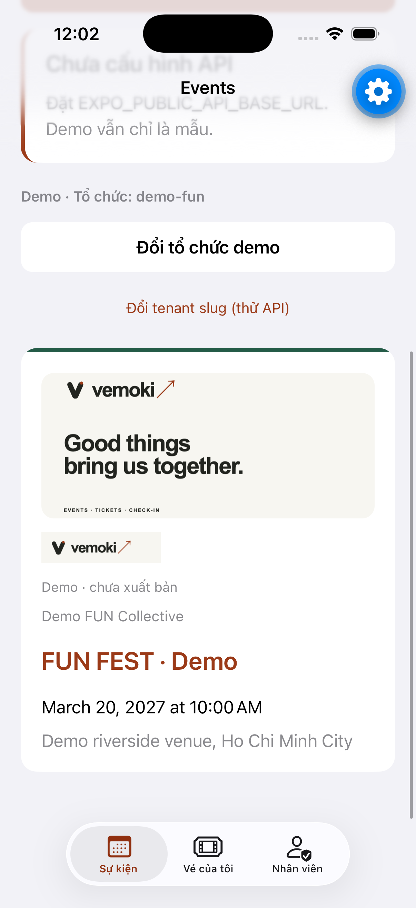
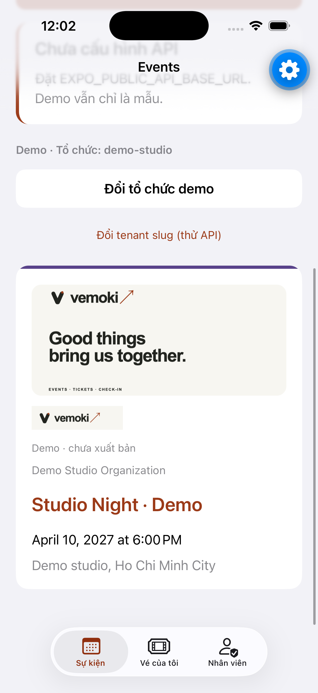
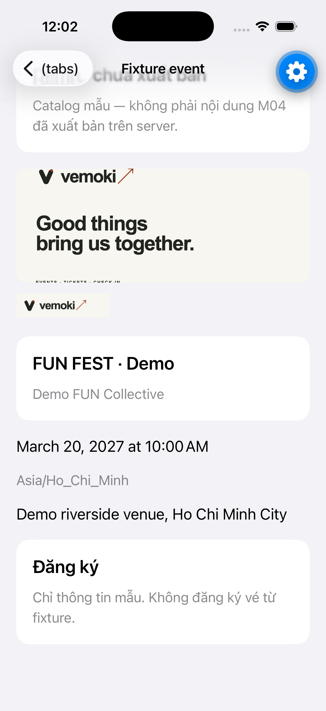
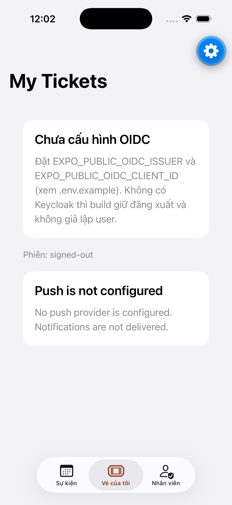

# D9-S2-T3 — iOS hiển thị media demo đúng (#142)

**Issue:** [#142](https://github.com/hangndat/ticket-solution/issues/142) · Story [#139](https://github.com/hangndat/ticket-solution/issues/139) · Epic [#134](https://github.com/hangndat/ticket-solution/issues/134)  
**Ownership:** `apps/mobile` only · Role `ios` · Team `BLUA62D52G` · **không** EAS Cloud Build  
**Branch:** `hangndat/d9-s2-t3-ios-media`

## Exact commit SHA

**Tip branch (review this):** `180cc45e0629cec66bcff11c5ce59ef2df0dcb59`  
**Behavior commit:** `15370969d8d2eceb00dfdb292b7a554b35cea040` (`feat(mobile): render bundled demo media…`)

*(Docs pin commit không đổi hành vi runtime. Revalidation bắt buộc nếu có commit hành vi mới sau tip.)*

## Thay đổi

- Bundle demo logo/banner từ pack `brand/vemoki` → `apps/mobile/assets/demo/{logo,banner}.png`.
- `SafeEventImage` + `EventMediaHeader` / `EventBanner` / `EventLogo`: fail-closed (thiếu/URL xấu/`onError` → không render broken glyph).
- Catalog keys: fixture ids `demo-fun-fest` / `demo-studio-night` + UUID seed từ `brand/demo/manifest.json`.
- Wire vào Events list (demo + published nếu có `logoUrl`/`bannerUrl`), fixture/published detail, My Tickets / ticket detail khi `eventId` khớp demo.

## Checks

```bash
cd apps/mobile && pnpm test && pnpm typecheck && pnpm lint
# 187 pass; tsc --noEmit; eslint src clean
```

## Headless sim-uat

```bash
# Metro LAN (Simulator không dùng 127.0.0.1 của host)
REACT_NATIVE_PACKAGER_HOSTNAME=192.168.86.8 npx expo start --port 8083 --lan
xcrun simctl openurl <UDID> "exp://192.168.86.8:8083"
scripts/sim-uat.sh screenshot <UDID> …
```

- Device: iPhone 17 Pro · UDID `F191CF59-4B73-44E5-BFA8-4CE439EB31AD`
- Runtime: Expo Go SDK 58 + Metro (JS + bundled assets) — **không** EAS Cloud
- AX labels xác nhận: `Ảnh banner sự kiện`, `Logo sự kiện` trên Events + fixture detail
- Originals (gitignored): `apps/mobile/.uat-artifacts/d9-media/`
- Curated: [`d9-media/ios/`](./d9-media/ios/)

| Surface | File |
| --- | --- |
| Events · demo-fun + media |  |
| Events · demo-studio + media |  |
| Fixture detail · FUN FEST |  |
| Vé của tôi (OIDC misconfig; no ticket row) |  |

## Limitations

- Published remote `logoUrl`/`bannerUrl` cần API + signed URL; Expo Go session này không cấu hình `EXPO_PUBLIC_API_BASE_URL` — demo dùng asset bundle local.
- Ticket list/detail logo chỉ hiện khi `eventId` khớp demo fixture/UUID; không có vé demo signed-in trong UAT này.
- Không EAS Cloud; không merge; chờ DoD reviewer độc lập (exact SHA).

## Verdict (implementer handoff)

iOS demo media render **PASS** (không broken image trên Events/fixture). Chờ reviewer Cursor DoD.
