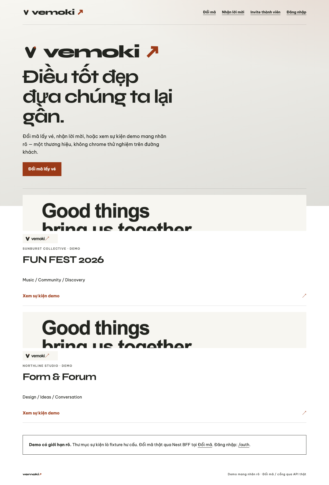
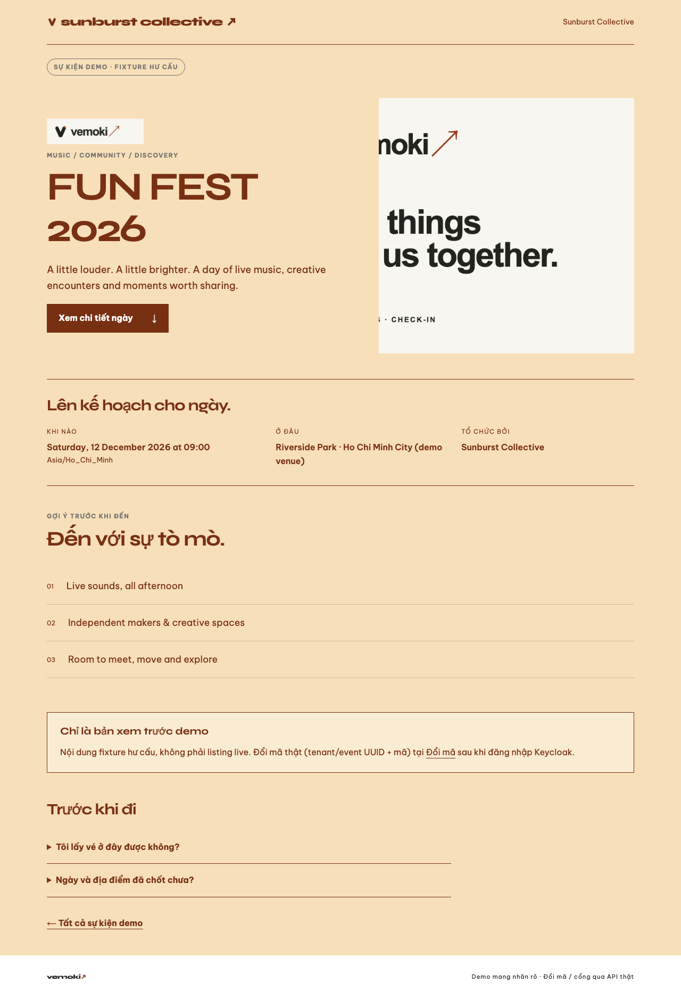
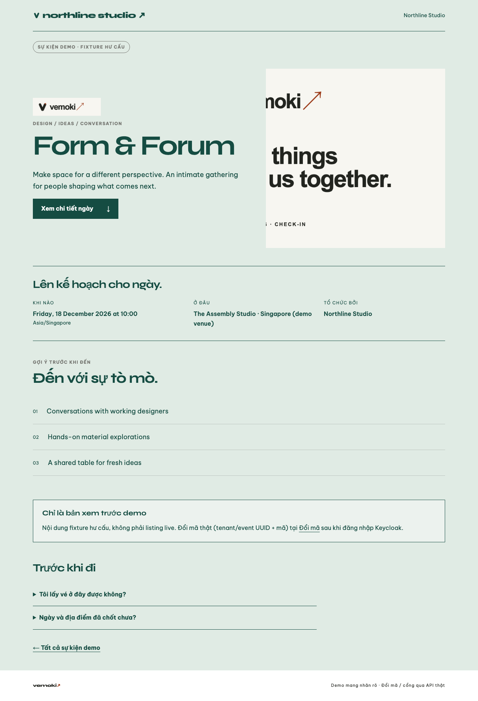

# D9-S2-T3 — Web hiển thị media demo đúng (#142)

**Issue:** [#142](https://github.com/hangndat/ticket-solution/issues/142) · Story [#139](https://github.com/hangndat/ticket-solution/issues/139) · Epic [#134](https://github.com/hangndat/ticket-solution/issues/134)  
**Ownership:** `apps/web` only (iOS sibling trên branch `hangndat/d9-s2-t3-ios-media` — không đóng #142 chỉ vì web PR)  
**Branch:** `hangndat/d9-s2-t3-web-media`  
**Exact SHA (impl tip):** `99d01b0b9065c4fa8ef73ff8966a3bf90348e303`  
**Note:** Commit docs pin này có thể đẩy tip branch thêm 1 SHA — DoD reviewer dùng tip `git rev-parse HEAD` trên PR.

## Phạm vi đã làm

- Bundled demo raster từ `brand/vemoki` → `apps/web/public/demo/{logo,banner}.png` (cùng nguồn seed MinIO #141).
- `demo-media.ts`: map fixture web (`fixture-fun-fest` / `fixture-form-forum`, tenant `sunburst` / `northline`) + seed ids (`demo-fun` / `demo-studio`, UUID manifest) → `/demo/*.png`.
- `SafeEventImage` fail-closed (`onError` → không render glyph broken).
- `EventBanner` / `EventLogo` / `EventMediaHeader` trên home + trang sự kiện demo.
- Unit: `apps/web/tests/demo-media.test.ts`.

## Checks

```bash
pnpm --filter @ticket/web exec tsx --test tests/demo-media.test.ts
pnpm --filter @ticket/web lint
pnpm --filter @ticket/web typecheck
# Next local :3012
WEB_BASE_URL=http://127.0.0.1:3012 WEB_UAT_OUT_DIR=apps/web/.uat-artifacts/d9-media \
  bash scripts/web-uat.sh screenshot http://127.0.0.1:3012/ …
```

| Check | Result |
| --- | --- |
| unit demo-media | PASS (5) |
| lint | PASS |
| typecheck | PASS |
| `GET /demo/logo.png` | 200 · 11186 bytes |
| `GET /demo/banner.png` | 200 · 37546 bytes |
| Playwright img `naturalWidth` home + event | logo 760 · banner 1200 (không broken) |

## Headless UAT screenshots

Originals (gitignored): `apps/web/.uat-artifacts/d9-media/`  
Curated: [`d9-media/web/`](./d9-media/web/)

| Surface | File |
| --- | --- |
| `/` (cards + logo/banner) |  |
| `/t/sunburst/events/fun-fest-2026` |  |
| `/t/northline/events/form-forum-2026` |  |

## Limitations

- Không resolve MinIO signed URL runtime — demo surface dùng static `/public/demo` (bucket vẫn private theo ADR-14).
- Web marketing fixtures (`sunburst` / `northline`) khác slug seed iOS (`demo-fun` / `demo-studio`); media pack dùng chung file Vemoki.
- Issue #142 còn cần iOS sibling; web PR **không** `Fixes`/#close Issue.

## Verdict (implementer)

Web demo media renders without broken images — sẵn sàng Chờ duyệt / DoD reviewer độc lập trên exact tip SHA.
