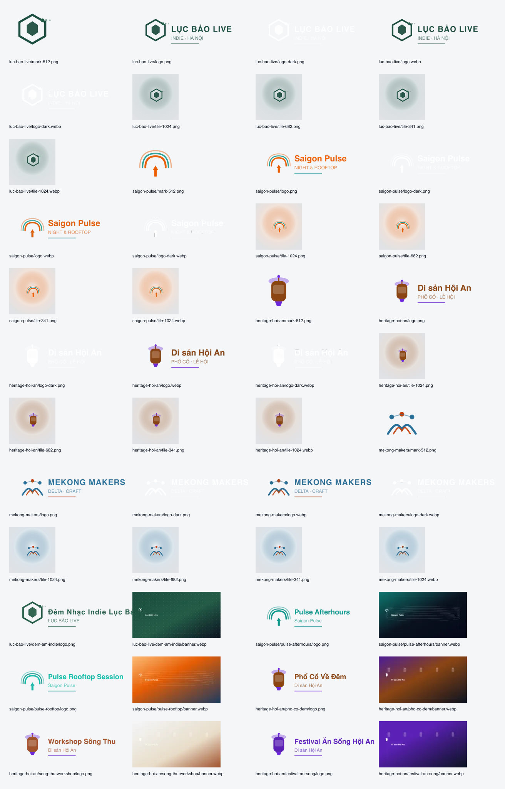

# Epic #686 — Prod seed media (raster + manifest)

| Field | Value |
| ----- | ----- |
| Epic | [#686](https://github.com/hangndat/ticket-solution/issues/686) |
| Scope | `brand/prod/**`, `scripts/prod-media-build.mjs`, `scripts/prod-media-verify.mjs` |
| Dataset | `docs/demo/PROD-SEED-DATASET.md` |
| PD inventory | `docs/design/prod-seed-media/README.md` |
| Upload prod | **Không** (repo-only; MinIO seed follow-up) |

## Summary

- **16** raster files: **4** org lockups (`760×200` PNG) + **6** events × (logo PNG + banner WebP `1200×630`).
- OG / share: cùng file `banner.webp` (`ogShare: true` trong manifest).
- iOS / web: một master per slot (PD §2.2 — scale trên thiết bị; không bundle @2x/@3x riêng).
- Generator: SVG template → `sharp` (dep `@ticket/backend`); font stack hệ thống (`DejaVu Sans`, `Helvetica`, `Arial`).
- Verify: `pnpm prod:media:verify` — kích thước, MIME, `ASSET_LIMITS` (≤5 MiB, ≤4096 px, ≤16M px).

## Commands

```bash
pnpm prod:media:build    # writes brand/prod + contact sheet
pnpm prod:media:verify
```

## Contact sheet



## Manifest

Path: `brand/prod/manifest.json` — UUID khớp `PROD-SEED-DATASET.md` (`686f0001-*` tenants, events, asset `0008`).

## Verify (local)

```
prod-media-verify PASS (16 files)
```

## Visual QA (spot check)

- Banner `object-fit: cover` safe zone ~10% mép; mark + org label trong vùng an toàn trái.
- Logo lockup: nền trong PNG; chữ + mark không bị cắt trong khung `760×200`.
- Không SVG upload; không stock ảnh bản quyền.

## SHA

`315b725fe8e2` (branch `hangndat/epic686-prod-media-raster`)

## Limitations

- `prod-seed-media.sh` chưa wire manifest `events[]` — task BE follow-up.
- Chưa gắn `logoAssetId` / `bannerAssetId` trên prod DB.
