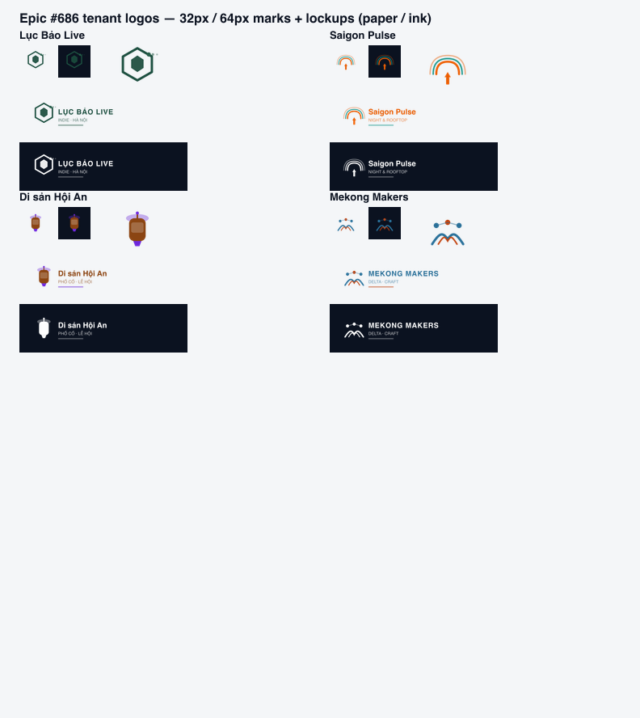

# Epic #686 — Tenant logo redesign (4 org)

| Field | Value |
| ----- | ----- |
| Epic | [#686](https://github.com/hangndat/ticket-solution/issues/686) |
| Scope | Tenant-level marks + wordmarks (`brand/prod/{slug}/`), `scripts/prod-media-src/`, build/verify |
| PD | `docs/design/prod-seed-media/README.md` §5.1 |
| Dataset | `docs/demo/PROD-SEED-DATASET.md` — UUID `686f0001-0008-4000-8000-00000{tenant}01` unchanged |
| Upload prod | **Không** |

## Summary

Redesigned **four distinct** tenant identities (mark + wordmark), readable at **32px** mark size:

| Tenant | Mark motif | Primary |
| ------ | ---------- | ------- |
| Lục Bảo Live | Jade hex + pulse dots | `#1B4D3E` |
| Saigon Pulse | Concentric pulse arcs + tower | `#E85D04` / `#0D9488` |
| Di sản Hội An | Lantern + halo | `#8B4513` / `#6D28D9` |
| Mekong Makers | Delta rivers + maker nodes | `#2A6F97` / `#C2410C` |

**Mekong Makers** (0 events): full tenant asset suite in manifest — not derived from event anchors.

## Raster outputs (per tenant)

| Role | File | Size | Format |
| ---- | ---- | ---- | ------ |
| Mark | `mark-512.png` | 512×512 | PNG, transparent |
| Lockup light | `logo.png` | 760×200 | PNG |
| Lockup dark | `logo-dark.png` | 760×200 | PNG |
| Lockup WebP | `logo.webp`, `logo-dark.webp` | 760×200 | WebP |
| Avatar tile | `tile-1024.png`, `tile-682.png`, `tile-341.png` | square | PNG (@3x / @2x / @1x) |
| Tile WebP | `tile-1024.webp` | 1024×1024 | WebP |

API primary slot: `tenantBrand.logo` → `logo.png` (`logoAssetId` stable).

## SVG sources

Regenerated on build under `scripts/prod-media-src/{slug}/` (`mark.svg`, `lockup-light.svg`, `lockup-dark.svg`). Logic: `scripts/prod-media-src/tenant-logos.mjs`.

## Commands

```bash
pnpm prod:media:build    # raster + EPIC686-MEDIA + tenant contact sheets
pnpm prod:media:verify
```

## Visual QA (contact sheet)

Marks at **32px** and **64px** on paper `#F4F6F8` and ink `#0B1220`; lockups light on paper, dark variant on ink.



## Verify

Run `pnpm prod:media:verify` after build — all manifest entries including `tenantBrand.assets[]`.

## SHA

`bc59555` (branch `hangndat/tenant-logo`)
