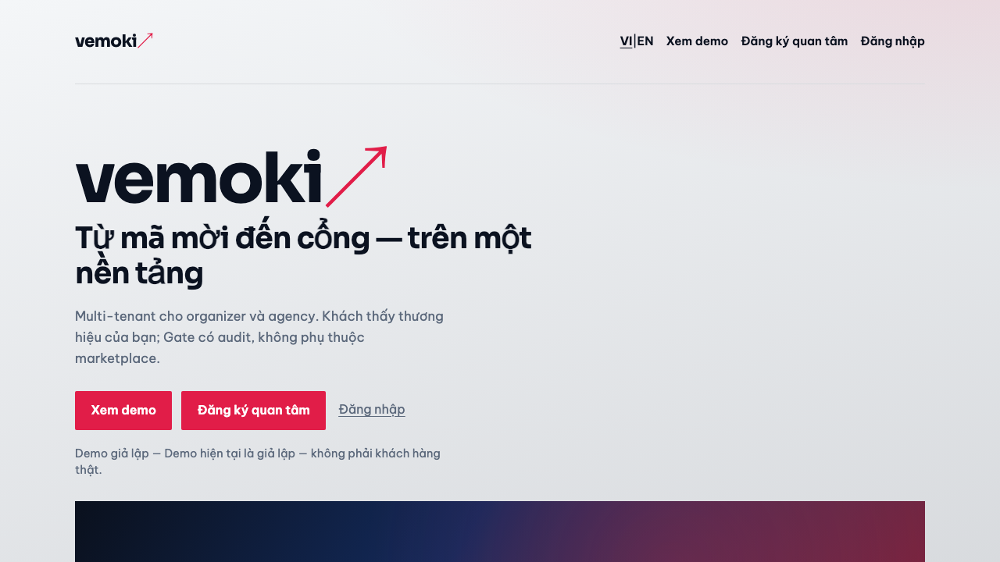

# FE Marketing requirements audit — Premium B2B EventTech vs hiện trạng Vemoki

| Trường | Giá trị |
| ------ | ------- |
| Ngày | 2026-10-22 |
| Repo SHA (worktree) | `037e75773e3bed32ea588994cd3ea138b2b73891` |
| Vai trò | reviewer-dod + product-ba checklist (read-only) |
| Live | [vemoki.com](https://vemoki.com) (marketing), [app.vemoki.com](https://app.vemoki.com) (product — chỉ quan sát guest surface, không tạo dữ liệu) |
| Chuẩn đối chiếu | Brief user (Premium B2B EventTech marketing site) **và** quyết định đã chốt O13 / Live Pulse v2 / ADR-22 |

## Tóm tắt điều hành

- **Live `vemoki.com`** đang phục vụ trang O13 sales (rewrite `/` → `/marketing`): hero, audience, workflow, whitelabel, trust, demo giả lập, form quan tâm, footer — **không** có FAQ, bento features, business-outcomes KPI, testimonial/logo khách, Aceternity/shadcn/Motion trên marketing.
- **Định vị hiện tại:** “nền tảng / ops in-person” (invite → QR → Gate), **không** dùng ngôn ngữ “Event Operating System”; khớp [O13](https://github.com/hangndat/ticket-solution/blob/main/docs/DECISION-LOG.md#o13--trang-bán-platform-gtm--tách-subdomain-18102026) và `copy.ts`, **mâu thuẫn** với brief user nếu bắt buộc Event OS + Midnight Indigo.
- **Ước lượng đáp ứng brief user (toàn bộ yêu cầu): ~42%** (xem §7). Đáp ứng **O13 đã chốt + honesty rules (demo giả lập, không social proof giả): ~78%**.

---

## 1. Phạm vi & phương pháp

- **Repo:** `apps/web/src/marketing/**`, `apps/web/app/marketing/**`, `apps/web/app/api/marketing/interest/route.ts`, `brand/vemoki/tokens.json`, `packages/ui`, `docs/ops/ADR-22-WEB-DS-ACETERNITY.md`, `docs/design/o13-platform-sales/**`.
- **Live:** `curl` HTML/metadata; Lighthouse mobile (`docs/reviews/assets/lighthouse-vemoki-mobile.json`); Playwright screenshot hero.
- **Không** sửa `apps/*`, không commit/push ứng dụng; chỉ artifact review này.

---

## 2. Bảng yêu cầu con

Legend: **ĐÁP ỨNG** · **MỘT PHẦN** · **CHƯA** · **MÂU THUẪN** (với quyết định đã chốt trong repo).

### 2.1 Stack & toolchain

| # | Yêu cầu | Trạng thái | Bằng chứng |
| --- | --- | --- | --- |
| S1 | Next.js App Router | **ĐÁP ỨNG** | `apps/web/package.json` L20 `next@16.4.2`; routes `apps/web/app/marketing/page.tsx`, `.../en/page.tsx` |
| S2 | TypeScript | **ĐÁP ỨNG** | Toàn bộ `apps/web/src/marketing/*.ts(x)`; `typescript` devDep `apps/web/package.json` L34 |
| S3 | Tailwind CSS v4 | **MỘT PHẦN** | Deps `tailwindcss@4.1.14`, `@tailwindcss/postcss` (`package.json` L25–26); `app/globals.css` L5–6 import `@ticket/ui/vemoki-theme.css` — **marketing dùng class `.mkt*` trong `live-pulse-legacy.css`**, không utility Tailwind trên sales page |
| S4 | shadcn/ui | **CHƯA** (marketing) | `apps/web/components.json` cấu hình registry; **không** có `apps/web/components/ui/**`; marketing không import shadcn |
| S5 | Aceternity UI | **CHƯA** (runtime) | ADR-22: slice 0 pipeline only, không UI Aceternity trên route public (`docs/ops/ADR-22-WEB-DS-ACETERNITY.md` L43–45) |
| S6 | Motion (library) | **MỘT PHẦN** | `motion` trong `packages/ui/package.json` L31 + `UiMotionProvider` — **không** mount trên marketing; hero chỉ CSS `@keyframes mkt-glow` + `prefers-reduced-motion` (`live-pulse-legacy.css` L2997–3013) |

### 2.2 Design system

| # | Yêu cầu | Trạng thái | Bằng chứng |
| --- | --- | --- | --- |
| D1 | Midnight Indigo design system | **MÂU THUẪN** với brief user; **đúng theo repo** | Brief user: Midnight Indigo. SoT: `brand/vemoki/tokens.json` L5–6 `"artDirection": "Live Pulse"`, `version: 2`, ink/paper/signal; live HTML `--ink:#0B1220` (curl vemoki.com). **Không** có “Midnight Indigo” trong repo (`rg` 0 hit) |
| D2 | Premium SaaS typography | **MỘT PHẦN** | `app/layout.tsx` L32–64 `next/font/local` Sora + Be Vietnam Pro; `.mkt-hero h1` display stack (`live-pulse-legacy.css` L2903–2910). Chưa đạt mức “premium SaaS marketing” kiểu Aceternity/bento |
| D3 | Accessible components (shadcn/Radix) | **MỘT PHẦN** | Form native + ARIA thủ công (`interest-form.tsx` L143–255); không Radix primitives trên marketing |
| D4 | Responsive layouts | **ĐÁP ỨNG** | `clamp()`, `min-height: 44px` buttons (`live-pulse-legacy.css` L2888–2930); screenshot mobile/desktop hero |
| D5 | Restrained microinteractions | **MỘT PHẦN** | CSS transition nút + glow hero; reduced-motion tắt animation (`L3007–3013`); không Motion/React microinteraction |

### 2.3 Định vị & nội dung trung thực

| # | Yêu cầu | Trạng thái | Bằng chứng |
| --- | --- | --- | --- |
| P1 | “Event Operating System” cho agency/enterprise | **CHƯA** (ngôn ngữ) | Hero VI: `copy.ts` L142–144 “Từ mã mời đến cổng — trên một nền tảng”; EN L287–289 “in-person events & gate platform”. Research O13: “ops platform in-person” (`docs/plans/VEMOKI-PLATFORM-SALES-PAGE-RESEARCH.md` L17) |
| P2 | Buyer agency + enterprise teams | **MỘT PHẦN** | `#audience` Owner + Agency (`sales-page.tsx` L59–80); **không** có block “enterprise” riêng |
| P3 | Demo metrics có nhãn | **MỘT PHẦN** | **Không** hiển thị số KPI marketing; có nhãn trung thực: `data-testid="demo-badge"` + `badge.demo` / `hero.demo_note` (`sales-page.tsx` L46–48; `copy.ts` L139–148) |
| P4 | Không testimonial/logo khách giả | **ĐÁP ỨNG** | Không section testimonial/logo; `demo.banner` “không dùng làm bằng chứng khách thật” (`copy.ts` L197–197); test AC-6 forbidden claims `marketing-copy.test.ts` L18–24 |

### 2.4 Tám section (brief user) vs `sales-page.tsx`

| Section (brief) | Map O13 / code | Trạng thái | Bằng chứng |
| --- | --- | --- | --- |
| Hero / Product Preview | `#hero` + `.mkt-hero-visual` | **MỘT PHẦN** | `sales-page.tsx` L21–57 — preview là gradient + label, **không** ảnh/screenshot sản phẩm, không `next/image` |
| Trust | `#trust` | **ĐÁP ỨNG** | `sales-page.tsx` L114–131 |
| Feature Bento Grid | — | **CHƯA** | Không grid/bento; có `#whitelabel` + stack rows thay feature marketing |
| How It Works | `#workflow` | **ĐÁP ỨNG** | `sales-page.tsx` L82–93, ordered list 5 bước |
| Solutions by Audience | `#audience` | **ĐÁP ỨNG** | `sales-page.tsx` L59–80 |
| Business Outcomes | — | **CHƯA** | Không section outcomes/KPI; chỉ copy “asOf” trong trust (`copy.ts` L190–192) |
| FAQ | — | **CHƯA** | Không `#faq` / accordion |
| Conversion CTA / Footer | `#interest`, CTA repeat, `MarketingChrome` footer | **ĐÁP ỨNG** | `sales-page.tsx` L146–165; `chrome.tsx` L52–61 |

**Thêm (O13, không trong brief 8 section):** `#whitelabel` (L95–112), `#demo` giả lập (L133–144) — khớp PD `docs/design/o13-platform-sales/visual-notes.md`.

### 2.5 Lead form & CRM

| # | Yêu cầu | Trạng thái | Bằng chứng |
| --- | --- | --- | --- |
| L1 | Zod validation | **CHƯA** | `interest-validate.ts` L41–81 custom validator; **không** `zod` trong `apps/web` (`rg` 0) |
| L2 | Validation chức năng | **ĐÁP ỨNG** | Client + server: `interest-form.tsx` L45–64; `route.ts` L53–64 |
| L3 | Server-side route / action | **ĐÁP ỨNG** | `POST` `apps/web/app/api/marketing/interest/route.ts` |
| L4 | CRM integration interface | **MỘT PHẦN** | `notifyInterestWebhook` + env `MARKETING_INTEREST_WEBHOOK_URL` (`interest-store.ts` L27–57) — **interface webhook**, không HubSpot/Salesforce SDK |
| L5 | Nơi lưu hiện tại | **ĐÁP ỨNG** | JSONL `.data/marketing-interest.jsonl` (`interest-store.ts` L12–24) |
| L6 | Consent / privacy | **ĐÁP ỨNG** | Checkbox + link privacy (`interest-form.tsx` L230–248); privacy page live `/privacy` |

### 2.6 RSC, media, SEO

| # | Yêu cầu | Trạng thái | Bằng chứng |
| --- | --- | --- | --- |
| R1 | Default Server Components | **MỘT PHẦN** | `SalesPage` server (`sales-page.tsx` no `'use client'`); islands: `InterestForm`, `LocaleSwitch`, `MarketingHtmlAttrs` |
| R2 | `next/image` tối ưu | **CHƯA** (marketing) | Marketing không import `next/image`; hero visual pure CSS |
| R3 | `next/font` | **ĐÁP ỨNG** | `app/layout.tsx` L32–64; live preload font URLs trong HTML vemoki.com |
| R4 | Metadata / OG | **MỘT PHẦN** | `app/marketing/page.tsx` L5–8 title/description/robots index; live OG **image URL** `https://app.vemoki.com/opengraph-image.png` (curl) — host product, không apex |
| R5 | sitemap | **CHƯA** | Không `app/sitemap.ts`; không `/sitemap.xml` kiểm tra repo |
| R6 | robots.txt | **CHƯA** | `GET https://vemoki.com/robots.txt` → **404** HTML (curl 2026-10-22) |
| R7 | JSON-LD | **CHƯA** | Không `application/ld+json` trong marketing routes |

### 2.7 Core Web Vitals (Lighthouse mobile, live)

Chạy: `lighthouse https://vemoki.com --form-factor=mobile` → `docs/reviews/assets/lighthouse-vemoki-mobile.json`.

| Metric | Giá trị | Ghi chú |
| --- | --- | --- |
| Performance score | **0.86** | |
| Accessibility score | **1.00** | |
| LCP | **3.6 s** (score 0.59) | Dưới ngưỡng “good” 2.5s |
| CLS | **0.001** | Tốt |
| TBT | **40 ms** | Tốt |
| FCP | **1.4 s** | |
| Total transfer | **~462 KiB** | |
| Unused JS (audit) | **~27 KiB** est. | Chunk lớn `3jthsunasly4_.js` ~230KB resource trong treemap |
| INP | *không có field* | Lighthouse run không trả INP (lab) |

### 2.8 Accessibility (a11y)

| # | Yêu cầu | Trạng thái | Bằng chứng |
| --- | --- | --- | --- |
| A1 | Landmarks / skip link | **ĐÁP ỨNG** | `main id="main"`; skip link `chrome.tsx` L28–30; live HTML |
| A2 | Focus / errors | **MỘT PHẦN** | Form focus on error `interest-form.tsx` L57–62; `:focus-visible` product globals — marketing buttons rely on legacy |
| A3 | `prefers-reduced-motion` | **ĐÁP ỨNG** (hero) | `live-pulse-legacy.css` L3007–3013 |
| A4 | axe / Playwright marketing | **MỘT PHẦN** | Lighthouse a11y **100** live; **không** test UAT marketing trong `apps/web/tests/` (chỉ `marketing-host.test.ts`, `marketing-copy.test.ts`). `@axe-core/cli` local fail ChromeDriver mismatch — **không** dùng làm evidence |

### 2.9 Analytics & consent

| # | Yêu cầu | Trạng thái | Bằng chứng |
| --- | --- | --- | --- |
| N1 | Track CTA clicks | **CHƯA** | Chỉ `data-testid` (`cta-demo`, `cta-interest`) — không `fetch` analytics / `gtag` / PostHog trong `apps/web/src/marketing/**` |
| N2 | Form start | **CHƯA** | Không event on focus/submit start |
| N3 | Qualified lead submit | **CHƯA** | POST API không emit analytics; privacy copy: MVP không SDK quảng cáo (`copy.ts` L234) |
| N4 | Consent banner | **CHƯA** | Form consent liên hệ only; không CMP cookie |

### 2.10 Cấu trúc component & content config

| # | Yêu cầu | Trạng thái | Bằng chứng |
| --- | --- | --- | --- |
| C1 | Reusable section components | **MỘT PHẦN** | `MarketingChrome`, `InterestForm`, `SalesPage` monolith sections inline — không `sections/hero.tsx` bento, v.v. |
| C2 | Configurable marketing content | **MỘT PHẦN** | `copy.ts` dictionary + `t(locale, key)` — **không** JSON/CMS external |
| C3 | Host routing `vemoki.com` vs `app.` | **ĐÁP ỨNG** | Live `x-middleware-rewrite: /marketing`; tests `marketing-host.test.ts` L77–83; O13 DECISION-LOG |

### 2.11 Live `app.vemoki.com` (guest, không tạo dữ liệu)

| # | Quan sát | Bằng chứng |
| --- | --- | --- |
| G1 | Product home vẫn catalog/guest surface | `curl` title `Vemoki` — không phải sales copy marketing |
| G2 | Demo CTA trỏ `?demo=1` | Live nav marketing `href="https://app.vemoki.com/?demo=1"` |
| G3 | Tách host đúng O13 | Marketing chỉ apex; app giữ redeem/catalog |

---

## 3. Mâu thuẫn cần user quyết

| ID | Brief user | Đã chốt trong repo | Khuyến nghị |
| --- | --- | --- | --- |
| M1 | **Midnight Indigo** DS | **Live Pulse v2** (`tokens.json`, ADR-22, visual-identity-v2) | Giữ Live Pulse trừ khi user **đổi** brand ADR — không implement Midnight “ngầm” |
| M2 | Premium **Aceternity + shadcn + Motion** marketing | ADR-22 **slice 0**: toolchain only; O13 sales = **legacy `.mkt` CSS** | Epic #766 slice ≥1 cho marketing redesign; không coi slice 0 là “đã có Aceternity site” |
| M3 | **Event Operating System** positioning | O13: **ops / gate platform**, anti-marketplace | Nếu muốn Event OS: PD copy pass + AC — không chỉ đổi headline |
| M4 | 8 section **Bento + FAQ + Outcomes** | O13 PD: typography lists, **không** card grid marketing (`visual-notes.md` L66) | User chọn: giữ O13 minimal **hoặc** mở scope brief mới (FAQ/outcomes/bento) |
| M5 | `vemoki.com` vs `app.vemoki.com` | **Đã chốt** O13 | Không mâu thuẫn — chỉ note OG image vẫn `app.vemoki.com` |

---

## 4. Gap ưu tiên (theo brief user)

| Ưu tiên | Gap | Effort (ước lượng) | Ownership |
| --- | --- | --- | --- |
| P0 | Quyết M1–M4 (brand + scope section) | Product | User + PD |
| P1 | FAQ + Business outcomes (labeled demo metrics only) | 2–4 ngày web | `apps/web/src/marketing` + `copy.ts` |
| P1 | Analytics events (CTA, form start, lead) + privacy note | 1–2 ngày | web + coordinator chọn provider |
| P1 | `robots.txt` + `sitemap.xml` cho marketing index | 0.5–1 ngày | `apps/web/app` |
| P2 | Zod parity (hoặc giữ validator + document) | 0.5 ngày | `interest-validate.ts` |
| P2 | Product preview thật (`next/image` screenshot) | 1–2 ngày | marketing + design assets |
| P2 | LCP 3.6s → &lt;2.5s (font/JS split marketing) | 2–5 ngày | perf pass |
| P3 | Aceternity/shadcn bento hero (ADR slice ≥1) | 1–2 tuần | `packages/ui` + marketing routes |
| P3 | CRM webhook production + n8n/HubSpot | ops | env + `MARKETING_INTEREST_WEBHOOK_URL` |
| P3 | Playwright axe UAT `vemoki.com` marketing | 1 ngày | `apps/web/tests/` |

---

## 5. Đề xuất slice implement

| Slice | Mục tiêu | Path | Ước lượng |
| --- | --- | --- | --- |
| **0 (done)** | O13 sales VI/EN, host split, form JSONL + webhook hook | `apps/web/src/marketing/*`, middleware hosts | — |
| **1** | SEO hygiene + analytics minimal + FAQ | `app/robots.ts`, `app/sitemap.ts`, `copy.ts`, event helper | 3–5 ngày |
| **2** | Outcomes + labeled demo metrics (no fake logos) | new section components | 3–5 ngày |
| **3** | ADR-22 slice 1: shadcn form primitives + optional `UiMotionProvider` island on hero | `packages/ui`, refactor `InterestForm` | 1–2 tuần |
| **4** | Aceternity bento + premium layout (nếu user chọn sau M4) | `packages/ui` vendored components | 2–3 tuần |

---

## 6. Product-BA checklist (O13)

| AC | Trạng thái | Evidence |
| --- | --- | --- |
| Buyer Owner + Agency | **ĐÁP ỨNG** | `#audience` |
| CTA Demo + Đăng ký quan tâm | **ĐÁP ỨNG** | hero + nav live |
| Demo giả lập, không social proof | **ĐÁP ỨNG** | badge + demo section |
| VI + EN | **ĐÁP ỨNG** | `/` và `/en` |
| Privacy + support trên apex | **ĐÁP ỨNG** | footer links; pages `app/marketing/privacy` |
| Không claim payment/seat/wallet Android | **ĐÁP ỨNG** | `FORBIDDEN_COPY_PATTERNS` test |

---

## 7. Kết luận % đáp ứng

**Phương pháp:** 38 hạng mục §2, trọng số bình quân: ĐÁP ỨNG = 1.0, MỘT PHẦN = 0.5, CHƯA/MÂU THUẪN (vs user brief) = 0.

| Tập yêu cầu | Điểm | % |
| --- | --- | --- |
| Brief user Premium B2B (toàn bộ §2) | ~16.0 / 38 | **~42%** |
| O13 + honesty + host split (§6 + rows tương ứng) | ~18.5 / 24 | **~77%** |

**Verdict audit:** Hiện trạng **production-usable cho O13 GTM tối giản**, **chưa** đạt brief marketing premium EventTech đầy đủ. Không phát hiện testimonial/logo khách giả; form lead **functional** với lưu JSONL + webhook tùy chọn.

---

## 8. Artifacts

| File | Mô tả |
| --- | --- |
| `docs/reviews/assets/vemoki-marketing-hero-2026-10-22.png` | Screenshot hero live |
| `docs/reviews/assets/lighthouse-vemoki-mobile.json` | Lighthouse raw (perf + a11y) |

---

*Reviewer: worker task_3a14ddf58f16 · read-only · SHA `037e75773e3b`*
