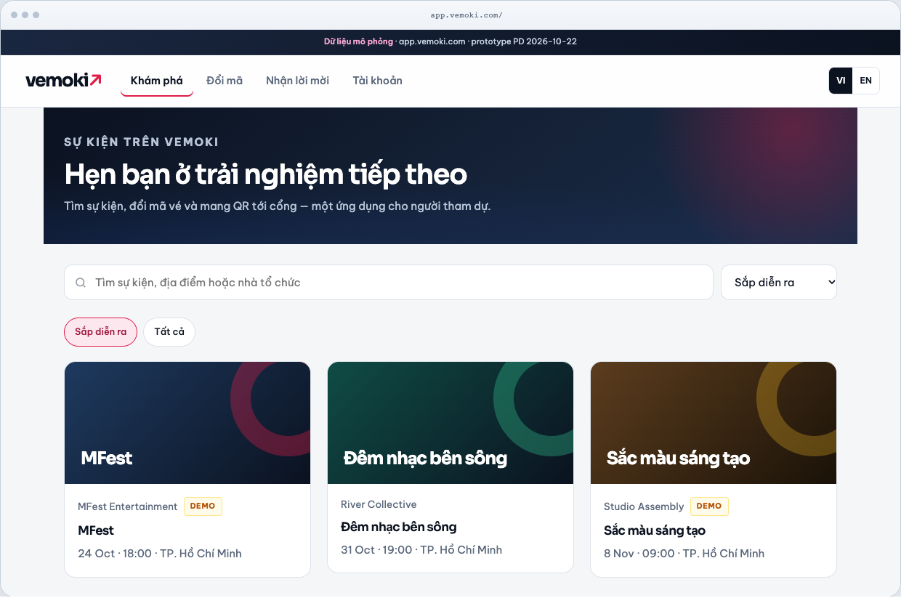
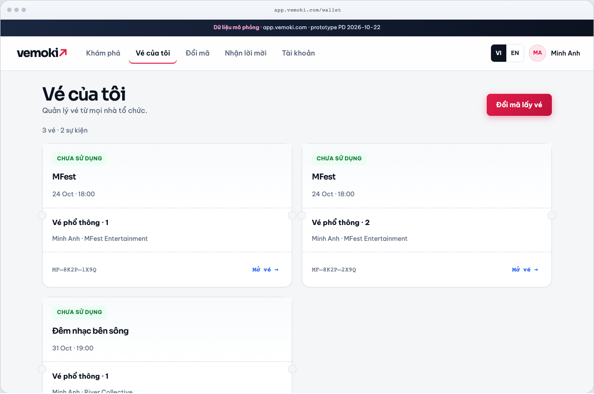
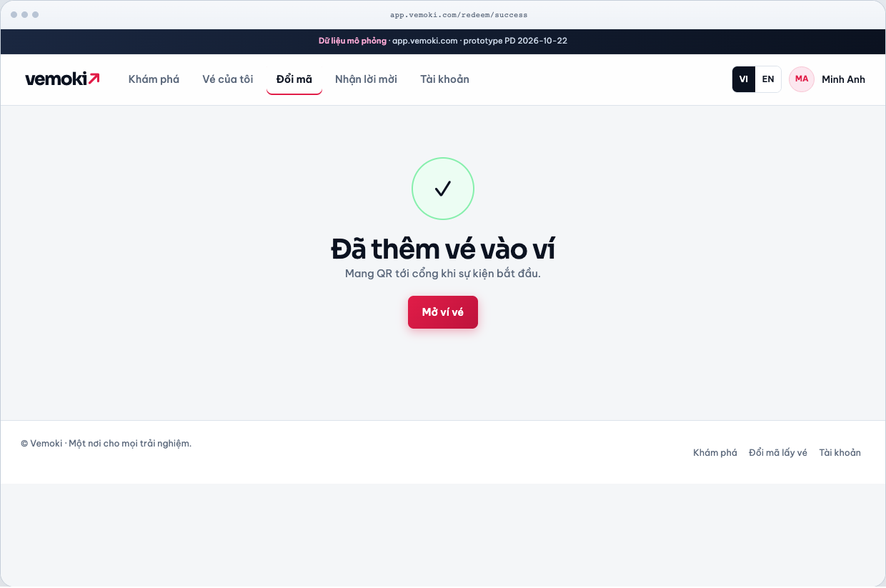
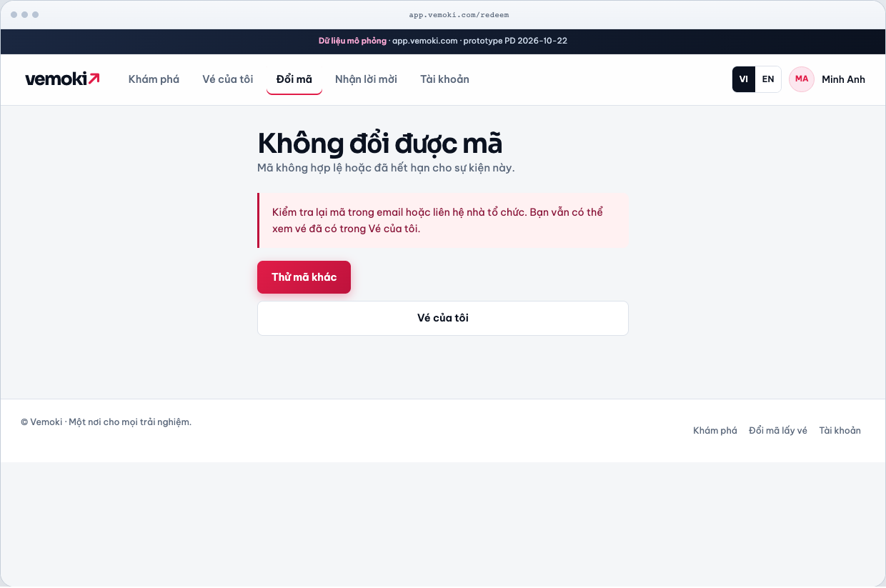
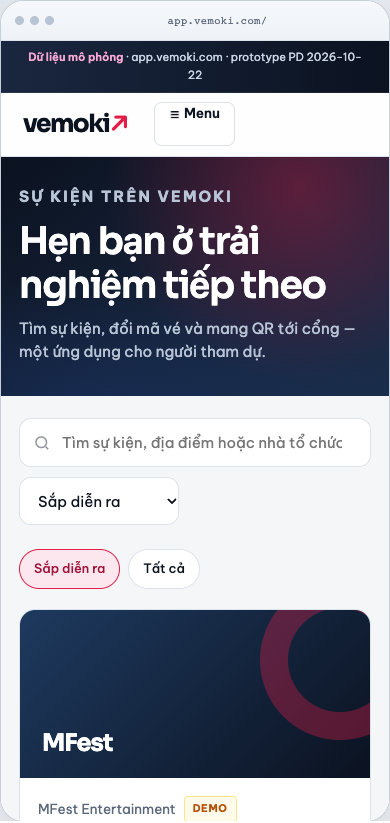
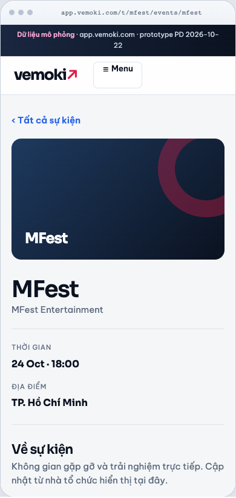
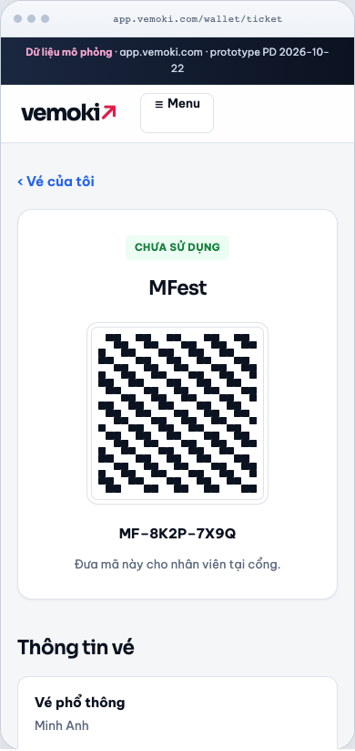

# UI Uplift — App attendee (`app.vemoki.com`) · 2026-10-22

| Trường | Giá trị |
| --- | --- |
| Task | `task_9dc081d885e8` · Role `product-design` |
| Epic | [#766](https://github.com/hangndat/ticket-solution/issues/766) DS · [#770](https://github.com/hangndat/ticket-solution/issues/770) marketing (handoff liên quan) |
| Cost tier | `standard` |
| Architecture impact | **Không** — `docs/design` + `docs/reviews` only |
| Prototype | [`docs/design/ui-uplift-2026-10/app/index.html`](../design/ui-uplift-2026-10/app/index.html) (+ [`css/app-uplift.css`](../design/ui-uplift-2026-10/app/css/app-uplift.css)) |
| SoT mockup cũ | [`web-prototype.html`](../plans/mobile-production-refactor/web-prototype.html) |
| SoT token | [`brand/vemoki/tokens.json`](../../brand/vemoki/tokens.json) · Live Pulse v2 |
| Căn cứ UX | [`FE-BA-COHERENCE-2026-10-22.md`](./FE-BA-COHERENCE-2026-10-22.md), [`FE-PD-ACETERNITY-DS-2026-10-22.md`](./FE-PD-ACETERNITY-DS-2026-10-22.md), [`MKT-PD-EVENT-OS-SPEC-2026-10-22.md`](./MKT-PD-EVENT-OS-SPEC-2026-10-22.md) |
| Ảnh uplift | [`docs/reviews/assets/ui-uplift-app/`](./assets/ui-uplift-app/) (Playwright Chrome · 1280 + mobile frame 390) |

---

## Tóm tắt

Prototype HTML tĩnh mô tả **một lần nâng cấp thị giác rõ** cho surface attendee: hero catalog ink-band, card spotlight, vé răng cưa, redeem đủ bước (gate → form → terms → success/error), empty/loading/error + toast. Giữ token Live Pulse v2 (Sora + Be Vietnam Pro), VI/EN, touch ≥44px, `prefers-reduced-motion`. **Chưa** sửa `apps/*` — handoff FE theo slice ưu tiên cuối tài liệu.

---

## (a) Phê bình hiện trạng — vì sao «không thấy khác biệt»

Các PR Epic #715 / DS slice 0–4 **cố ý diff=0** trên UI (token pipeline, `@ticket/ui` primitives, perf) nên prod vẫn trông như mockup 20/10: system font stack, radius 8px phẳng, catalog không có rhythm section, card sự kiện = khối art + text không elevation, ví vé = hộp viền xám không «vé thật».

| Khía cạnh | Prod / mockup hiện tại | Kỳ vọng premium (prototype uplift) |
| --- | --- | --- |
| **Typography** | `-apple-system` / 14px đồng đều | Sora display + Be Vietnam Pro body, scale H1/H2 rõ, eyebrow uppercase |
| **Rhythm** | Trắng phẳng từ nav → grid | Band hero ink + gradient signal/blue; paper có chiều sâu |
| **Catalog card** | Viền 1px, hover không đổi | Lift + shadow + spotlight pointer (pattern Aceternity *card spotlight*, giảm motion) |
| **Demo seed** | Tên org «demo» dễ nhầm (BA-021) | Badge **Demo** trên card (màu warn, không claim khách thật) |
| **Nav IA** | Hai «Sự kiện» khi admin (BA-002); «lời mời» 3 nghĩa (BA-010) | Attendee: **Khám phá** · **Đổi mã** · **Nhận lời mời** (claim) · **Vé của tôi** — tách redeem vs claim |
| **Redeem lỗi** | Copy kỹ thuật, ít bước tiếp (BA-033) | Alert + «Thử mã khác» + CTA **Vé của tôi** |
| **Vé / QR** | Khung QR đơn giản | Ticket-card răng cưa, dashed perforation, mono code |
| **Chrome** | Không strip trung thực demo | Strip «Dữ liệu mô phỏng» (MKT spec) |

### Evidence ảnh (so sánh)

| | Desktop 1280 |
| --- | --- |
| **Prod guest home** (post–slice C, vẫn «phẳng») |  |
| **Uplift catalog guest** |  |
| **Mockup 20/10** (baseline) |  |
| **Uplift wallet** |  |
| **Uplift redeem success** |  |
| **Uplift redeem error** |  |

Mobile (khung 390 trong prototype):

| Màn | Ảnh |
| --- | --- |
| Catalog guest |  |
| Event detail |  |
| Ticket QR |  |

---

## (b) Nguyên tắc thị giác (app attendee)

| Chủ đề | Quy ước uplift |
| --- | --- |
| **Type scale** | Display Sora: H1 2.35rem → 1.75rem mobile; body 15px Be Vietnam Pro; eyebrow 0.65rem / 0.14em |
| **Spacing** | Main padding 28px (18px mobile); grid gap 22px; form card padding 28px |
| **Radius** | Card 16px; button/input 8–12px; browser chrome 20px |
| **Elevation** | `--shadow-sm/md/lg`; primary CTA gradient signal + shadow hồng nhẹ |
| **Màu nhấn** | ink `#0B1220` section hero; signal `#E11D48` CTA/active; focus `#2563EB` links/focus ring 3px |
| **Ảnh / art** | Placeholder gradient + vòng tròn (giữ mockup) — **không** ảnh khách giả |
| **Rhythm** | Catalog: strip demo → nav glass → hero ink → tools paper → grid; detail: hero art → 2 cột + sticky sidebox |
| **Motion** | Hover card 200ms; sheet menu 200ms; success pop 400ms; shimmer loading; **tắt** khi `prefers-reduced-motion` |
| **a11y** | Skip link; `aria-expanded` menu; error `role="alert"`; toast `role="status"`; contrast AA trên ink/paper |

---

## (c) Map khối → component (Aceternity / shadcn / `@ticket/ui`)

Legend: **A** = pattern Aceternity (vendored, giảm motion) · **S** = shadcn · **N** = `@ticket/ui` / app composite · **⛔** = không dùng

| Khối prototype | Nguồn / component | Ghi chú |
| --- | --- | --- |
| Demo strip | **N** `DemoDataBanner` | Mới — `role="status"`, copy MKT |
| Site header + nav | **N** `SiteHeader` | ⛔ floating/resizable navbar |
| Mobile sheet menu | **S** `Sheet` + **N** link list | Focus trap |
| Locale VI/EN | **N** (i18n keys) | Khớp `apps/web` i18n slice sau |
| Catalog hero ink-band | **N** + **A** *hero-sections* (opacity/gradient only) | Không beams/shaders |
| Search + filter | **S** `Input` + **N** `FilterChip` | ⛔ vanish input |
| Event card + spotlight | **N** `CatalogEventCard` + **A** *spotlight* CSS vars | ⛔ 3D/wobble |
| Demo badge | **N** `DemoBadge` | Primitive mới (warn variant) |
| Owned strip | **N** hoặc **S** `Button` link | |
| Detail layout | **N** `EventDetailLayout` + **S** `Card` | Sticky sidebox |
| Redeem form / terms | **S** `Field`, `Input`, `Checkbox` + **N** `RedeemFlowLayout` | Terms scroll box |
| Auth gate | **N** `AuthGateLayout` | OIDC ngoài UI |
| Wallet ticket card | **N** `WalletTicketCard` | Perforation CSS — primitive mới |
| QR panel | **N** | Logic QR app |
| Account shell | **N** + **S** `Separator` | ⛔ Aceternity sidebar dock |
| Empty / loading / error | **N** `SurfaceState` + **S** `Skeleton` | Đã có kind — thêm illustration ring |
| Toast | **S** `Sonner` | Opacity only |
| Dialog | **S** `AlertDialog` | |
| Footer | **N** | Phân vai link (BA-005) |

**Primitive mới đề xuất:** `DemoDataBanner`, `DemoBadge`, `CatalogHeroBand`, `WalletTicketCard` (perforation), `FilterChip` (nếu chưa export từ UI package).

---

## (d) Thay đổi theo ưu tiên + slice FE (ownership)

| Ưu | Thay đổi hiển thị | Slice / path | Effort |
| --- | --- | --- | --- |
| **P0** | Font Sora + Be Vietnam Pro + token CSS vars trên chrome attendee | `apps/web` layout + `globals.css` / `@ticket/ui/tokens` | S (đã có pipeline — **bật** trên UI) |
| **P0** | Catalog hero band + spacing/radius uplift | `apps/web` `HomeCatalogGrid`, home page | M |
| **P0** | `CatalogEventCard` spotlight + demo badge | `packages/ui` + `home-catalog` | M |
| **P1** | Nav labels: Khám phá / Đổi mã / Nhận lời mời / Vé của tôi (BA-002, BA-010) | `site-chrome.tsx`, `capabilities.ts` | S |
| **P1** | `WalletTicketCard` perforation + ticket detail QR panel | `apps/web` wallet routes | M |
| **P1** | Redeem: terms step UI + success/error illustration + actionable copy (BA-033) | `apps/web` redeem/* | M |
| **P2** | Event detail sticky sidebox highlight | event detail page | S |
| **P2** | Empty / loading skeleton grid catalog | home + wallet | S |
| **P2** | Demo strip prod (env) | shared layout | S |
| **P3** | Toast Sonner styling | providers | S |
| **Defer** | Gate/admin/platform | Ngoài attendee uplift | — |

**Không claim:** payment, marketplace, testimonial, số % bịa — giữ [`MKT-PD-EVENT-OS-SPEC`](./MKT-PD-EVENT-OS-SPEC-2026-10-22.md).

---

## Kiểm tra prototype

1. Mở `index.html` bằng double-click (hoặc `file://`).
2. Thanh **reviewnav**: 16 màn attendee (gồm loading, error, toast).
3. **Desktop 1280** / **Mobile 390** + **VI/EN** trong khung.
4. Chụp lại: `node docs/design/ui-uplift-2026-10/app/capture-screenshots.mjs` (từ repo root sau `pnpm install`).

---

## Vòng lặp PD (2–3)

| Vòng | Thay đổi |
| --- | --- |
| 1 | Khung web-prototype + token/type |
| 2 | Hero ink, card spotlight, ticket perforation, redeem error/success |
| 3 | Demo badge, claim tách redeem, chụp Playwright + so prod `fe-web-F-home` |

**Đánh giá:** Desktop catalog/wallet đã «premium EventTech» ở mức prototype (contrast, depth, vé đặc trưng); cần FE merge token + component để prod khớp — không chỉ CSS vars ẩn.
