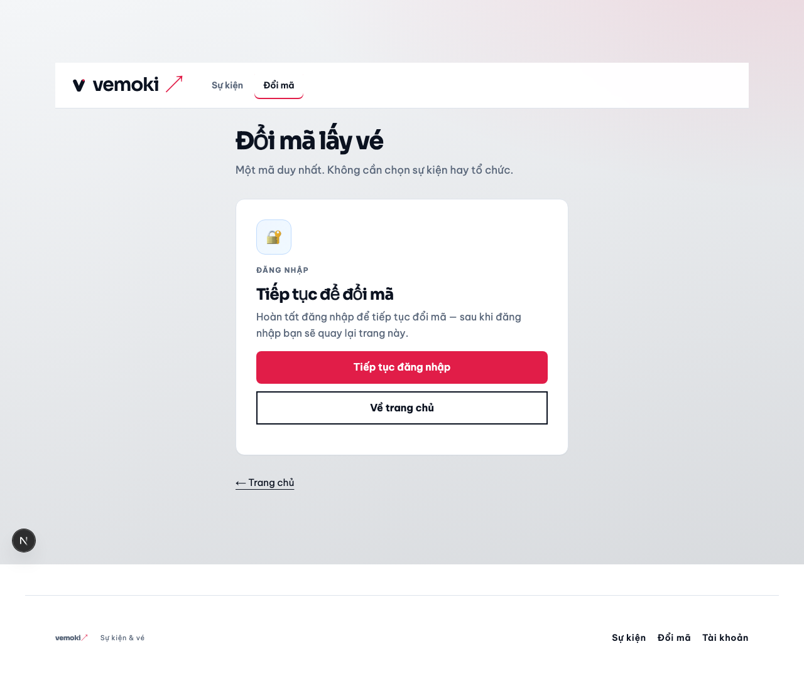
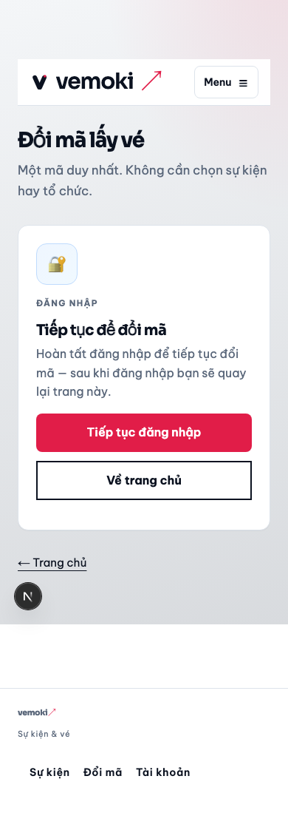
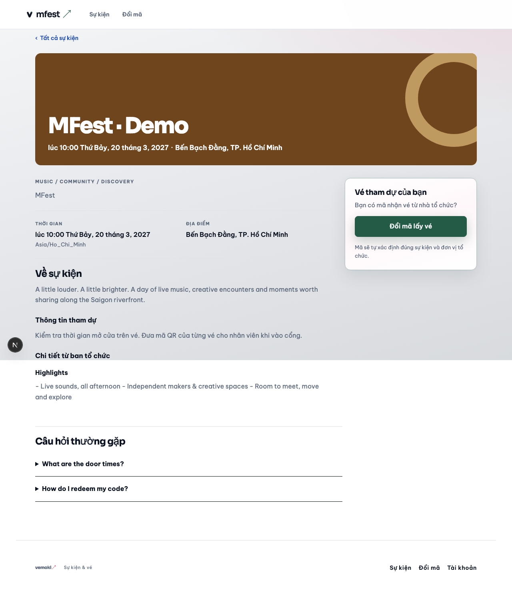
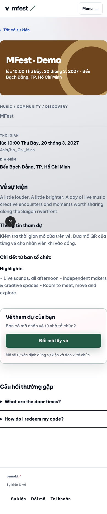
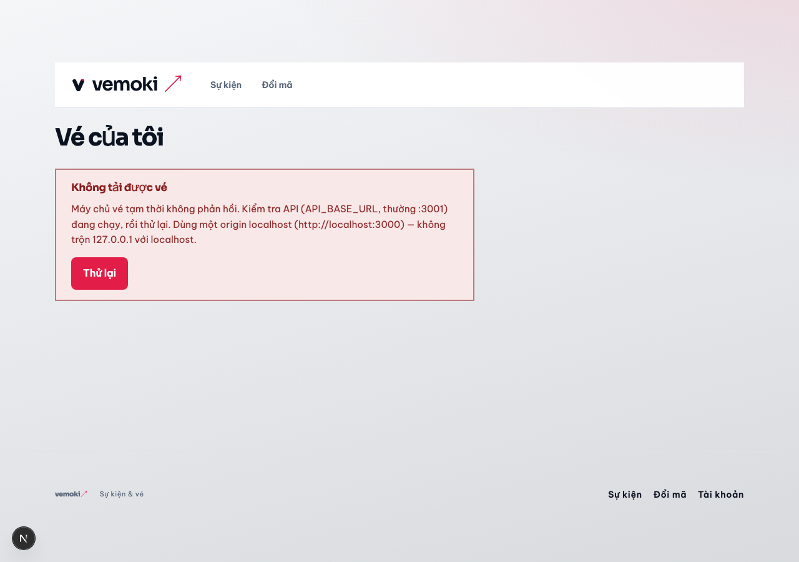
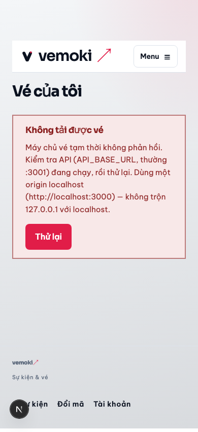

# UI uplift — App slice A2 (wallet · redeem · event detail) · 2026-10-22

| Trường | Giá trị |
| --- | --- |
| Slice | A2 — wallet, redeem presentation, event sidebox (không site-chrome/catalog) |
| Prototype | [`docs/design/ui-uplift-2026-10/app/`](../design/ui-uplift-2026-10/app/) |
| Ảnh app (local UAT) | [`docs/reviews/assets/ui-uplift-app-a2/`](./assets/ui-uplift-app-a2/) |

## Thay đổi

- **WalletTicketCard** — vé răng cưa, dashed perforation, mono code (`wallet-ticket-card.module.css`).
- **Wallet page** — heading/grid uplift (`wallet-page.module.css`).
- **Ticket QR** — panel inset + meta list (`ticket-detail.module.css`).
- **Redeem** — gate illustration, terms box product chrome, success/error rings + BA-033 «Thử mã khác» / «Vé của tôi» (`redeem-surface.module.css`, `redeem-form.tsx` logic giữ nguyên).
- **Event detail** — sticky sidebox highlight signal (`event-detail-sidebox.module.css`).

## Evidence

Chụp sau `./scripts/fe-uat-stack.sh bootstrap` + API :3001 + `next dev` (OIDC env từ `print-env`):

```bash
WEB_BASE_URL=http://localhost:3000 node docs/reviews/assets/ui-uplift-app-a2/capture-a2-screenshots.mjs
```

| Màn | Desktop 1280 | Mobile 390 |
| --- | --- | --- |
| Redeem gate |  |  |
| Event sidebox |  |  |
| Wallet |  |  |

So sánh hướng prototype: [`UI-UPLIFT-APP-2026-10-22.md`](./UI-UPLIFT-APP-2026-10-22.md).
