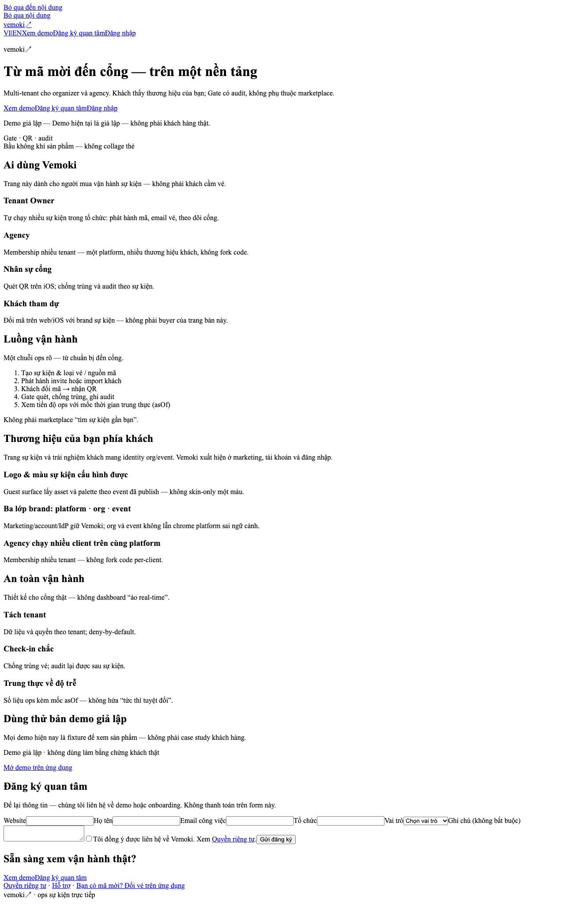
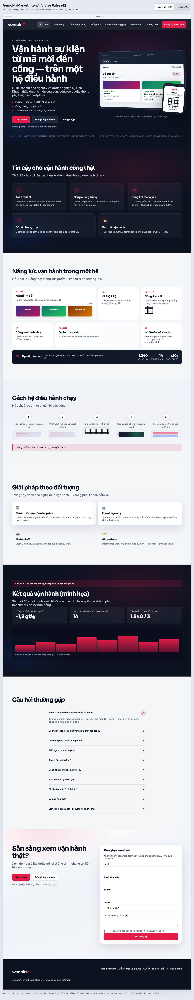
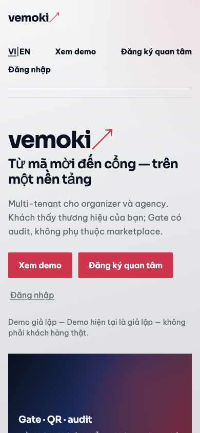

# UI uplift — Marketing (`vemoki.com`) · 2026-10-22

| Trường | Giá trị |
| --- | --- |
| Surface | Marketing sales host |
| Epic | [#770](https://github.com/hangndat/ticket-solution/issues/770) |
| DS Epic | [#766](https://github.com/hangndat/ticket-solution/issues/766) / [#715](https://github.com/hangndat/ticket-solution/issues/715) |
| Prototype | [`docs/design/ui-uplift-2026-10/marketing/index.html`](../design/ui-uplift-2026-10/marketing/index.html) |
| Spec copy | [`MKT-PD-EVENT-OS-SPEC-2026-10-22.md`](./MKT-PD-EVENT-OS-SPEC-2026-10-22.md) |
| Aceternity map | [`FE-PD-ACETERNITY-DS-2026-10-22.md`](./FE-PD-ACETERNITY-DS-2026-10-22.md) |
| Screenshots | [`assets/ui-uplift-marketing/`](./assets/ui-uplift-marketing/) |

---

## (a) Phê bình hiện trạng — vì sao «chưa thấy khác biệt»

Các slice hạ tầng DS (#715, #766) **cố ý diff=0** trên UI runtime: token CSS, primitives, và marketing route giữ layout O13 / Radix-era — đúng chiến lược «foundation trước, visual sau». Người dùng mở `vemoki.com` hoặc marketing trên app host vẫn thấy **cùng hierarchy phẳng**: headline + đoạn support + CTA + khối «atmosphere» gradient thay vì **product truth**, không có **type display** hay **nhịp section ink/paper**.

| | Hiện trạng (prod / O13) | Kỳ vọng premium (prototype uplift) |
| --- | --- | --- |
| Hero | H1 một cột; visual = placeholder «Gate · QR · audit» (không ảnh app) | Split grid: EOS copy + **khung thiết bị** + ảnh `app-redeem` / `gate` thật |
| Typography | Syne/O13 hoặc system; scale ~1.2–1.4× body | **Sora display** clamp 2.35–3.75rem; Be Vietnam Pro body |
| Section rhythm | Chủ yếu paper; ít contrast band | Xen kẽ **ink** (hero, trust, outcomes) ↔ **paper** (bento, how, FAQ) |
| Features | Danh sách / card đồng kích thước | **Bento asymmetric** 7 ô PRD (span 2+1+1 / banner ops) |
| Trust | Bullet text | **Icon cards** trên nền ink + hover border signal |
| How it works | List đơn giản | **Timeline 5 bước** + connector + minh họa step |
| Outcomes | Thiếu hoặc số không nhãn | **Demo banner** + 3 metric cards + chart tĩnh |
| Motion | Ít / generic | Marquee nhẹ, hero fade, FAQ height ≤200ms; `prefers-reduced-motion` |

**Ảnh so sánh**

| Baseline (prod guest capture 22/10) | Uplift prototype (VI desktop 1280) |
| --- | --- |
|  |  |

| Mobile baseline (app marketing host) | Uplift mobile 390 |
| --- | --- |
|  |  |

**Kết luận PD:** Khác biệt không nằm ở «đổi màu token» mà ở **composition, scale, product preview, và section architecture** — đúng phản hồi user sau merge hạ tầng.

---

## (b) Nguyên tắc thị giác (Live Pulse v2)

| Khía cạnh | Quy ước uplift |
| --- | --- |
| **Type scale** | Display Sora 700–800; H1 clamp; H2 ~2.35rem; body 1rem/1.65; eyebrow 0.7rem caps |
| **Spacing** | Section `clamp(4rem, 8vw, 6.5rem)`; grid gap 1–1.5rem; CTA row gap 0.75rem |
| **Radius** | sm 8px (buttons) · md 12px (cards) · lg 18px (bento) · xl 24px (device frame) |
| **Elevation** | Device frame: shadow-frame + ink gradient bezel; bento hover: soft shadow + signal glow corner |
| **Màu nhấn** | `--signal` CTA; `--focus` 3px ring; ink sections dùng radial signal/blue glow **từ token** (không purple AI) |
| **Ảnh / device** | **UI composition** HTML/CSS (vé/ví + cổng + phone 390); tab Vé/Cổng; nhãn **Demo**; caption dưới frame; **không** screenshot crop lệch / PII |
| **Rhythm** | ink → ink (trust) → paper (bento) → paper-alt (how) → paper (solutions) → ink (outcomes) → paper (faq) → paper-alt (cta) → ink footer |
| **Motion** | ≤2 hiệu ứng/section; không beams/3D/parallax (MKT spec §2) |
| **A11y** | Skip link, landmarks, accordion APG, `role="status"` demo disclaimers, touch 44px, reduced-motion |

---

## (c) Map khối → component (Aceternity / shadcn / `@ticket/ui`)

| Section | Pattern tham chiếu Aceternity | shadcn (S) | `@ticket/ui` / custom (N) | Primitive mới? |
| --- | --- | --- | --- | --- |
| Header | Resizable navbar **⛔** — chỉ sticky blur | — | `SiteHeader` marketing variant | `MarketingNav` locale group |
| Hero | Hero sections (opacity fade only) | `Button` | `VemokiLockup`, **`ProductPreviewFrame`** + tabs | **ProductPreviewFrame** |
| Trust | Card spotlight **⛔** | `Card` outline | `TrustColumn` / icon grid | — |
| Bento | **bento-grid** layout (flat, no tilt) | `Card` | `FeatureBentoCell`, existing **BentoGrid** section | Cell span API |
| How | Timeline / steps (static) | — | **`StepsTimeline`** | **StepsTimeline** |
| Solutions | Feature cards | `Card` | `AudienceCard` emphasis/muted | — |
| Outcomes | — | `Alert` info | **`DemoMetric`**, static bar chart | **DemoMetric** + disclaimer strip |
| FAQ | — | **`Accordion`** | — | — |
| CTA / form | signup-form **structure only** | `Input`, `Field`, `Checkbox`, `Button` | `MarketingFooter`, interest form | Wire O13 form API |
| Footer | — | — | `MarketingFooter` | — |

**Đã có trong monorepo (slice 0–4):** `Button`, `Input`, `Card`, `Alert`, `Skeleton`, `SurfaceState`, `BentoGrid` + marketing bento section — uplift **tái sử dụng** variants + thêm N ở trên.

---

## (d) Thay đổi theo thứ tự ưu tiên + slice FE (ownership)

| Ưu | Thay đổi hiển thị | Slice / path | Effort |
| --- | --- | --- | --- |
| **P0** | Hero EOS + **ProductPreviewFrame** + ảnh `public/marketing/*` | `apps/web` marketing route `/(marketing)` hero | M |
| **P0** | Section rhythm ink/paper + Sora/Be Vietnam Pro `next/font` | `apps/web/app` marketing layout + `globals.css` / `@ticket/ui` tokens | S |
| **P1** | Trust 5-up icon grid | `packages/ui` + marketing page section | S |
| **P1** | Bento asymmetric 7 cells (map PRD keys) | Extend `BentoGrid` + `FeatureBentoCell` | M |
| **P1** | StepsTimeline 5 bước | `packages/ui` + section | S |
| **P2** | Solutions 2×2 emphasis | `Card` compositions | S |
| **P2** | Outcomes demo banner + metrics + chart | `DemoMetric` + static SVG | M |
| **P2** | FAQ 10 accordion i18n | shadcn `Accordion` + copy keys | S |
| **P2** | CTA split + interest form states | Form + O13 API contract | M |
| **P3** | VI/EN routes `/` `/en` + chrome | i18n dictionary merge MKT spec | M |
| **P3** | Motion: hero fade, marquee optional | `UiMotionProvider` island | S |

**Ownership:** marketing host và `apps/web` marketing island — **web slice Epic #770**; primitives — **packages/ui Epic #766**; không đụng `apps/portal` (antd freeze).

---

## Evidence — Playwright captures

| File | Viewport |
| --- | --- |
| [marketing-desktop-1280-vi.png](./assets/ui-uplift-marketing/marketing-desktop-1280-vi.png) | 1280, VI |
| [marketing-mobile-390-vi.png](./assets/ui-uplift-marketing/marketing-mobile-390-vi.png) | 390, VI |
| [marketing-desktop-1280-en.png](./assets/ui-uplift-marketing/marketing-desktop-1280-en.png) | 1280, EN |
| [marketing-mobile-390-en.png](./assets/ui-uplift-marketing/marketing-mobile-390-en.png) | 390, EN |

**Mở prototype:** double-click `docs/design/ui-uplift-2026-10/marketing/index.html` (ảnh product load từ `docs/reviews/assets/...`).

---

## Self-review (3 vòng)

1. **Vòng 1:** Khung review chrome + 8 section DOM + copy MKT spec — thiếu contrast CTA secondary trên ink.
2. **Vòng 2 (22/10 — phản hồi ảnh VI 1280):** Hero đổi sang **UI composition** (vé/ví + cổng quét + phone 390 chồng lệch, nhãn Demo, không PII); nav VI đồng bộ locale (bỏ Features/FAQ cứng EN), ~5 link + 2 CTA, Quyền riêng tư/Hỗ trợ chỉ footer; bento thêm visual event tiles + ops metrics demo; How timeline bỏ emoji → mini CSS; shell review scroll full-page cho Playwright.
3. **Vòng 3:** Outcomes disclaimer + chart tĩnh + FAQ accordion a11y + EN toggle — đủ «premium B2B» so với baseline; perf chưa tối ưu (theo phase UX).

### Bảng tự đánh giá (premium B2B SaaS · 1–5) — sau vòng 2

Thang: 5 ≈ Linear/Vercel/Stripe marketing; 4 = ship-ready prototype; &lt;4 = làm lại.

| Section | Desktop 1280 | Mobile 390 | Ghi chú vòng 2 |
| --- | ---: | ---: | --- |
| Hero + nav | 4.5 | 4.3 | Composition khung thiết bị + phone; nav locale; không crop ảnh redeem |
| Trust (ink) | 4.0 | 4.0 | 5 icon cards, hover signal |
| Bento / Features | 4.2 | 4.0 | Ô invite lớn + 3 event demo; ops banner số demo |
| How it works | 4.0 | 4.0 | Timeline 5 bước + CSS mini visuals; mobile card stack |
| Solutions | 4.0 | 4.0 | 2×2 emphasis/muted |
| Outcomes | 4.2 | 4.1 | Banner minh họa + 3 metric + chart |
| FAQ | 4.0 | 4.0 | Accordion APG, copy đủ 10 câu |
| CTA + form | 4.3 | 4.2 | Band gradient + form shadow |
| Footer | 4.0 | 4.0 | Privacy/support + attendee link |

**VI + EN:** Ảnh full-page cập nhật 22/10 (`capture-screenshots.mjs` + Chrome channel). Mọi section ≥4 sau chỉnh How; không còn lỗi hiển thị rõ (crop hero, nav lẫn ngôn ngữ).

**Verdict PD:** Prototype đạt mục tiêu «nhìn thấy khác»; FE cần P0 hero + rhythm trước khi user review lại production.
