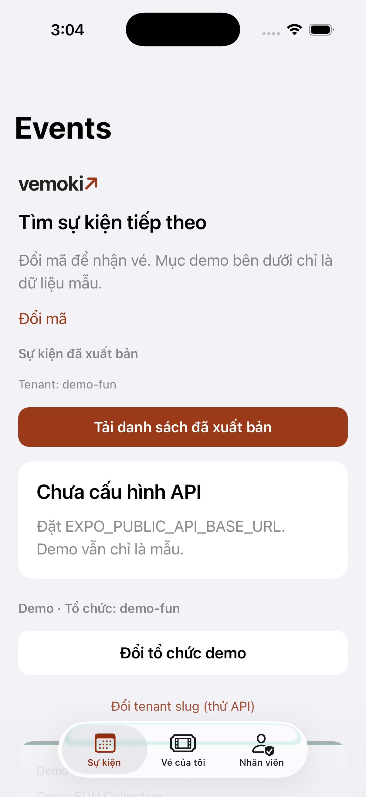
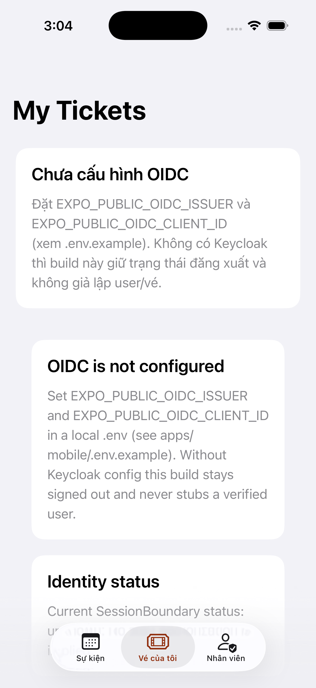
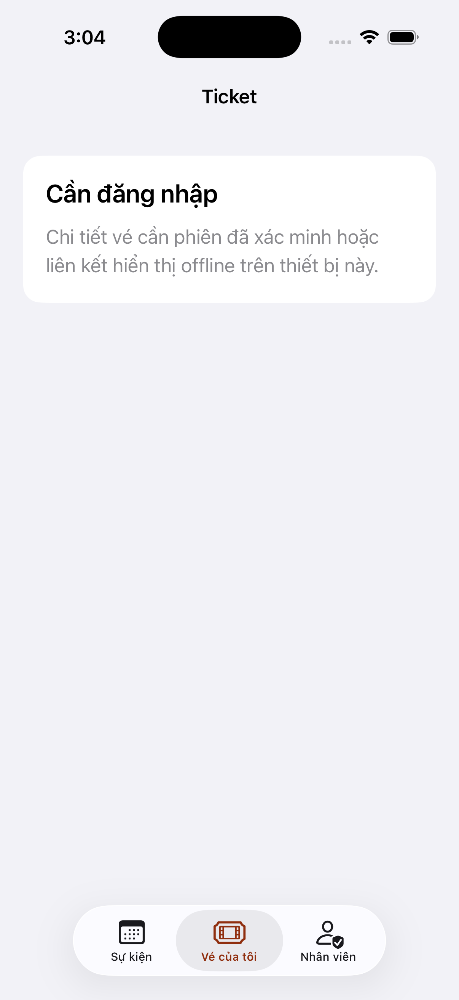
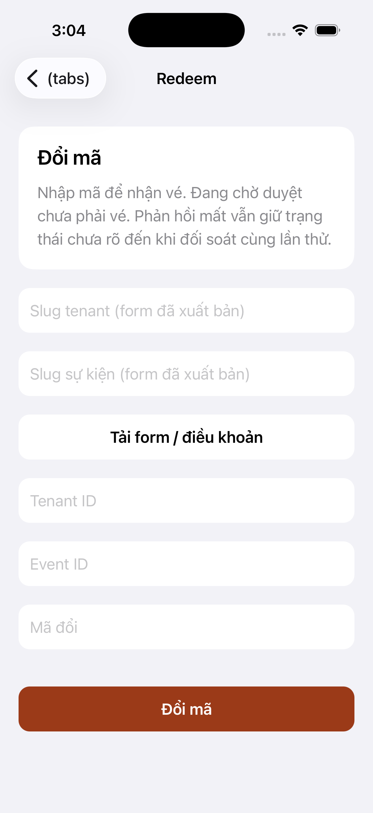
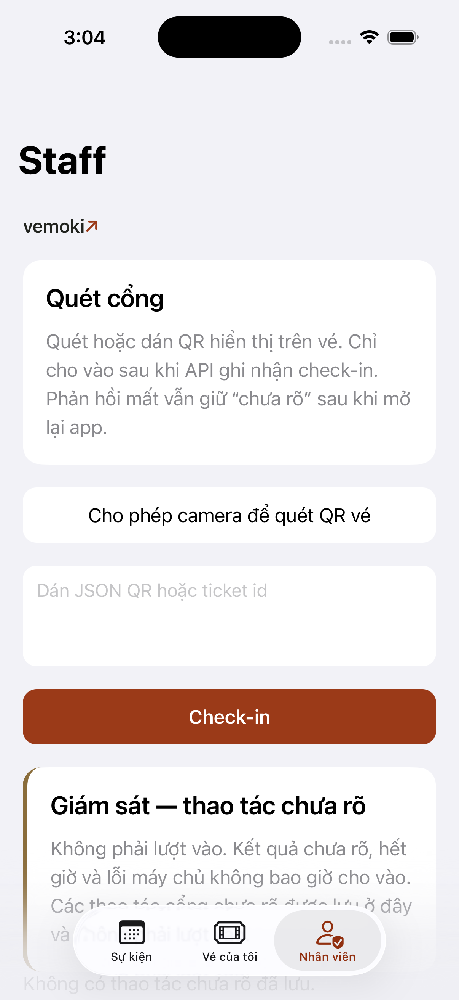

# D6 iOS UX/UI — headless Simulator UAT notes

**Branch:** `hangndat/d6-ios` (PR [#93](https://github.com/hangndat/ticket-solution/pull/93))  
**Issues:** [#81](https://github.com/hangndat/ticket-solution/issues/81) (parent), #82 (iOS half), #87, #88  

**Tip SHA (capture reference):** `a3eabf248a4187026df59c4d5725de018ab4b565`  
**Merge SHA:** `b93124b58eb1740d263fc5191ddd9a9aad4506f6`

## Token mapping (`brand/vemoki/tokens.json` → RN)

| Token | Usage |
| --- | --- |
| `colors.ink` / `paper` / `signal` / `focus` | Screen chrome, CTAs, focus rings |
| Spacing scale | Layout padding / gaps |
| Type | Display + body fonts wired to Vemoki brand |

## Screenshots (tracked)

Captured via `scripts/sim-uat.sh` (AXe HID + `simctl`; no cliclick / Computer Use). Curated copies under [`d6-uat/ios/`](./d6-uat/ios/):

| Screen | File |
| --- | --- |
| Events list |  |
| My tickets |  |
| Ticket detail |  |
| Redeem |  |
| Staff scan |  |

Originals also live gitignored at `apps/mobile/.uat-artifacts/d6-*.png`.

## Limits

- Simulator headless UAT only — **not** physical device or TestFlight store UAT.
- Auth/session-dependent chrome may show empty/error without live Clerk session.
- D6 PASS ≠ pilot ready / store submission.
