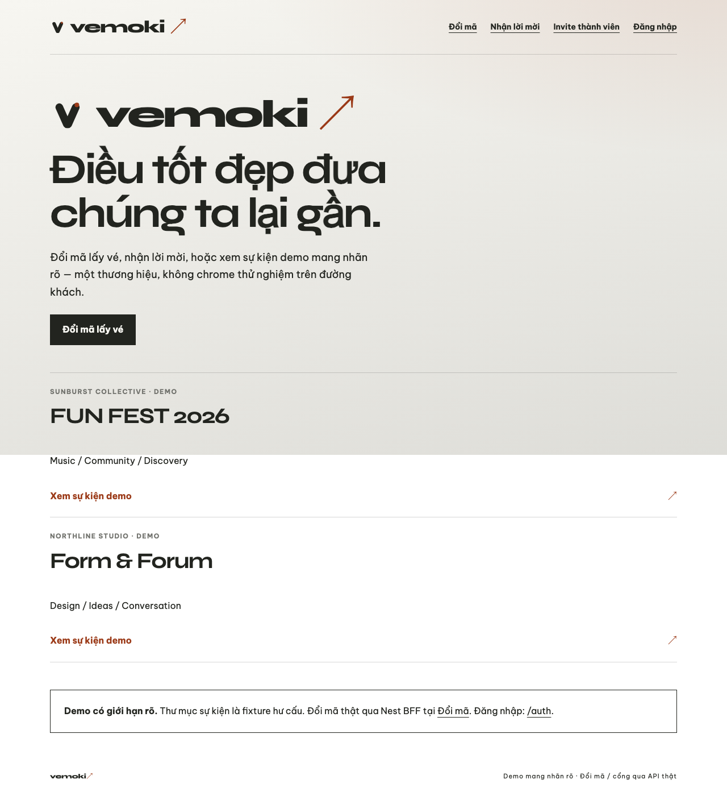
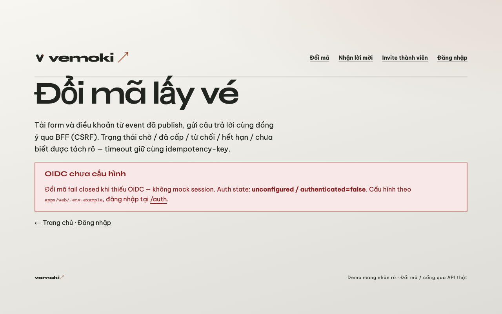
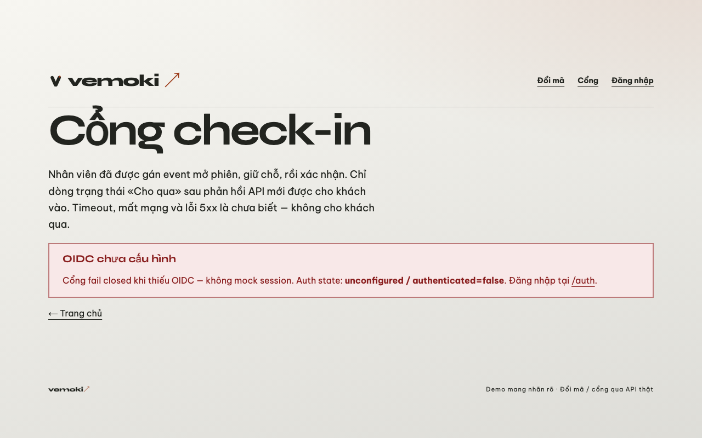
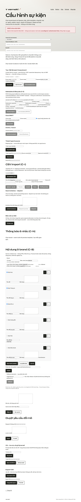
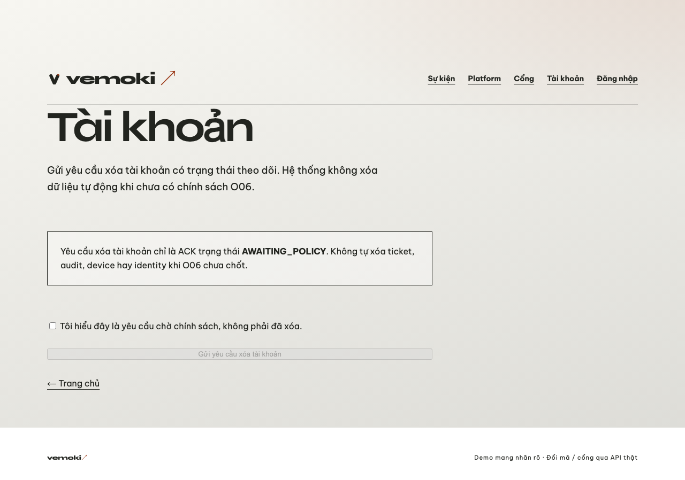
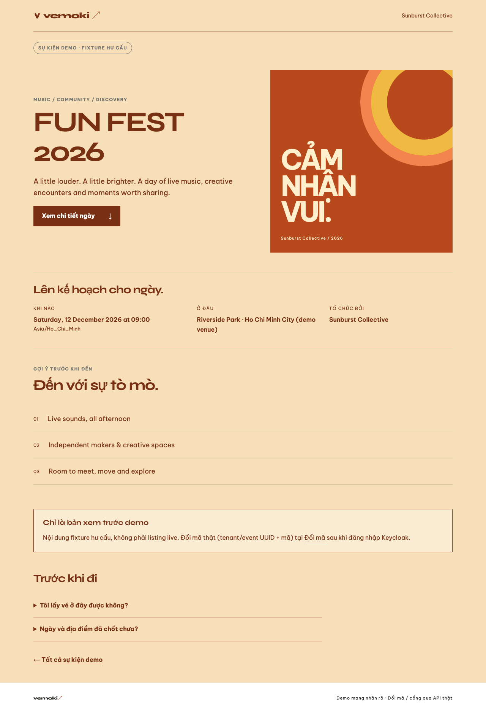

# D6 Web UX/UI — headless UAT notes

**Branch:** `hangndat/d6-web` (PR [#92](https://github.com/hangndat/ticket-solution/pull/92))  
**Issues:** [#81](https://github.com/hangndat/ticket-solution/issues/81) (parent), #82 (web half), #83, #84, #85  

**Tip SHA (capture reference):** `613518a631ff5f477f48359b6dbd143477d454e1`  
**Merge SHA:** `eb0d0784f300571dc7a557c0db3ecd865c4e9cfe`  
**Final PR tip:** `ec8eac6180c150d96bcc02d0a0242b0c1bd13501`

## Token mapping (`brand/vemoki/tokens.json` → CSS)

| Token | CSS var | Notes |
| --- | --- | --- |
| `colors.ink` | `--ink` | Body text / chrome |
| `colors.paper` | `--paper` | Page background (+ subtle gradient mix) |
| `colors.signal` | `--signal` | Wordmark arrow / accent |
| `colors.focus` | `--focus` | `:focus-visible` rings |
| Spacing | `--space-1`…`--space-8` | 4→72px scale |
| Type | `--font-display` (Syne), `--font-body` (Be Vietnam Pro) | next/font; not Arial/Inter |

## Screenshots (tracked)

Captured via `scripts/web-uat.sh` (Playwright headless). Curated copies under [`d6-uat/web/`](./d6-uat/web/):

| Route | File |
| --- | --- |
| `/` |  |
| `/redeem` |  |
| `/gate` |  |
| `/admin` |  |
| `/account` |  |
| Demo event public |  |

Originals also live gitignored at `apps/web/.uat-artifacts/d6-*.png`.

## Limits

- Fail-closed OIDC pages show empty/error chrome without live session.
- Admin/platform panels unchanged in API contract — visual/IA only.
- Headless Chromium only — **not** device/TestFlight UAT.
- D6 PASS ≠ pilot ready.
