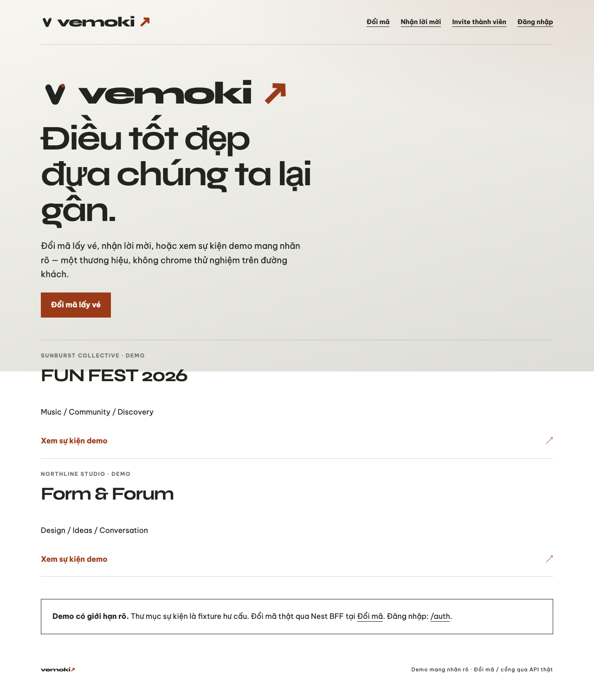
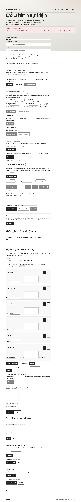
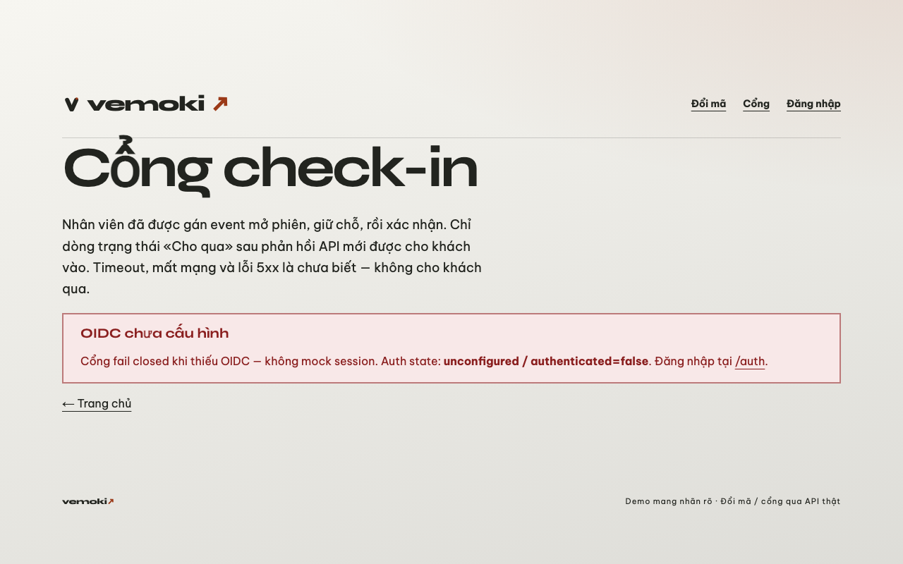
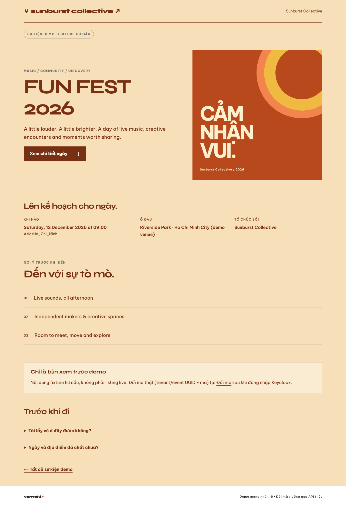
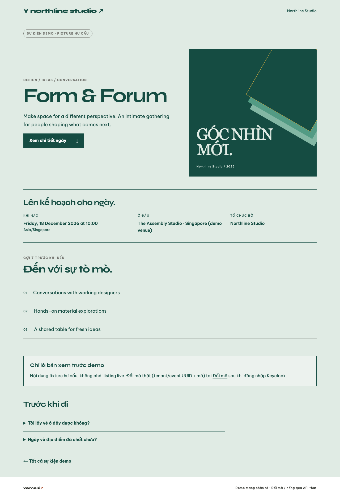

# D8 Web theming — headless UAT notes

**Branch:** `hangndat/d8-web-theme`  
**Issues:** [#124](https://github.com/hangndat/ticket-solution/issues/124) (story), [#125](https://github.com/hangndat/ticket-solution/issues/125) (T1), [#126](https://github.com/hangndat/ticket-solution/issues/126) (T2) · Epic [#119](https://github.com/hangndat/ticket-solution/issues/119)

## Scope shipped (apps/web only)

- `ThemeProvider` + Vemoki default branding → CSS vars `--ink/--paper/--signal/--focus/--brand`
- Parse/sanitize tenant branding DTO (`displayName`, `primaryColor`, `secondaryColor`, `logoUrl`, `logoAssetId`)
- BFF `GET /api/bff/public/tenants/[tenantSlug]/branding` → proxies `/v1/public/tenants/{slug}/branding`, **200 + Vemoki fallback** when upstream missing
- Wordmark / BrandMark / FooterBrand / HeroWordmark consume branding context
- Demo event surfaces override via `brandingFromEventBrand`

## Checks

```bash
cd apps/web && pnpm test && pnpm typecheck && pnpm lint && pnpm build
# UAT (Playwright headless):
WEB_BASE_URL=http://127.0.0.1:3010 ./scripts/web-uat.sh screenshot …
```

BFF fallback smoke (upstream absent → 502 mapped to Vemoki):

```text
GET /api/bff/public/tenants/unknown-tenant/branding
→ source=vemoki-default, wordmark=vemoki, primaryColor=#9b3a18
```

## Screenshots (tracked)

| Route | File |
| --- | --- |
| `/` |  |
| `/admin` |  |
| `/gate` |  |
| Demo sunburst |  |
| Demo northline |  |

Originals also at `apps/web/.uat-artifacts/d8-*.png` (gitignored).

## Limits / known gaps

- S1 BE branding GET (#122) may still be landing in parallel — web uses proposed path + fail-closed Vemoki fallback (coordinator ask timed out; aligned to BE WIP columns `display_name` / `primary_color` / `secondary_color` / `logo_asset_id`).
- Platform home/admin/gate chrome uses Vemoki until a tenant slug is resolved into `ThemeProvider`.
- Logo `` only when allowlisted `logoUrl` is present; `logoAssetId` alone does not resolve a public URL yet.
- Headless Chromium only — not device UAT. D8-S2 code complete ≠ epic milestone PASS.
