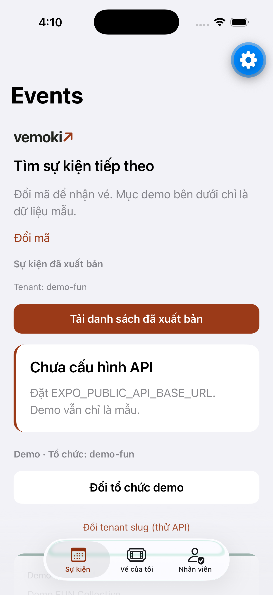
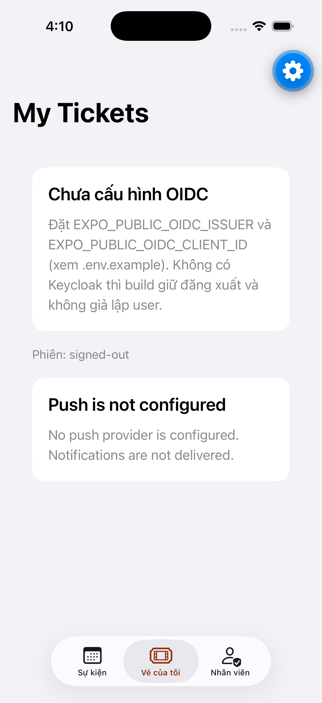
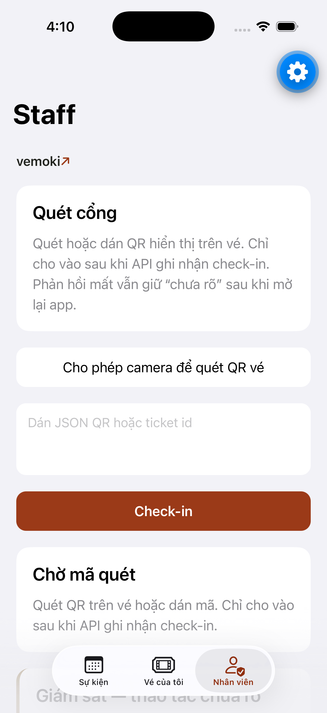

# D9 iOS — empty/error/loading polish (#145)

**Branch:** `hangndat/d9-ios-ux`  
**Issue:** [#145](https://github.com/hangndat/ticket-solution/issues/145) (Story #143 → Epic #134)  
**Ownership:** `apps/mobile` only · Team `BLUA62D52G` · **không** EAS Cloud Build

## Thay đổi

- Shared `LoadingState` / `EmptyState` / `ErrorState` (+ VI copy module) cho ví / scan / events.
- Ví: loading + empty + error có tiêu đề VI rõ; retry trên lỗi online.
- Scan: loading khi khôi phục store / đang kiểm tra; idle `Chờ mã quét`.
- Events (+ detail): loading / empty published / error list có retry; fail-closed misconfig.

## Checks

```bash
cd apps/mobile && pnpm test && pnpm typecheck && pnpm lint
```

- Unit: `src/components/screen-state-copy.test.ts` (kèm suite mobile).
- Headless sim-uat: `scripts/sim-uat.sh` + Expo Go SDK 58 trên Simulator (AXe HID; không cliclick).

## Screenshots (tracked)

| Surface | File |
| --- | --- |
| Events (API misconfig ErrorState) |  |
| Ví / My Tickets (OIDC empty) |  |
| Staff scan (idle EmptyState) |  |

Originals cũng ở `apps/mobile/.uat-artifacts/` (gitignored).

## Limits

- Simulator + Expo Go — **không** TestFlight / thiết bị thật; không EAS.
- Ví signed-in empty/loading và scan busy cần OIDC/API live — không chứng minh trong session này.
- D9 polish ≠ pilot ready / store submission.
