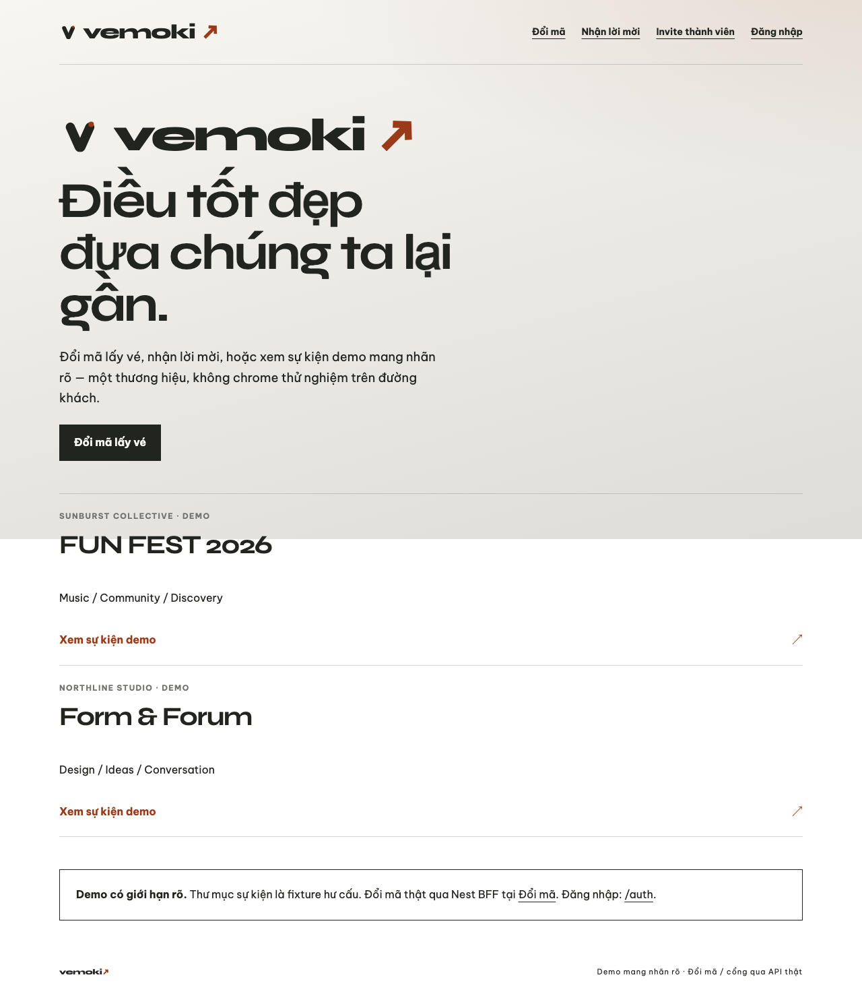
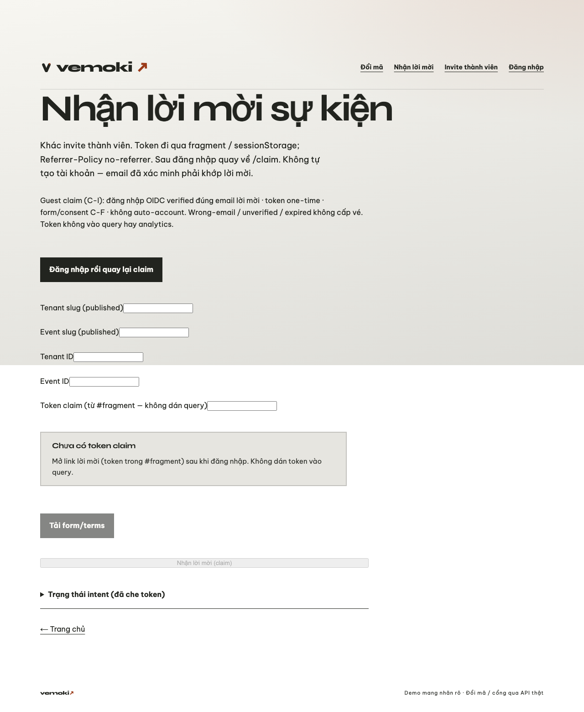
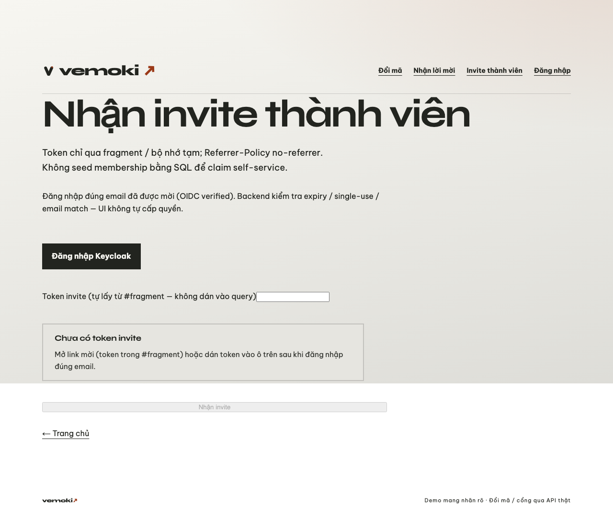
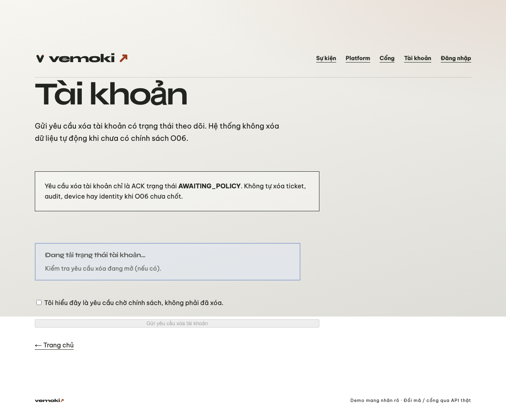
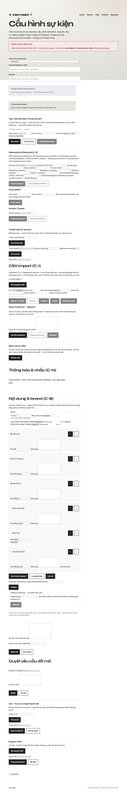
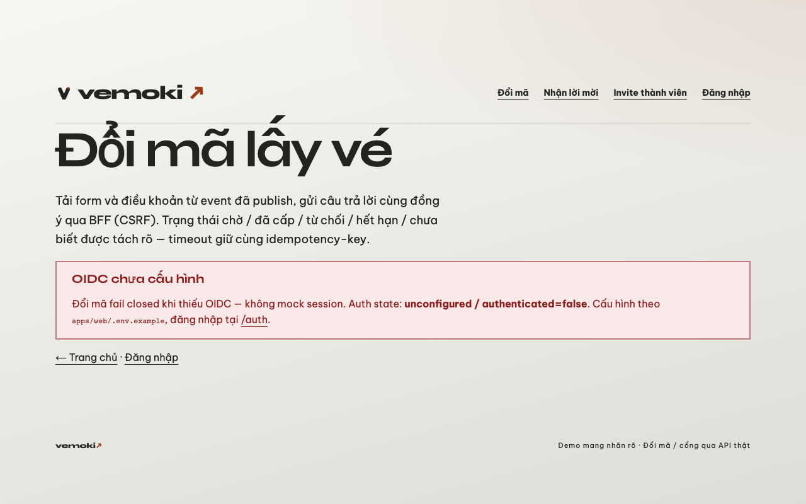
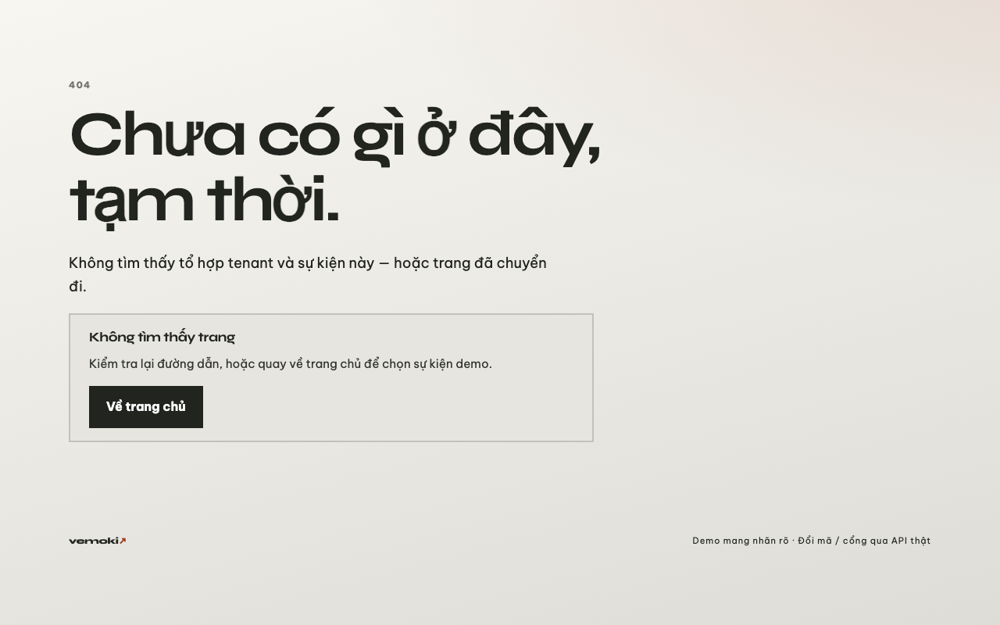

# D9-S3-T1 — Web empty/error/loading polish (#144)

**Issue:** [#144](https://github.com/hangndat/ticket-solution/issues/144) · Story [#143](https://github.com/hangndat/ticket-solution/issues/143) · Epic [#134](https://github.com/hangndat/ticket-solution/issues/134)  
**Scope:** `apps/web` only — shared `SurfaceState` + wire into demo surfaces.

## What changed

- Shared `SurfaceState` (`empty` / `loading` / `error` / `unknown`) + CSS `.state-loading`
- Route `loading.tsx`, polished `error.tsx` / `not-found.tsx`
- Wired: home (empty list), claim/invite (no token), account (load/empty/busy), admin (tenants + events empty), staff, platform me, redeem schema

## Headless smoke

```bash
pnpm --filter @ticket/web exec tsx --test tests/surface-state.test.ts
pnpm --filter @ticket/web lint
pnpm --filter @ticket/web typecheck
# Next on :3010 (port 3000 occupied elsewhere)
WEB_BASE_URL=http://127.0.0.1:3010 bash scripts/web-uat.sh screenshot http://127.0.0.1:3010/claim …
```

Captured via Playwright headless. Curated copies: [`d9-uat/web/`](./d9-uat/web/).

| Route | File |
| --- | --- |
| `/` |  |
| `/claim` (empty token) |  |
| `/invite` (empty token) |  |
| `/account` |  |
| `/admin` |  |
| `/redeem` |  |
| 404 |  |

Originals also live gitignored at `apps/web/.uat-artifacts/d9-ux/`.

## Limitations

- Fail-closed OIDC pages show empty/error chrome without live session (expected).
- Admin/platform loading states need live BFF; smoke captures anonymous empty/error paths.
